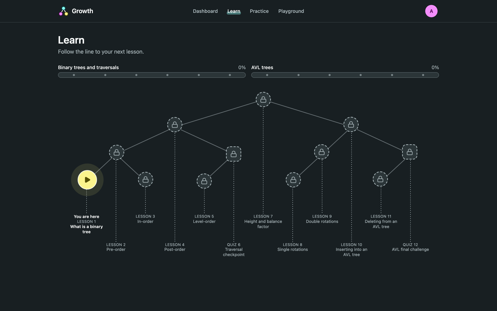
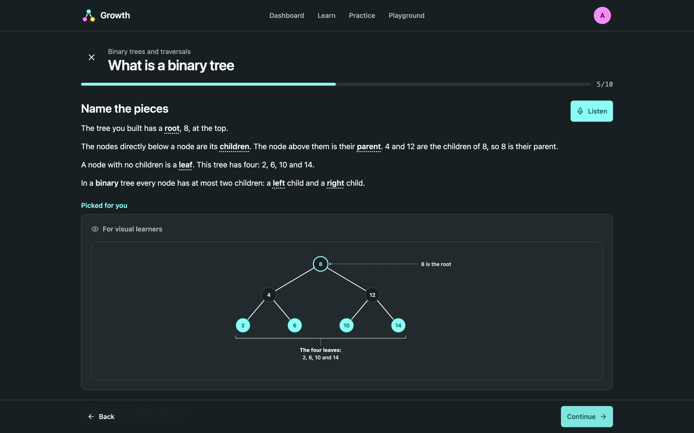
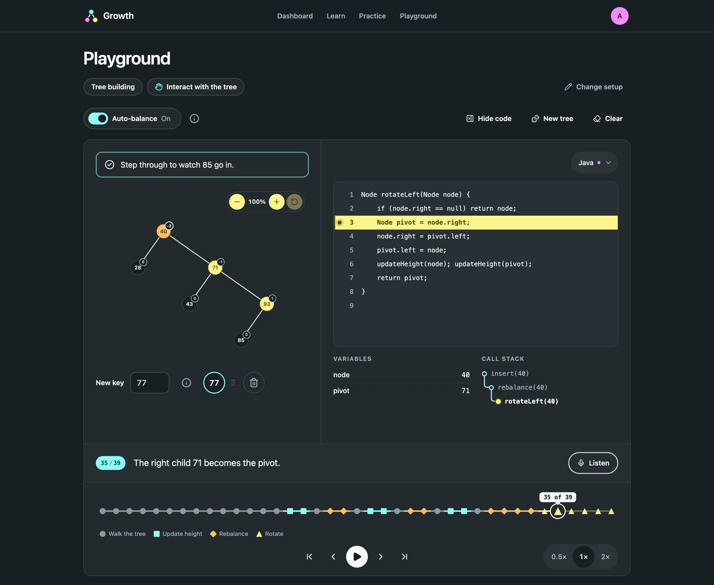
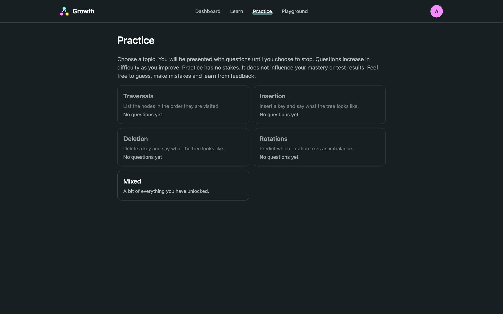
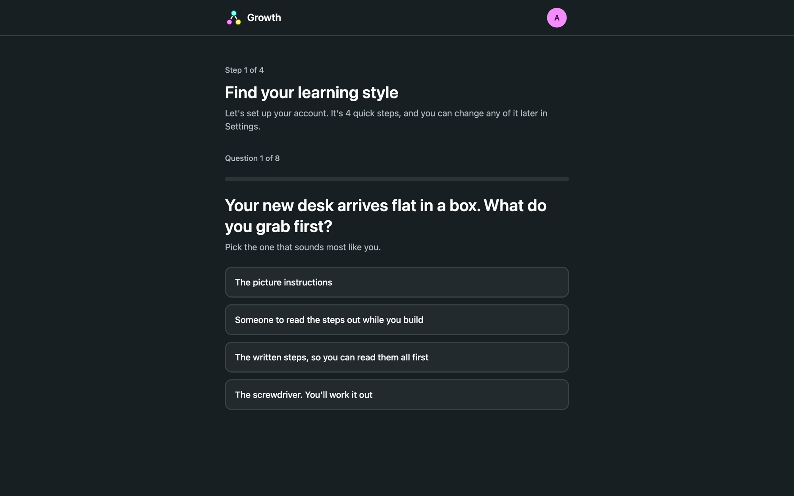
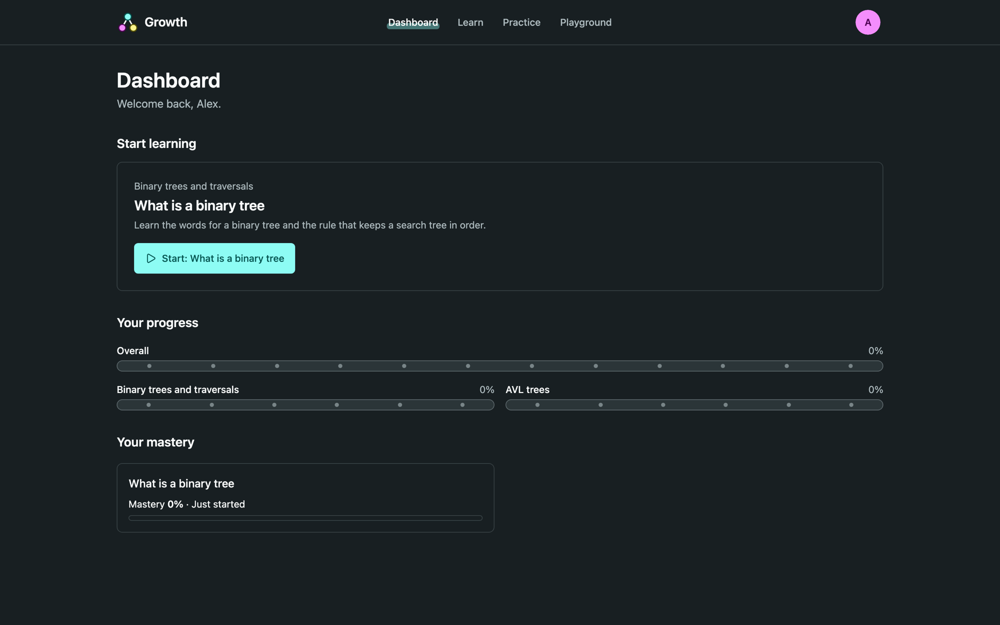

<div align="center">


# Growth

**Learn AVL trees before the lecture, by watching them rebalance.**

An interactive pre-lecture tutor for COS212 (Data Structures and Algorithms) at the University of Pretoria,<br />
built as our COS750 (Educational Software Development) project.

[](https://github.com/hayley-d/growth/actions/workflows/ci.yml)


[**Docs**](https://hayley-d.github.io/growth/) ·
[**SE document**](https://hayley-d.github.io/growth/se/introduction/) ·
[**ID document**](https://hayley-d.github.io/growth/id/introduction/) ·
[**Quick start**](#quick-start)

</div>

---

## About

Growth is a pre-lecture app for COS212 students at the University of Pretoria. It teaches binary search tree basics, traversals and AVL trees.

### What students learn

The learning path has 12 lessons:

| Unit | Lessons |
| --- | --- |
| **Binary trees** | 1. Binary trees |
| **Traversals** | 2. Pre-order · 3. In-order · 4. Post-order · 5. Level-order · 6. Traversal checkpoint |
| **Balance** | 7. Height and balance factor |
| **Rotations** | 8. Single rotations · 9. Double rotations |
| **AVL trees** | 10. AVL insert · 11. AVL delete · 12. Final challenge |

## Features

<table>
  <tr>
    <td width="50%" valign="top">
      
      <h3>A learning path shaped like a tree</h3>
      Lessons unlock in order along a path drawn as a binary tree, with progress tracked per unit.
    </td>
    <td width="50%" valign="top">
      
      <h3>Lessons tailored to how you learn</h3>
      Short steps mix text, animated trees and code. Each step shows a version picked for your VARK learning style, and every step has a <b>Listen</b> button.
    </td>
  </tr>
  <tr>
    <td width="50%" valign="top">
      
      <h3>A playground to break things in</h3>
      Build a tree and drag new keys to where you think they belong. Then step through all of it: walking the tree, updating heights, rebalancing and rotating. The code trace highlights each line as it runs, with the variables and call stack beside it. Turn auto-balance off to do the rotations yourself.
    </td>
    <td width="50%" valign="top">
      
      <h3>Low-stakes practice</h3>
      Generated questions on traversals, insertion, deletion and rotations get harder as you improve. Practice never affects your mastery.
    </td>
  </tr>
  <tr>
    <td width="50%" valign="top">
      
      <h3>Onboarding that sets you up</h3>
      An 8-question quiz finds your learning style. You also pick whether code is shown as pseudocode, Java (the language COS212 uses) or Rust, whether lessons are read aloud, and whether you appear on the leaderboard.
    </td>
    <td width="50%" valign="top">
      
      <h3>Progress and mastery</h3>
      The dashboard picks up where you left off and shows your mastery of each lesson, which checkpoint tests feed into.
    </td>
  </tr>
</table>

## Tech stack

| Layer | Stack |
| --- | --- |
| **Frontend** | React 19, TanStack Router, Query, Form and Table, Zustand, Tailwind, organised with atomic design |
| **Backend** | Hono on Bun, Better Auth, Prisma 7, PostgreSQL, split into domain, application, infrastructure and presentation layers |
| **Shared** | Zod schemas, the AVL tree functions and seeded question generators |
| **Docs** | Astro Starlight with an OpenAPI reference, deployed to GitHub Pages |
| **Tooling** | Bun workspaces, Biome, Lefthook, commitlint, GitHub Actions CI |

The request and response contracts are written once as Zod schemas in `shared/` and imported by both the frontend and backend with `@shared/`.

## Quick start

<details>
<summary><b>Prerequisites</b></summary>

- [Bun](https://bun.sh) 1.3 or newer
- [Docker](https://www.docker.com) for the database
- Git

</details>

```sh
git clone git@github.com:hayley-d/growth.git
cd growth
bun install
cp backend/.env.example backend/.env
docker compose up -d
cd backend && bun run prisma:migrate && bun run prisma:generate && cd ..
bun run dev
```

Then open:

| What | Where |
| --- | --- |
| App | http://localhost:5173 |
| API | http://localhost:3000/api/health |
| Docs | http://localhost:4321 |

The [getting started guide](https://hayley-d.github.io/growth/dev/getting-started/) covers the env file and test browsers in more detail.

### Useful scripts

| Command | What it does |
| --- | --- |
| `bun run dev` | Runs the backend, frontend and docs together |
| `bun run test` | Runs every workspace's tests |
| `bun run typecheck` | Typechecks every workspace |
| `bun run lint` | Lints with Biome |
| `bun run check` | Lints and formats with Biome, writing fixes |
| `bun run build` | Builds every workspace |

## Project structure

```text
growth/
├── frontend/   React app (atoms → molecules → organisms → templates → pages)
├── backend/    Hono API, Prisma schema and course content
├── shared/     Zod schemas, AVL engine and question generators used by both sides
├── docs/       Starlight docs site: SE document, ID document and developer guide
└── .github/    CI, docs deploy and release workflows
```

## Documentation

| | |
| --- | --- |
| [**Learn the trees**](https://hayley-d.github.io/growth/learn/trees/) | What each tree is and the part that trips people up |
| [**SE document**](https://hayley-d.github.io/growth/se/introduction/) | Approach, requirements, architecture, design, testing and deployment |
| [**ID document**](https://hayley-d.github.io/growth/id/introduction/) | Learners, objectives, learning theories, scaffolding, assessment and storyboards |
| [**Developer guide**](https://hayley-d.github.io/growth/dev/getting-started/) | Setup, architecture of each workspace, API reference and scripts |

## Contributing

Commits follow [Conventional Commits](https://www.conventionalcommits.org), and a Lefthook pre-commit hook checks them along with Biome. Read the [branches and commits page](https://hayley-d.github.io/growth/dev/reference/git-workflow/) before you open a PR.

## Team

<table>
  <tr>
    <td align="center"><a href="https://github.com/hayley-d"><br /><sub><b>Hayley Dodkins</b></sub></a><br /><sub>u21528790</sub></td>
    <td align="center"><a href="https://github.com/TiaanBosman101"><br /><sub><b>Tiaan Bosman</b></sub></a><br /><sub>u22704958</sub></td>
    <td align="center"><a href="https://github.com/Jack-jack1"><br /><sub><b>Jack Bawden</b></sub></a><br /><sub>u23529068</sub></td>
    <td align="center"><a href="https://github.com/phillDup"><br /><sub><b>Philipp du Plessis</b></sub></a><br /><sub>u23526204</sub></td>
    <td align="center"><a href="https://github.com/NicohaasHerhaasus"><br /><sub><b>Henco Pretorius</b></sub></a><br /><sub>u23525381</sub></td>
  </tr>
</table>

---

<div align="center">
<sub>Built for COS212 at the University of Pretoria</sub>
</div>
