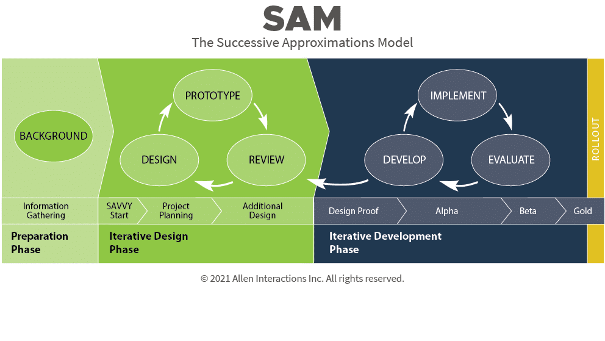

## SAM 2

For this project we followed Michael Allen's Successive Approximation Model (SAM) (Allen and Sites, 2012).
Linear approaches such as ADDIE finish one stage before starting the next and try to get each stage right the first time (Elm Learning, n.d.).
SAM allowed us to build rough versions, test them and refine them in small iterations,
where each iteration gets us closer to the final product.

SAM comes in two versions, both versions use an interative approach to create the final product. SAM 1 fits smaller projects and teams better as it only has three iterations of the evaluation, design and development steps. SAM 2 is an extension of SAM 1 for larger projects. SAM 2 has eight
steps spread across three phases, preparation, iterative design and iterative development (Peck, 2026). For this project we decided to use SAM 2. 

*Figure 1: The SAM 2 process (Allen Interactions, 2021, cited in Elm Learning, n.d.)*

## Description of Phases

The **preparation phase** is where we gather information about the learners, learning goals,
and constraints. This phase is supposed to be short as we will come back to it again. The second
step in the preparation phase is **Savvy start**, where we sketched storyboards and brainstormed
ideas of lessons, quizes and learning paths.  

The second phase is the **interative design phase**. This is an iterative process where 
we first designed a prototype of a lesson, quiz or learning path and then 
reviewed the ideas with the team. Project planning also happens in this phase, we planned
what we were going to build and who was going to build the different items. Each item then
become a ticket on our sprint board.

The final phase is the **iterative development** phase where we started with a design proof which allowed us to see if the design worked as we wanted. After the design proof we completed the alpha version of the content which was a complete version of the item that required testing. After 
the alpha version we developed the beta version of an item which resolved any errors found in the alpha version. Finally the gold version was developed which was the final version of the item (Peck, 2026).

## Why we picked SAM 2

When we received the project specification, we had around four weeks and a team of five to build the app.
SAM lets us get a rough version of everything working and then go back and improve parts when we have time.

SAM also matches our software engineering approach. We chose Agile for the software engineering approach, and SAM works in the same way using short iterations. 

SAM allows us to try more than one idea. SAM expects you to test a few versions of a solution and drop the ones that don't work (Elm Learning, n.d.). This prevents us from committing to one design and finding out later that it fails.

## References

Allen, M.W. and Sites, R. (2012) *Leaving ADDIE for SAM: an agile model for developing the best learning experiences*. Alexandria, VA: ASTD Press.

Elm Learning (n.d.) *The SAM (Successive Approximation Model) approach to eLearning*. Available at: https://elmlearning.com/hub/instructional-design/sam-successive-approximation-model/ (Accessed: 27 October 2026).

Marshall, L. (2026) *L11 – Educational software development: lifecycles and instructional design* [Lecture slides]. COS750: Educational Software Development, University of Pretoria.

Peck, D. (2026) *The Successive Approximation Model (SAM): a complete guide*. Available at: https://www.devlinpeck.com/content/successive-approximation-model (Accessed: 27 October 2026).
