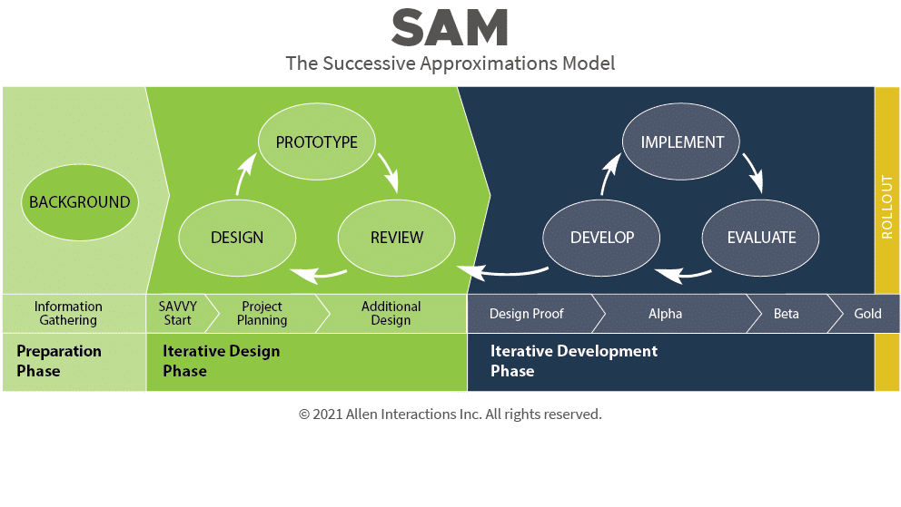

## SAM 2

For this project we followed Michael Allen's Successive Approximation Model (SAM) (Allen and Sites, 2012).
Linear approaches such as ADDIE finish one stage before starting the next and try to get each stage right the first time (Elm Learning, n.d.).
SAM allowed us to build rough versions, test them and refine them in small iterations,
where each iteration gets us closer to the final product.

SAM comes in two versions, both versions use an iterative approach to create the final product. SAM 1 has one cycle of evaluate, design and develop that repeats about three times, so design and development happen together. It suits simple projects where there isn't much to build. SAM 2 splits design and development into separate phases, for projects where there is real development work to do. SAM 2 has eight
steps spread across three phases, preparation, iterative design and iterative development (Peck, 2026). For this project we decided to use SAM 2. 

*Figure 1: The SAM 2 process (Allen Interactions, 2021, cited in Elm Learning, n.d.)*

## Description of Phases

The eight steps of SAM 2 are split over the three phases:

- Preparation: information gathering and the Savvy start
- Iterative design: project planning and additional design
- Iterative development: design proof, alpha, beta and gold

The preparation phase starts with information gathering, where we gather information about the learners, learning goals
and constraints. For us this meant reading the project specification, choosing the data structure from CS2023 and working out who our learners are. This step is supposed to be short as we will come back to it again. The second
step is the Savvy start, where we brainstormed ideas for each item and sketched a first round of rough storyboards. On the storyboard pages this is the round with ideas A to E, which is labelled "Savvy start".

The second phase is the iterative design phase. In project planning we planned
what we were going to build and who was going to build the different items. Each item then
became a ticket on our [project board](https://github.com/users/hayley-d/projects/5/views/6), and each ticket was built on its own branch and merged through a pull request. The rest of this phase is additional design. We took the storyboards from the Savvy start, reviewed them with the team and redesigned them. A round doesn't have to pick one storyboard. It can join the best parts of several into a new one, and we review that too. On the storyboard pages these rounds are Design 2 and Design 3. The [playground storyboard](../storyboards/playground/playground/) shows this over three rounds.

*Figure 2: Our [project board](https://github.com/users/hayley-d/projects/5/views/6). Each item is a ticket with the person building it, and an item that needs fixing after review moves to Revision.*

The final phase is the iterative development phase. We started each item with a design proof, which let us see if the design worked the way we wanted in the actual app. After the design proof we built the alpha version, which is a complete version of the item that still needs testing. The beta version fixes the errors found in the alpha, and the gold version is the final version (Peck, 2026).

Since Growth is a prototype, and we only had around four weeks, we did not go as far as gold. All the items we built made it to alpha, and then beta. We tested the beta ourselves as a team because we couldn't get access to COS212 students in the time we had. The [Alpha and beta](../development/) page shows what we changed along the way.

## Why we picked SAM 2

When we received the project specification, we had around four weeks and a team of five to build the app.
SAM lets us get a rough version of everything working and then go back and improve parts when we have time.

We picked SAM2 because Growth consists of twelve lessons, a playground, tests and practice mode. We wanted important items to undergo a few rounds of storyboards before we knew what to build, and then it needed to be built. SAM 2 enabled us to agree on a storyboard as a team first, and only then turn it into a ticket for someone to build. 

SAM also matches our software engineering approach. We chose Agile for the software engineering approach, and SAM works in the same way using short iterations. 

SAM allows us to try more than one idea. SAM expects you to test a few versions of a solution and drop the ones that don't work (Elm Learning, n.d.). This prevents us from committing to one design and finding out later that it fails.

## References

Allen, M.W. and Sites, R. (2012) *Leaving ADDIE for SAM: an agile model for developing the best learning experiences*. Alexandria, VA: ASTD Press.

Elm Learning (n.d.) *The SAM (Successive Approximation Model) approach to eLearning*. Available at: https://elmlearning.com/hub/instructional-design/sam-successive-approximation-model/ (Accessed: 27 October 2026).

Peck, D. (2026) *The Successive Approximation Model (SAM): a complete guide*. Available at: https://www.devlinpeck.com/content/successive-approximation-model (Accessed: 27 October 2026).
