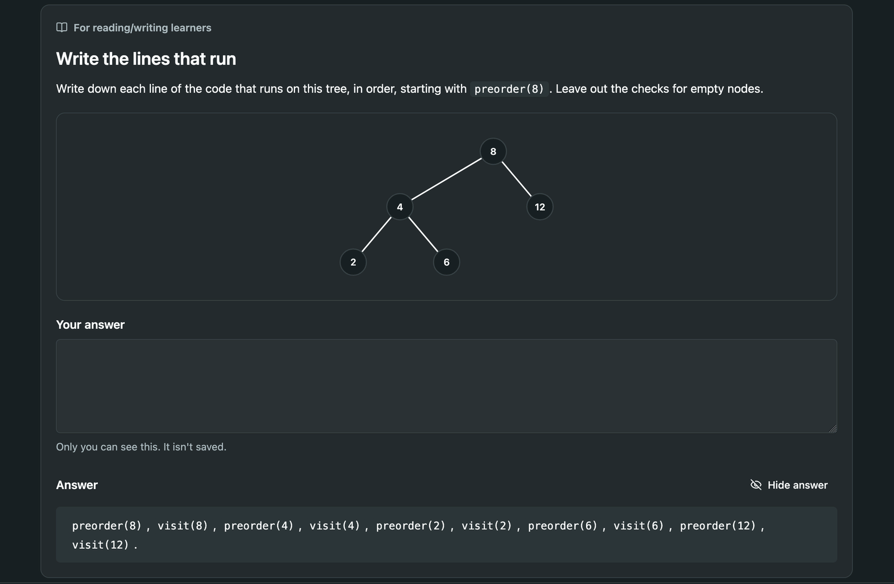

## Why We Chose VARK

We looked at the three models from the lecture, Fleming's VARK, Kolb's experiential learning cycle, and Honey and Mumford's activists, reflectors, theorists and pragmatists (Marshall, 2026). 

We picked VARK because VARK looks at how learners take in information through different senses being visual, text, hands on or by listening (Fleming and Mills, 1992). We thought it would be easy to make lesson blocks change according to a target sense. A step about a tree could show you the tree, ask you to read the tree out loud, ask you to write the tree or give you a tree to expolore. 

In contrast Honey and Mumford classifies people through 4 learning styles theorists, reflectors, pragmatists and activists (Bitsizelearning.co.uk, n.d). While VARK looks at the sensory channels, Honey and Mumford focuses on the learner's approach to problem solving. The team felt that this test may be a bit more involved compared to the VARK test so we decided to not go with this approach.

However we did find a way to include Kolb in some of our lessons. Kolb defines a learning cycle which involves 4 stages, concrete experience, reflective observation, abstract conceptualisation and active experimentation which we thought would map well to our lesson blocks. In a lesson a learner can perform an operation on a tree and watch how the nodes and tree changes which maps to a concret experience. The same lesson will include text that the learner can read which maps to the abstract conceptualisation. At the end of each lesson the learner is asked to write an end of lesson note which links back to the reflective observation. Finally, the playground enables the user to explore and experiment with trees and traversals which maps back to active experimentation.

## The four styles and how we accomodate them

Each lesson consists of steps with each step having one core block that every learner will see. A step can have extra blocks tagged with a learning style.

### Visual

VARK's visual modality is the preference to see information as maps, diagrams, graphs and flow charts (VARK Learn, n.d.). To target this modality we use tree diagrams that we can label and highlight.

In Figure 1 the visual block at step 5 lights up the four leaves and pins two labels to the tree. 

*Figure 1: The visual block at step 5 of "What is a binary tree", with the leaves highlighted and labelled. Own work.*

The words in the text are able to link to the tree. Each key term has a dotted underline, and when the learner hovers over it, the corresponding nodes light up.

*Figure 2: Hovering over "height" at step 8 lights up the nodes it counts.*

### Auditory

Aural learners who prefer talking through or hearing concepts have the option to use text-to-speech. Every block in a step has a transcript, so the learner can press the Listen button at the top of the step to hear the lesson instead of reading it.

We also write blocks for auditory learners that get them to talk. Figure 3 is one from the pre-order lesson. The block turns pre order traversal into a three-beat rhythm the learner says out loud. 

*Figure 3: The auditory block at step 2 of "Pre-order". *

### Reading and writing

These learners prefer reading and writing information, so the blocks that target this modality ask the learner to write.

Figure 4 shows one from step 2 of "Pre-order". It's the same step as the auditory block in Figure 3, but where that one has the learner chant **me, left, right**, this one has them write the order down.

*Figure 4: The reading and writing block at step 2 of "Pre-order"*

The answer stays hidden until the learner presses Show answer, so they have a go first. Then they can check their list against the answer when they finish or get stuck.

*Figure 5: The same block with the answer shown.*

At the end of every lesson there's one more writing step, and every learner gets it. It asks them to summarise what they learned in their own words.

### Kinesthetic

Kinesthetic learners learn through examples and experience. Their blocks get them to do something, either on the screen through clicking nodes or stepping through an operation, or off screen, using props like paper.

Figure 6 is the kinesthetic block at step 2 of "Pre-order", the same step as Figures 3 to 5. The auditory learner says **me, left, right** and the reading and writing learner writes it down. This learner taps the nodes in the correct order. 

*Figure 6: The kinesthetic block at step 2 of "Pre-order", after the first tap.*

Figure 7 is an off screen example that uses props. The kinesthetic block asks the learner to write `preorder(20)`, `preorder(10)` and `preorder(30)` on three scraps of paper and every time they press Step, they put a card on the pile when a call starts and take the top card off when it finishes. 

*Figure 7: The kinesthetic block at step 3 of "Pre-order"*

## What the learner sees on a step

The learner will always see the core block first. After the core block there will be one extra block displayed to the learner. If the step has a block for the learner's learning style, that is what is displayed. Otherwise a random block is shown and the learner can explore other ways to learn.

## Ties to a single learning style

We wanted to get the balance between acomodating how the learner prefers to learn and not tying the learner to a single learnign style. The app enables the user to explore other ways to learn during a lesson, so if the targeted block does not help them they can look at the other blocks.

In lessons core blocks can incoporate learning styles so a core block can contain a diagram to aid in the lesson content so a learner will get exposed to multiple block types.

## Mayer's principles

Mayer's multimedia principles have much stronger evidence than learning styles, and they're about the same question: how to mix words and pictures (Mayer, 2009). We used five of them.

- **Multimedia.** Words with pictures beat words alone. Six of the nine core steps in the binary tree lesson show a tree: a drawn tree, an animation, a diagram or a playground.
- **Spatial contiguity.** Put words next to what they describe. Labels like "8 is the root" sit beside node 8, not in a key under the picture.
- **Signalling.** Point out what matters. Bold terms light up their nodes when the learner points at or taps them.
- **Segmenting.** Let the learner set the pace. One idea per step, and nothing moves on until they press Continue.
- **Modality.** Spoken words with a picture beat printed words with a picture. Listen reads the step aloud while the tree stays on screen.

One honest catch. Mayer's redundancy principle warns against narration that repeats the text already on screen, and Listen does exactly that. We kept it because it's never on unless the learner presses it, and because the same transcript is what screen readers use.

## Design proof

Step 5 of "What is a binary tree", "Name the pieces", has blocks for three styles, and no auditory one, so it shows both cases: a learner whose style has a block and one whose style doesn't. Every learner reads the same core text: 8 is the **root**, 4 and 12 are its **children**, 2, 6, 10 and 14 are **leaves**.

- The **visual** learner gets "Picked for you" with the eye icon and the diagram, leaves lit and labels pinned. Pointing at **leaf** in the text lights up 2, 6, 10 and 14.
- The **auditory** learner has no auditory block at this step, so they get the diagram under "Another way to see it". Listen reads the core text and then the diagram's description: "The four leaves, 2, 6, 10 and 14, are highlighted."
- The **reading and writing** learner gets "Write the words" and a box to write four sentences in.
- The **kinesthetic** learner gets "Draw it on paper".

Each of them can open "Other ways to learn this (2)" and find the two blocks they weren't shown.

## References

Advanogy.com (2024) *Overview of learning styles*. Available at: http://www.learning-styles-online.com/overview/ (Accessed: 11 November 2026).

Bitsizelearning.co.uk (n.d) *Honey & Mumford's learning styles, explained*. Available at: https://www.bitesizelearning.co.uk/resources/honey-mumford-learning-styles (Accessed: 11 November 2026).

Clark, D. (2014) *Learning styles and preferences*. Available at: http://www.nwlink.com/~donclark/hrd/styles.html (Accessed: 11 November 2026).

Coffield, F., Moseley, D., Hall, E. and Ecclestone, K. (2004) *Learning styles and pedagogy in post-16 learning: a systematic and critical review*. London: Learning and Skills Research Centre.

Fleming, N.D. and Mills, C. (1992) 'Not another inventory, rather a catalyst for reflection', *To Improve the Academy*, 11, pp. 137–155.

Kolb, D.A. (1984) *Experiential learning: experience as the source of learning and development*. Englewood Cliffs, NJ: Prentice Hall.

Marshall, L. (2026) *L04 – Educational concepts: learning styles* [Lecture slides]. COS750: Educational Software Development, University of Pretoria.

Mayer, R.E. (2009) *Multimedia learning*. 2nd edn. Cambridge: Cambridge University Press.

Pashler, H., McDaniel, M., Rohrer, D. and Bjork, R. (2008) 'Learning styles: concepts and evidence', *Psychological Science in the Public Interest*, 9(3), pp. 105–119.

VARK Learn (n.d.) *The VARK modalities: visual, aural, read/write and kinesthetic*. Available at: https://vark-learn.com/about-vark/the-vark-modalities/ (Accessed: 11 November 2026).

Wikipedia (2024) *Learning styles*. Available at: http://en.wikipedia.org/wiki/Learning_styles (Accessed: 11 November 2026).
