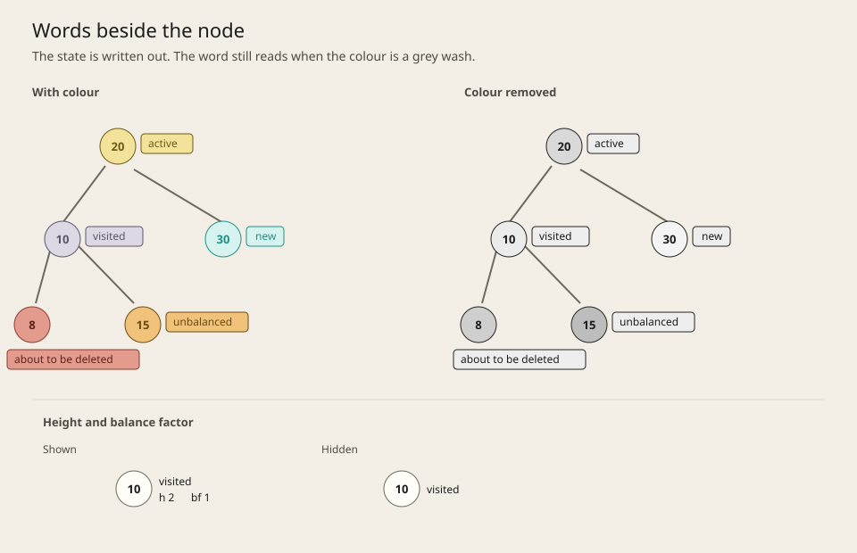

The playground draws one AVL snapshot at a time. Before building that view we sketched five ways to show it. Each sketch has the five node states (active, visited, about to be deleted, unbalanced, and new), height and balance factor both shown and hidden, and the same states with the colour taken out.

This is the savvy-start storyboard from SAM 2. We try more than one idea and keep the ones we drop, so the choice is on record. The approach is described in [Instructional design approach](./approach/).

## Marked circles

*Figure 1: Marked circles. The state is a fill plus a mark that does not depend on colour. Height and balance factor are lines under the key.*

## Words beside the node

*Figure 2: Words beside the node. The state is the word itself, with a colour wash behind it.*

## A different shape per state

*Figure 3: A different shape per state. The silhouette carries the state once the colour is gone.*

## A plain tree and a side list

*Figure 4: A plain tree and a side list. The drawing stays still, and the list carries the state.*

## Cards instead of circles

*Figure 5: Cards instead of circles. The state word and the height and balance rows sit inside the node.*

## What we kept

We kept Figure 1, and that is the tree the playground draws.

Every node stays a circle, the same size, which is already how the other trees in the app are drawn. The layout can then place nodes by in-order position and depth and scale the whole picture to the box. The fill uses the colour for that state: accent, muted, destructive, warning, or primary. The mark is what a learner still has when the colour is gone: a thick ring and a pointer, a tick, a dashed border and a cross, a badge with the balance factor, or an outline. Hiding height and balance factor removes the lines under the key and leaves the marks where they are.

### Words beside the node

Figure 2 needs no legend. The word names the state, in colour and in grey, and hiding height and balance factor is a matter of leaving those lines out. We dropped it because the words take the gap the next node needs. On the sketch, "about to be deleted" is wider than the circle, so the bar sits under the node and reaches toward the next one. In the playground that space is an edge, and the learner has to read a label to see what the step is doing.

### A different shape per state

Figure 3 still works with the colour removed, because the circle, square, diamond, hexagon, and double ring are still different. We dropped it because the learner has to remember which silhouette means which state. A tree of mixed shapes also stops reading as one kind of node, and the in-order layout assumes the nodes are one size.

### A plain tree and a side list

Figure 4 keeps the drawing calm. The words still name the state after the colour chips are gone, and hiding height and balance factor drops two columns. We dropped it because the state sits off the node. The leader lines on the sketch are the path the eye has to travel to see what the step is doing.

### Cards instead of circles

Figure 5 puts the key, the state word, and the height and balance rows in one place. The rows collapse when they are hidden, and the word still reads when the colour bar is grey. We dropped it because the cards are wide. Five of them already fill the frame, so a tree of the size the playground shows does not fit the box, and this gives up the circle the other trees in the app use.
