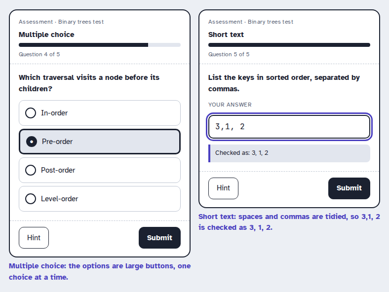
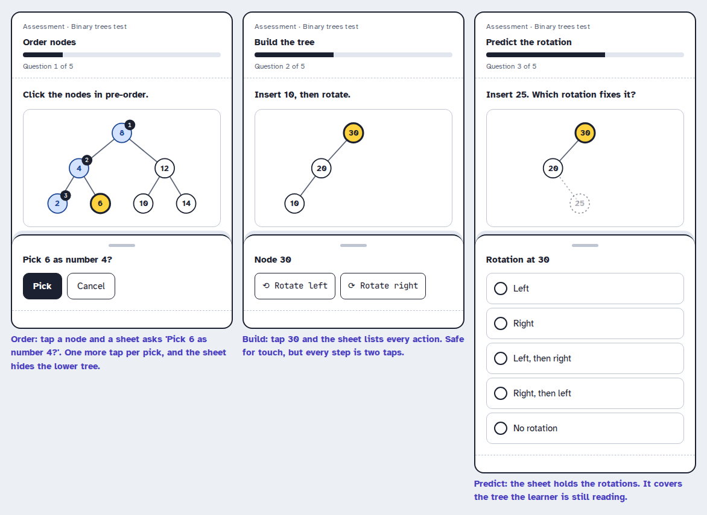
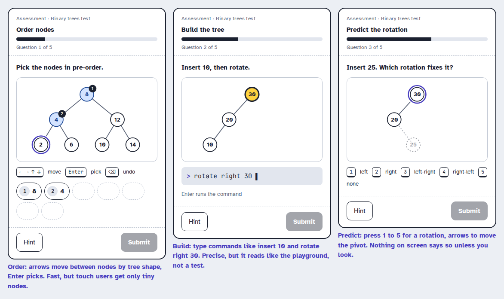
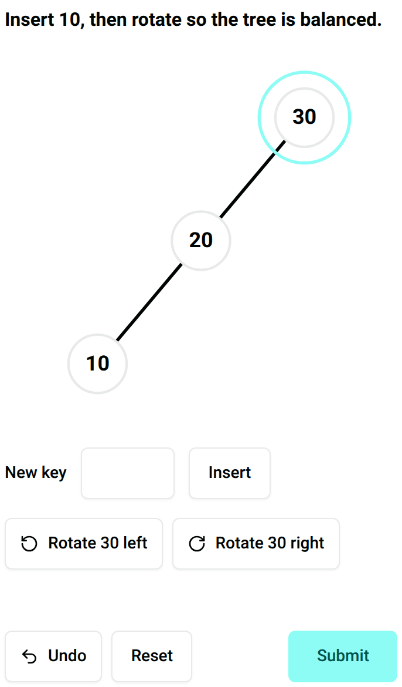
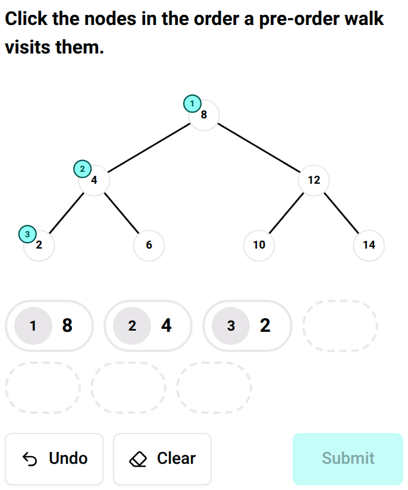

import { Aside, Steps } from "@astrojs/starlight/components";

Every lesson ends in a test of five questions, and the checkpoints have one too. A question is one of five kinds: order nodes, build tree, predict rotation, multiple choice or short text. The learner meets this screen at the end of every lesson, so it has to be obvious. This page is about how they answer, not what we ask.

The questions test the lesson's objectives. Order nodes tests "List the nodes of a tree in pre-order". Build tree tests "Insert a key into an AVL tree and rebalance it". Predict rotation tests "Fix a left-left or right-right imbalance with one rotation". Multiple choice and short text cover the rest. See the [learning objectives](../../../objectives/) page for the full list.

We followed SAM 2, as described in [Instructional design approach](../../../approach/). The savvy start was five storyboards, A to E, each a different way of answering. A review cut them down to one. Design 2 reworked it and design 3 settled it. Then we built a design proof and checked it.

All five storyboards use the same three sample questions, so they can be compared fairly. Order nodes asks for the pre-order walk of a 7-node tree. Build tree asks the learner to insert 10 into a tree of 30 and 20, then fix it with a rotation. Predict rotation asks which rotation fixes the tree after inserting 25. Only A is drawn for multiple choice and short text. Those two leave very little room to design.

## Savvy start

### A: Tap on the tree, drag as a shortcut

This follows the playground. The learner taps a node to use it, and can drag if they'd rather.

<Steps>

1. The learner taps the nodes in the order of the pre-order walk. Each pick gets a number on the tree and a chip in the list underneath. Undo and Clear are there, and Submit stays off until every node is picked.

2. The learner uses the keyboard instead. Tab moves between nodes, Enter picks one and Backspace undoes.

   

   *Figure 1: A · Tap on the tree, order nodes*

3. The learner sees a chip with the new key in build tree. They tap it to insert it, or drag it onto the tree. Undo and Reset sit below.

4. The learner taps the node that leans. Two buttons appear and name it: "Rotate 30 left" and "Rotate 30 right". They tap one.

5. The learner tabs to Submit once the tree is balanced.

   

   *Figure 2: A · Tap on the tree, build tree*

6. The learner taps the pivot node on the tree in predict rotation. The new key 25 is drawn dashed, so they can see where it goes.

7. The learner picks one rotation from a radio list: left, right, left then right, right then left, or no rotation. No rotation is always on offer, so nobody is forced to pick a node.

8. The learner moves through the list with the arrow keys, picks with Space and tabs on to Submit.

   

   *Figure 3: A · Tap on the tree, predict rotation*

9. The learner picks one of four large buttons in multiple choice.

10. The learner types "3,1, 2" in short text and a note under the box says "Checked as: 3, 1, 2". It matches "3, 1, 2".

    

    *Figure 4: A · Tap on the tree, multiple choice and short text*

</Steps>

### B: Drag only

Everything is dragged, like moving real pieces on a table.

<Steps>

1. The learner drags each node into the next numbered slot in order nodes, so the slots hold the walk.

2. The learner drags the new key to a dashed spot on the tree in build tree.

3. The learner drags a rotation card onto the pivot node in predict rotation.

   

   *Figure 5: B · Drag only*

</Steps>

### C: Bottom sheet

A tap on a node opens a sheet from the bottom of the screen that asks what to do.

<Steps>

1. The learner taps a node in order nodes and the sheet asks "Pick 6 as number 4?" with Pick and Cancel.

2. The learner taps a node in build tree and the sheet lists its actions, rotate left and rotate right.

3. The learner taps the pivot in predict rotation and the sheet lists the five rotations.

   

   *Figure 6: C · Bottom sheet*

</Steps>

### D: One step at a time

Each screen holds one small decision, with a row of step numbers on top.

<Steps>

1. The learner sees "Which node is next?" in order nodes and picks one. A 7-node tree is 7 screens.

2. The learner inserts in step 1 of build tree, rotates in step 2 and reviews in step 3.

3. The learner picks the pivot, then the rotation, then checks both on a review screen in predict rotation before submitting.

   

   *Figure 7: D · One step at a time*

</Steps>

### E: Keyboard first

The keyboard is the main way in, and the screen shows the keys.

<Steps>

1. The learner moves between nodes in order nodes with the arrow keys, by the shape of the tree. Enter picks and Backspace undoes.

2. The learner types commands such as "rotate right 30" in build tree.

3. The learner presses 1 to 5 to choose a rotation in predict rotation.

   

   *Figure 8: E · Keyboard first*

</Steps>

### Review

The team went through all five together.

A worked best. Tapping is the one thing everybody already does, and it matched the playground, so a learner who'd used the playground had nothing new to learn. The numbers on the tree were the clearest thing on any storyboard.

B failed the moment someone tried it by touch. Hitting a small node is hard, and hitting a node and then a rotation card is harder. C and D were calm but slow. C costs an extra tap on every answer and D needs seven screens for seven nodes. E was fast for the person who knew the keys and useless for the rest of us.

We carried three things into design 2. Keep A's tap model. Take E's arrow keys and Enter as the keyboard path. Take D's review screen, but only where a question is long.

## Design 2: Tap on the tree with a keyboard path

A, with E's keys folded in and a short check before the learner submits.

<Steps>

1. The learner taps nodes in order nodes. The numbers show on the tree and in the list, and Tab and Enter do the same job.

2. The learner inserts a key in build tree and taps the node that leans. The rotate buttons name it.

3. The learner taps the pivot and picks a rotation in predict rotation. "Pivot: 30" is written under the tree as text.

4. The learner presses Submit. A line above the button reads back the answer, such as "Pivot 30, left then right", before it goes in.

   

   *Figure 9: Design 2 · Tap on the tree with a keyboard path*

</Steps>

### Review

The team looked again, this time in the dark scheme and the high contrast one.

The read-back line was the problem. It added a line to every question, and in a narrow window it pushed Submit below the fold for build tree. We dropped it. The number badges survived, and in the high contrast scheme they were easier to see than the colour of a picked node. That's the reason we keep a number, and not just a colour, on every pick.

What we carried on: no read-back line, a plain key box to insert and a "Pivot" line in words.

## Design 3: Tap on the tree

The version we built. It's A, using the playground's tap model and its Undo, Clear and Rotate buttons.

<Steps>

1. The learner taps nodes in order nodes. Each pick gets a number on the tree and a chip in the list, and Undo and Clear take picks back. Submit stays off until all are picked.

2. The learner types a key in the New key box in build tree and presses Insert. A key that's already there gets a message and the tree doesn't change.

3. The learner taps the node that leans, presses "Rotate 30 right" and sees the tree turn. Undo and Reset are always on.

   

   *Figure 10: Design 3 · Build tree*

4. The learner taps the pivot in predict rotation and sees "Pivot: 30". Tapping it again lets go of it.

5. The learner picks "No rotation" and sees "Pivot: none, because there is no rotation". The pivot goes, and the answer is sent without one.

6. The learner picks one of the large options in multiple choice, or types in short text and sees "Checked as: 3, 1, 2". An answer over 200 characters after tidying says "Too long" and Submit stays off.

</Steps>

### Review

The team checked the build against the sample questions.

It matched design 2, minus the read-back line, and it read the same in every scheme because every state has a number or a word next to it. Two things were off. The tree's nodes are small in a narrow window, and a finger still misses them. And we'd left drag out of build tree, so the "drag it onto the tree" part of A isn't there yet.

## Decision

<Aside type="tip" title="We picked design 3, tap on the tree">
Tap a node, read the numbers and words on screen, press Submit.
</Aside>

### Why we picked it

We went with tapping because it's the only gesture all five question kinds can share. A learner who has answered one question knows how to answer the next four. And it matches the playground, where they've already tapped nodes and used Undo and Clear on a traversal prediction, so there's nothing to learn at the exact moment they're being tested.

Every choice is shown twice. A pick is a number on the node and a chip in the list. A pivot is a ring on the tree and the words "Pivot: 30". Take the colour away and the learner still sees what they chose. That matters most in the high contrast and colour-blind friendly schemes, and it's a rule of the app. See [presentation design](../../../presentation/).

:::note[Add to the Presentation design page]
Say that every selected state in a test is shown with a number or a word as well as a colour, and link back to this storyboard.
:::

It's also kind to a learner who's tested. No timer and no hidden gesture, and a step back for every move. Undo, Clear and Reset let them change their mind, which is more of an [assessment](../../../assessment/) choice than a design one.

:::note[Add to the Assessment page]
Explain that test questions are answered with a tap, and that nothing on screen gives the answer away before Submit. Link back to this storyboard.
:::

### CCAF

For build tree.

| | |
| --- | --- |
| **Context** | The learner is on question 2 of 5 at the end of the single rotations lesson. A tree of 30 and 20 is on screen. They've used the playground's Rotate buttons before. |
| **Challenge** | Insert 10, then work out which rotation makes the tree balanced again. |
| **Activity** | The learner types 10 in the New key box and presses Insert, taps node 30, and presses "Rotate 30 right". Then they press Submit. |
| **Feedback** | The tree redraws after each move, and Undo steps back. The result will come from the attempt page after Submit. A question never says if it was right itself. |

### What we dropped

- **B: Drag only.** It's the most direct idea, but a learner without a pointer has no way in at all, and in predict rotation they have to hit two targets. We dropped drag from the build too. Build tree takes a typed key and a button for now, and a drag shortcut can come later.
- **C: Bottom sheet.** It's safe for touch. But every answer costs one more tap, and the sheet covers the part of the tree the learner is still reading.
- **D: One step at a time.** Clear, but seven screens for seven nodes, and the learner can no longer see the tree and their answer together. We kept the idea of a check before Submit for a long question, and didn't use it here.
- **E: Keyboard first.** It's quick for someone who knows the keys and leaves anyone using touch with nothing. Typed commands also read like the playground and not like a test. Its arrow keys and Enter live on inside A as the keyboard path.

## Design proof

We built the five question components first, in `frontend/src/components/`: `MultipleChoiceQuestion`, `TextQuestion`, `OrderNodesQuestion`, `BuildTreeQuestion` and `PredictRotationQuestion`. They take their answer from props, give back an answer when the learner presses Submit, and never show a result. The attempt page will mount them. Order nodes needed a number on the tree, so `TreeView` got a `badges` prop for it.

*Figure 11: Design proof · Order nodes*

We tried them on a temporary test page, one tab per question kind, in a narrow window, and the tests drive each one by click and by keyboard. A code review then found four things we fixed. Undo in build tree left the selected node behind, so "Rotate 40 left" stayed on screen for a node that was gone. A comma list near 200 characters grew past the limit once tidied, and the server would have rejected it. Predict rotation kept saying "Pivot: 30" after "No rotation", and a picked node in order nodes didn't say it was picked to a screen reader. Each now has a test.

One thing is still open. The tree's nodes can be under 44px wide when the tree is scaled to fit a narrow space, because `TreeView` scales to fit. That comes from the tree, not these questions, and we'll fix it there.
