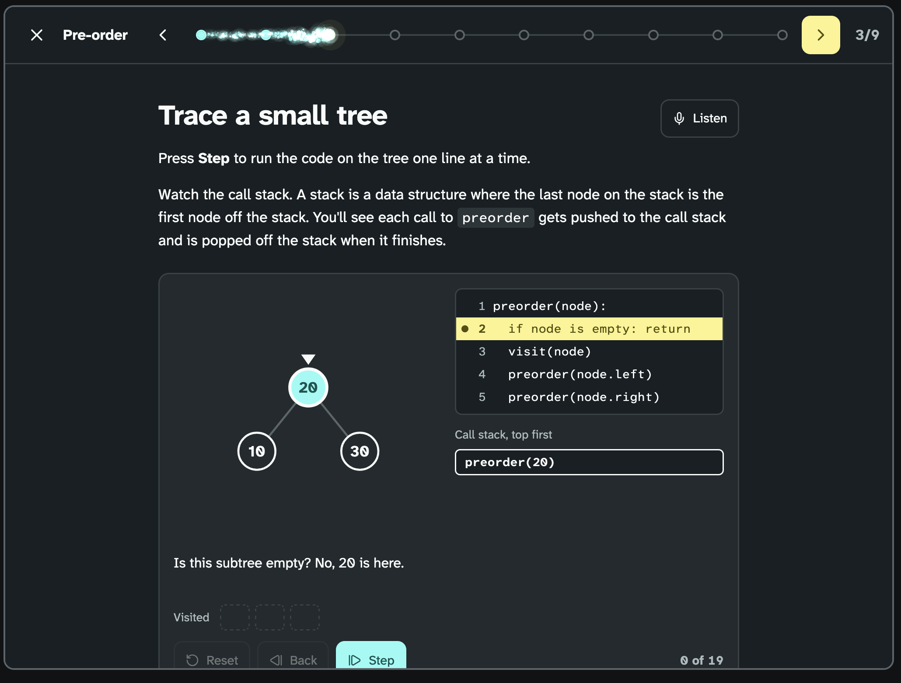
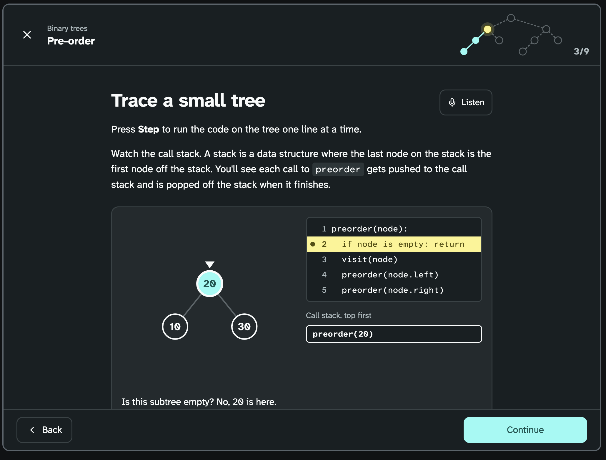

import { Aside, Steps } from "@astrojs/starlight/components";

The lesson page is the frame around every lesson's steps. 

We built it in two rounds. In round 1, the savvy start, we tried five different pages. In round 2 we took B, reworked it, and that became the page we picked.

## Round 1: Savvy start

### A: Contents rail

The whole lesson is one long page. A list of the steps sits on the left and follows the learner as they scroll.

<Steps>

1. The learner scrolls down the page, and a dot slides down the list to the step they're reading.

2. The learner clicks a step in the list, and the page scrolls to it.

   

   *Figure 1: A · Contents rail*

</Steps>

### B: Sparkler fuse

The lesson shows one step at a time. The progress bar is a fuse made of glowing particles, with a marker for each step. Back and Next sit on either side of it at the top.

<Steps>

1. The learner presses Next, and the bright head of the fuse glides to the next marker and throws off soft sparks.

2. The learner reads how far through they are from the lit markers and the counter.

   

   *Figure 2: B · Sparkler fuse*

</Steps>

### C: Task bar

A side panel lists every step, grouped into Learn, Use it and Reflect. Back and Next are at the bottom.

<Steps>

1. The learner finishes a step, and a tick pops in beside it in the panel.

2. The learner sees how many steps are done in each group, and clicks any step to go to it.

   

   *Figure 3: C · Task bar*

</Steps>

### D: Split view

The words are on the left and the thing the learner works with is on the right, so they never scroll between them. The arrows and the step counter are at the top.

<Steps>

1. The learner reads the step on the left.

2. The learner works with the tree, the code trace or the question on the right while the text stays put.

   

   *Figure 4: D · Split view*

</Steps>

### E: Growing tree

The progress bar is a small tree with one node per step. Back and a big Continue button sit at the bottom.

<Steps>

1. The learner presses Continue, and the branch to the next node draws itself, then the node grows in.

2. The learner reaches the end, and the whole tree grows in on the end screen.

   

   *Figure 5: E · Growing tree*

</Steps>

## Round 2: B reworked

From Round 1 we all preferred the large back and Contniue buttons at the bottom of the page so we wanted to swap out the top navigation buttons in prototype B
for those. We liked the concept of the fuse but did not like the sparkle effect it had so we wanted to change it to something calmer.

### Glow bar

The bar is plain and thin, with no glow at rest.

<Steps>

1. The learner presses Continue, and a soft light runs along the bar to its new end while it fills, then fades.

2. The learner presses Back, and the bar slides back with no light.

   

   *Figure 6: Glow bar*

</Steps>

## Decision

<Aside type="tip" title="We picked B+, the Glow bar">
</Aside>

### Why we chose the Glow bar

- The learner sees one step at a time, so they focus on one idea and never scroll through a long page.
- The thin bar shows how far through the lesson the learner is. 
- Back and Continue sit at the bottom, where the learner finishes reading.
- The bar is a progress bar that reads "Step 2 of 9" to a screen reader, and the counter shows the same, so progress never only depends on the light bar.
