import { Aside, Steps } from "@astrojs/starlight/components";

Lesson 1 is the pilot lesson, so everything after it borrows its words. It teaches what a binary tree is (nodes, root, leaves, parents and children, subtrees, depth and height) and then the binary search tree rule. It ends in a playground where learners insert keys into a plain search tree and watch where each one lands.

Before building anything we sketched five different ways to teach it. Each storyboard below walks through the whole lesson, step by step, with the real text the learner would see. The playground is storyboarded once, after the five, because every one of them finishes there.

Height counts nodes, so a leaf has height 1 and an empty tree has height 0. That matches the height question generator.

## A: Vocabulary first

This one teaches a single word at a time, all on the same tree. The learner works through every word first and only then meets the search tree rule, before heading to the playground.

<Steps>

1. The learner is shown a tree and learns what a node and an edge are.

2. The learner meets the root.

3. The learner meets parents and children.

   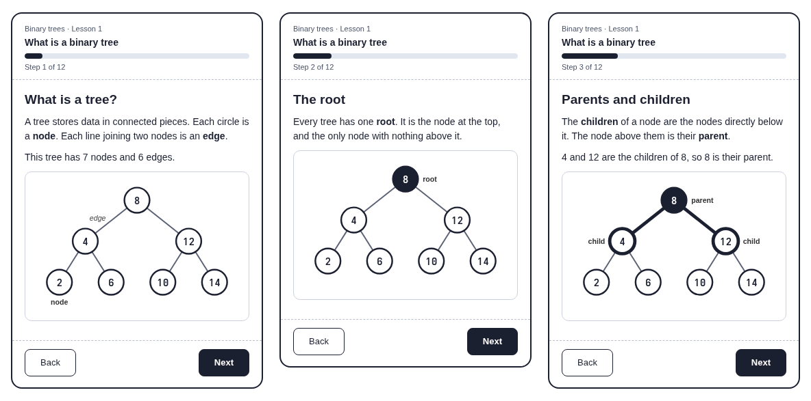

   *Figure 1: A · Vocabulary first, steps 1 to 3. Own work, low-fidelity prototype.*

4. The learner meets leaves.

5. The learner finds out that binary means each node has at most two children, a left one and a right one.

6. The learner sees a box drawn around part of the tree and learns that it is a subtree.

   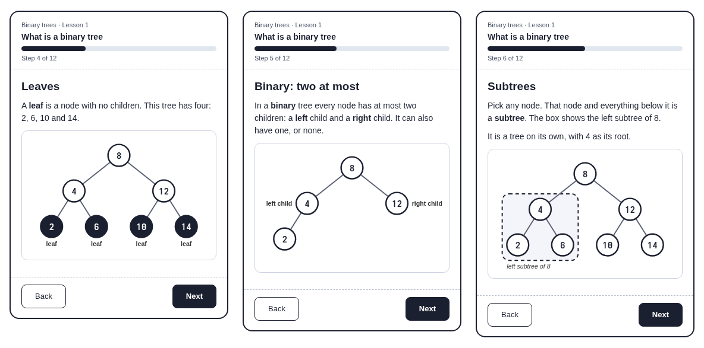

   *Figure 2: A · Vocabulary first, steps 4 to 6. Own work, low-fidelity prototype.*

7. The learner taps the leaves to check that the words so far have stuck.

8. The learner meets depth.

9. The learner meets height.

   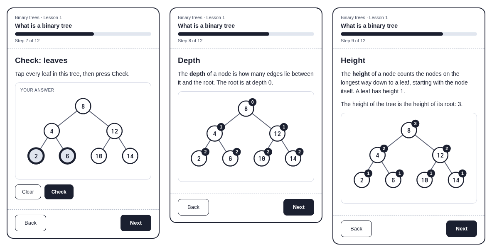

   *Figure 3: A · Vocabulary first, steps 7 to 9. Own work, low-fidelity prototype.*

10. The learner reads the search tree rule: smaller keys sit on the left and bigger keys on the right.

11. The learner moves on to the playground and inserts keys of their own.

12. The learner writes notes in their own words.

    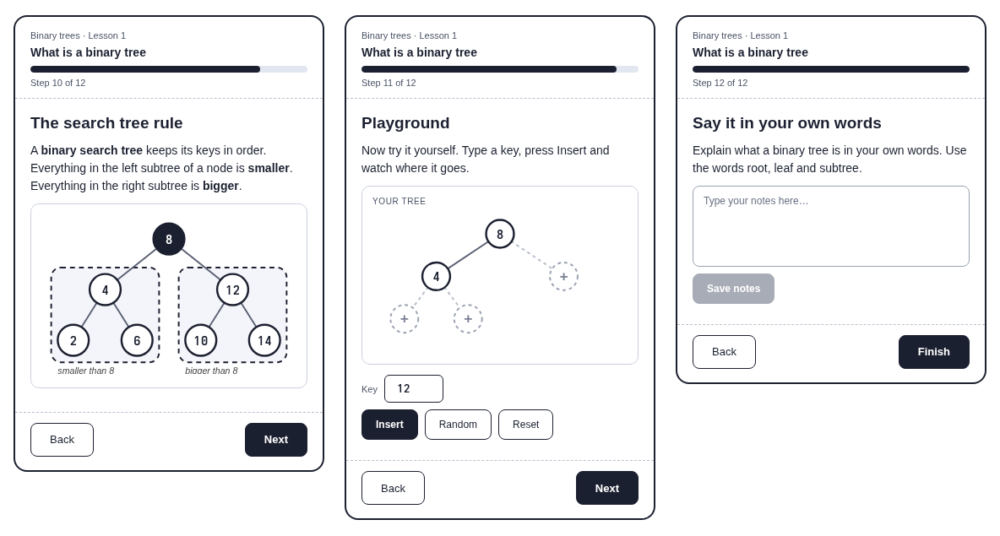

    *Figure 4: A · Vocabulary first, steps 10 to 12. Own work, low-fidelity prototype.*

</Steps>

**Playground:** The learner has only just read the rule, so the playground is their first chance to use it.

## B: Family tree first

This one begins with something learners already know, a family tree, and gradually turns it into a binary tree. Along the way it shows where the comparison stops working.

<Steps>

1. The learner starts with a family tree they already know.

2. The learner watches the family tree turn into circles and lines.

3. The learner learns that the oldest person is the root, and meets parents and children.

   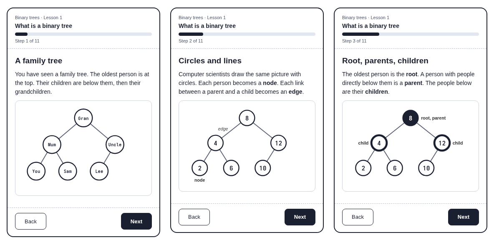

   *Figure 5: B · Family tree first, steps 1 to 3. Own work, low-fidelity prototype.*

4. The learner meets leaves.

5. The learner learns that, unlike a family, a binary tree allows at most two children per node.

6. The learner sees one branch of the family boxed in and learns that it is a subtree.

   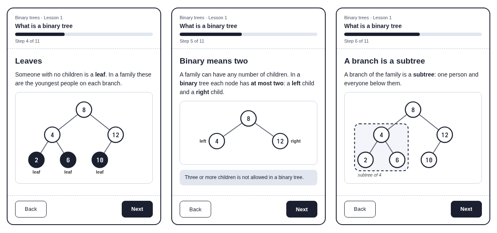

   *Figure 6: B · Family tree first, steps 4 to 6. Own work, low-fidelity prototype.*

7. The learner counts generations down the tree and so gets depth and height.

8. The learner sees where the family picture stops working, and the search tree rule takes over.

9. The learner answers a quick multiple choice question about parents.

   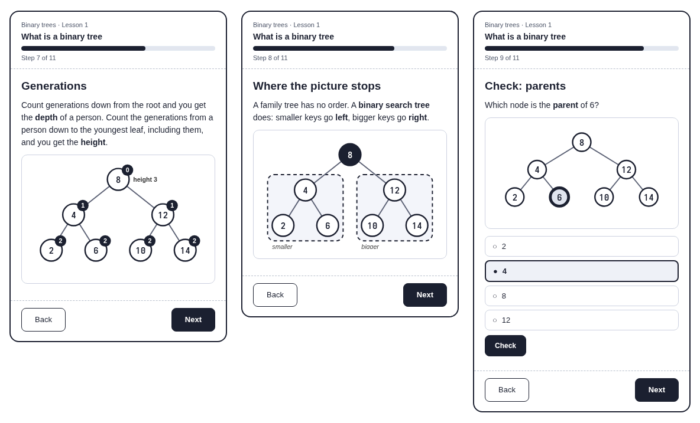

   *Figure 7: B · Family tree first, steps 7 to 9. Own work, low-fidelity prototype.*

10. The learner moves on to the playground and inserts keys of their own.

11. The learner writes notes in their own words.

    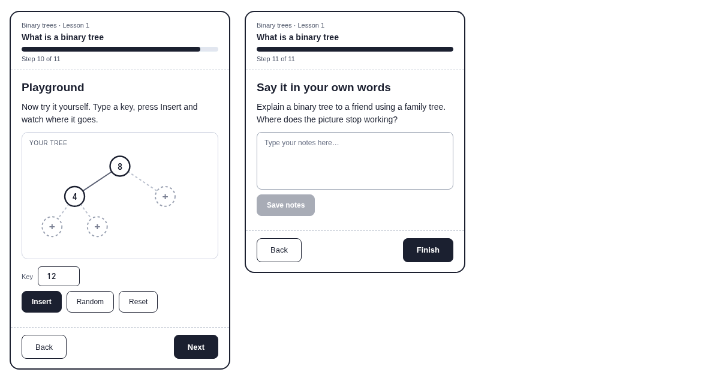

    *Figure 8: B · Family tree first, steps 10 and 11. Own work, low-fidelity prototype.*

</Steps>

**Playground:** The playground is the same one every idea ends with.

## C: Build it yourself

This one starts from an empty canvas. The learner builds the tree by tapping, and each word turns up just as it is needed. Keys only arrive near the end.

<Steps>

1. The learner adds the first node and is told it is the root.

2. The learner taps + to give a node a child, and meets the words parent and child.

3. The learner tries to give a node a third child and is stopped, which shows the two-child limit.

   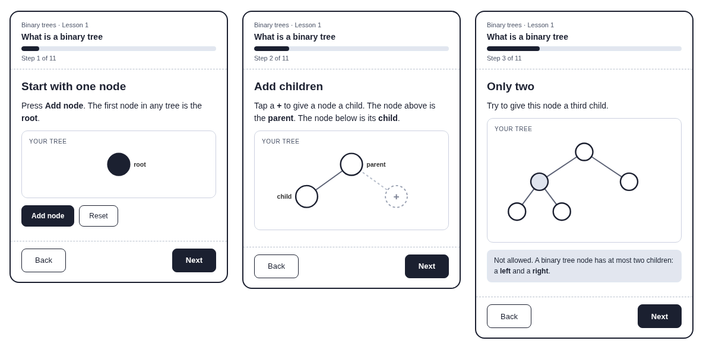

   *Figure 9: C · Build it yourself, steps 1 to 3. Own work, low-fidelity prototype.*

4. The learner keeps growing the tree and watches leaves appear as nodes with no children.

5. The learner taps a node and sees it and everything below it boxed as a subtree.

6. The learner switches on a depth counter and sees how far each node is from the root.

   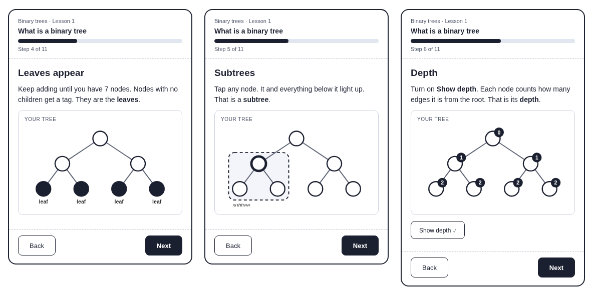

   *Figure 10: C · Build it yourself, steps 4 to 6. Own work, low-fidelity prototype.*

7. The learner switches on a height counter and sees how tall each node's subtree is.

8. The learner adds the key 5 by choosing left or right at every node on the way down.

9. The learner is told that the choices they just made are the search tree rule.

   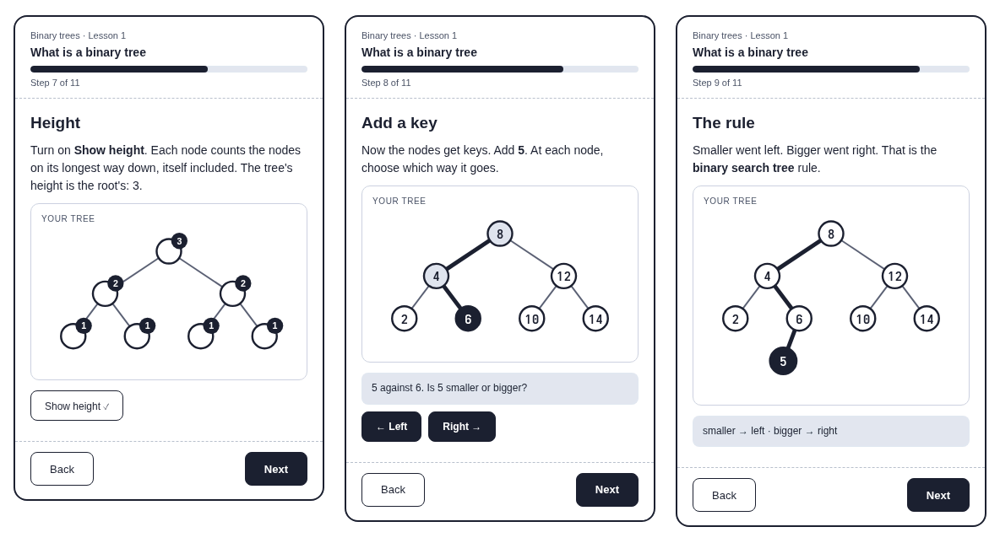

   *Figure 11: C · Build it yourself, steps 7 to 9. Own work, low-fidelity prototype.*

10. The learner moves on to the playground and inserts keys of their own.

11. The learner writes notes in their own words.

    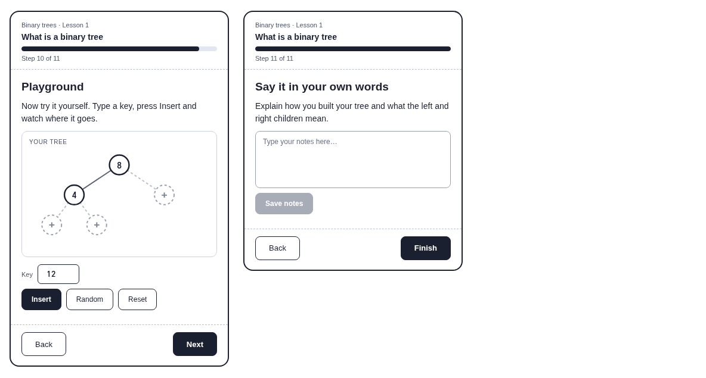

    *Figure 12: C · Build it yourself, steps 10 and 11. Own work, low-fidelity prototype.*

</Steps>

**Playground:** The learner has been adding nodes by hand all along, so the playground is where keys and the rule come in.

## D: Guess first

This one shows a finished tree and asks the learner to guess each word before it is explained. The answer follows straight after every guess.

<Steps>

1. The learner guesses which node is the root.

2. The learner hears why that node is the root, then guesses which nodes are leaves.

3. The learner sees what a leaf is, then guesses the parent of a node.

   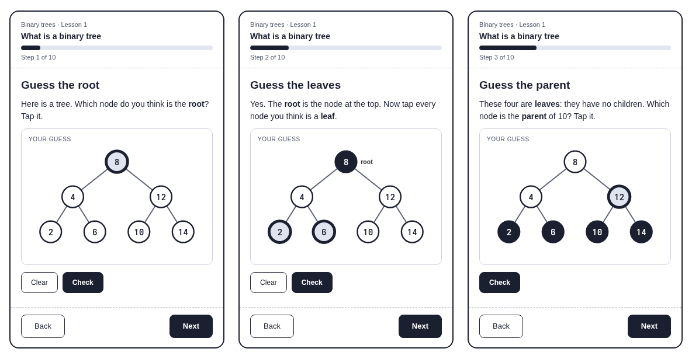

   *Figure 13: D · Guess first, steps 1 to 3. Own work, low-fidelity prototype.*

4. The learner taps every node they think is in the left subtree.

5. The learner guesses how deep a node sits.

6. The learner guesses how tall the tree is.

   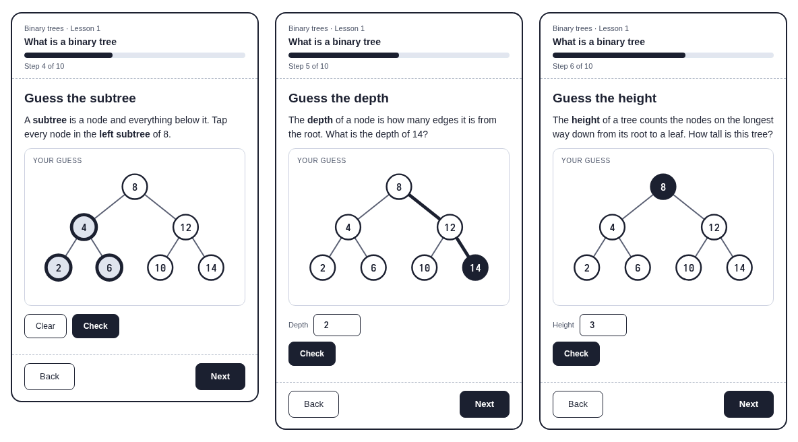

   *Figure 14: D · Guess first, steps 4 to 6. Own work, low-fidelity prototype.*

7. The learner taps the empty spot where they think a new key belongs.

8. The learner follows the path the key took down the tree and is shown the search tree rule.

9. The learner moves on to the playground and inserts keys of their own.

   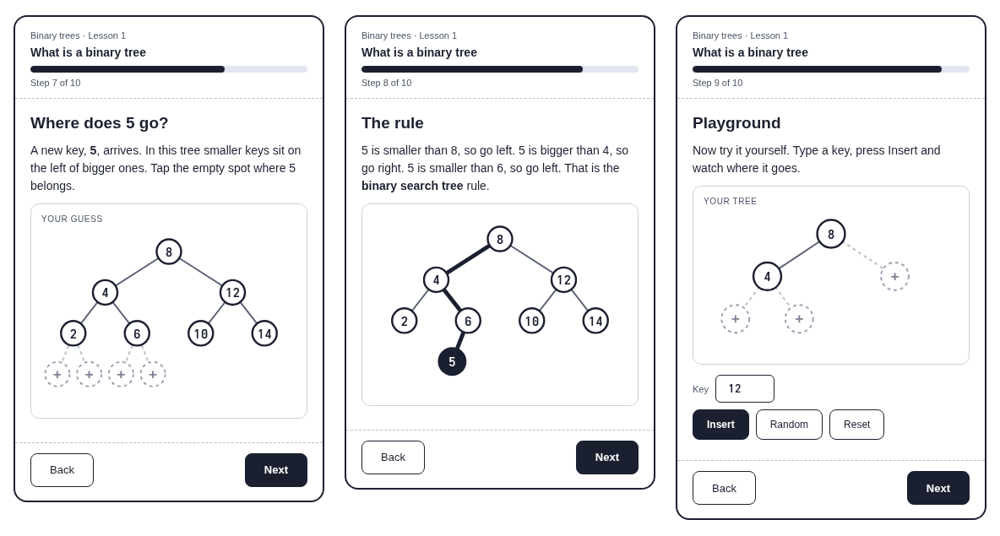

   *Figure 15: D · Guess first, steps 7 to 9. Own work, low-fidelity prototype.*

10. The learner writes notes in their own words.

    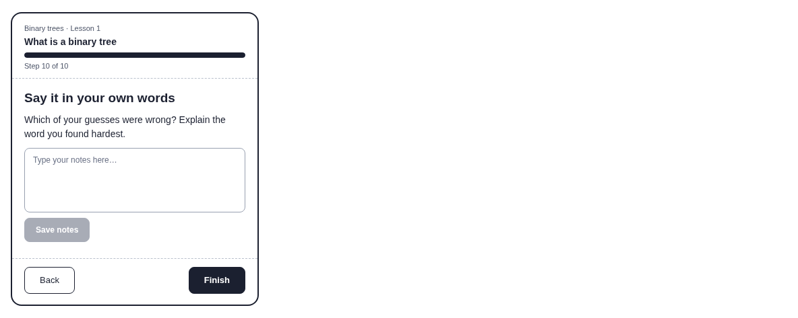

    *Figure 16: D · Guess first, step 10. Own work, low-fidelity prototype.*

</Steps>

**Playground:** The learner has been guessing all lesson, so the playground is simply open practice with no prompts.

## E: Drop keys in

This one opens with the same insert box the learner will use in the playground. They drop keys into an empty tree, and each word is introduced as soon as the tree needs it.

<Steps>

1. The learner starts with an empty tree and types in a first key.

2. The learner watches the first key become the root.

3. The learner inserts 4 and sees that smaller keys go left. Parent and child get their names here.

   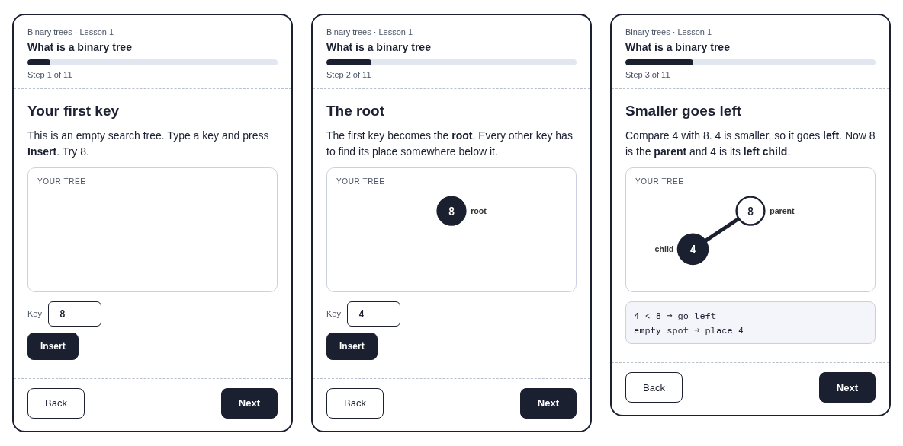

   *Figure 17: E · Drop keys in, steps 1 to 3. Own work, low-fidelity prototype.*

4. The learner inserts 12 and sees that bigger keys go right.

5. The learner inserts four more keys and fills out the tree.

6. The learner sees the root, the leaves and the parents named on the tree they just built.

   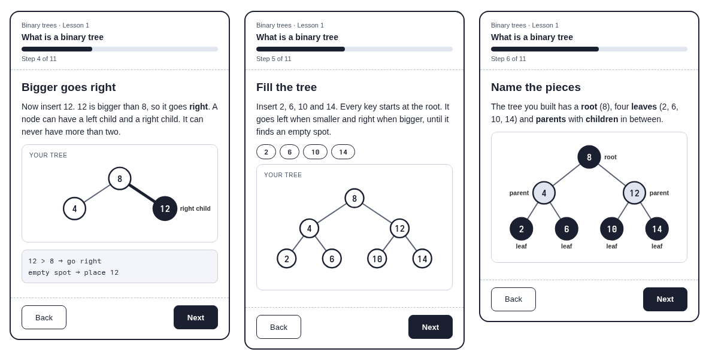

   *Figure 18: E · Drop keys in, steps 4 to 6. Own work, low-fidelity prototype.*

7. The learner sees a subtree boxed in, and that everything in the left one is smaller than its parent.

8. The learner meets depth and height on that same tree.

9. The learner taps the one key that breaks the rule.

   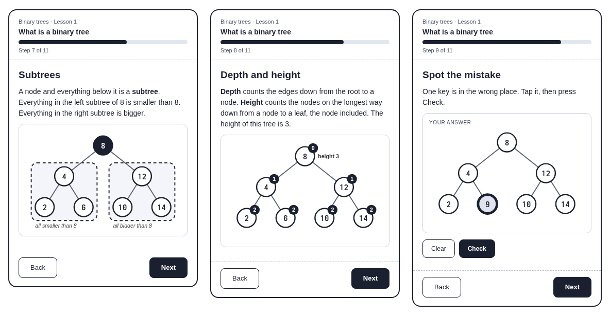

   *Figure 19: E · Drop keys in, steps 7 to 9. Own work, low-fidelity prototype.*

10. The learner moves on to the playground and inserts whatever keys they like.

11. The learner writes notes in their own words.

    

    *Figure 20: E · Drop keys in, steps 10 and 11. Own work, low-fidelity prototype.*

</Steps>

**Playground:** The learner met the insert box in step 1, so there is nothing new to learn when they reach the playground.

## Playground: insert keys into a plain search tree

Every storyboard above ends here. The learner types in a key, presses Insert and watches it travel down from the root, with each comparison written out as it happens. That way they can see why a key goes left or right instead of just being told. Nothing is balanced yet, and that is on purpose: the learner can see a plain search tree stretch into a line, which is exactly the problem AVL trees solve later.

<Steps>

1. The learner starts with a tree holding one key, an insert box and three buttons.

2. The learner presses Insert and watches the key travel down the tree, with every comparison written out.

3. The learner sees the key land, and the node count and height update.

   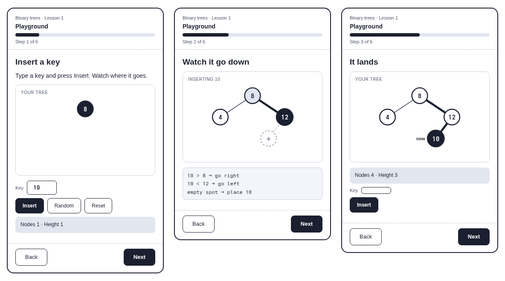

   *Figure 21: Playground, steps 1 to 3. Own work, low-fidelity prototype.*

4. The learner inserts keys in sorted order and watches the tree stretch into a line.

5. The learner tries to insert a key that is already there and is told why it can't go in.

6. The learner compares two insert orders of the same keys, side by side.

   

   *Figure 22: Playground, steps 4 to 6. Own work, low-fidelity prototype.*

</Steps>

**Controls:** Insert adds the key in the box, Random adds a key that isn't in the tree yet, and Reset empties the tree. After every insert the node count and height appear under the tree.

## Decision

<Aside type="tip" title="We picked E, drop keys in">
</Aside>

### Why we chose drop keys in

- The learner is doing something from the very first screen. They type a key and watch it land, instead of reading definitions or guessing.
- The insert box in the lesson is the same one they use in the playground, so the lesson flows straight into it and there is nothing new to learn at the end.
- Every word in the lesson's scope is still covered: root, parents and children, leaves, subtrees, depth and height, and the search tree rule. Each one shows up when the tree the learner has built needs it, in steps 2 to 8.
- The rule comes out of what the learner just did instead of arriving as a definition. That matters later, because reading a search tree in order gives its keys sorted, and the traversal lessons build on it.
- Every step pairs a tree with a short piece of text and a log of the comparisons, so it works with text-to-speech as well as the diagram.
- The best parts of the other ideas still fit inside it. The labelled tree from A is step 6, and the tap-to-check from D is step 9.

### Why we dropped the others

- **A: Vocabulary first.** It is clear and easy to check, but the learner reads seven definitions before they do anything, and the search tree rule only turns up at step 10. It feels like a glossary.
- **B: Family tree first.** It starts from something familiar, but a family can have any number of children and has no order, so a lot of steps go on explaining where the picture stops working. The search tree rule still has to be taught on top.
- **C: Build it yourself.** It is hands-on, but the nodes have no keys until step 8, so the learner builds shapes for no reason. Tapping + slots is also fiddly on a small screen, and it needs a tree editor that nothing else in the app uses.
- **D: Guess first.** A learner can't guess a word they have never heard, so the first guesses at root and leaf are just luck. It works better as a check after the words, which is why we kept it for step 9 of E.
