import { Aside, Steps } from "@astrojs/starlight/components";

Pre-order, in-order and post-order traversals are all variations of the same algorithm with a single line modified, thus they were storyboarded together. We made five storyboards representing different ways to teach them. For each storyboard, we teach pre-order and then compare with in-order and post-order to signify how they change. 

## A: Code first

This prototypes follows an  "algorithm-first" approach. The learner reads the algorithm rules, then the code and then traces the running code with the help of a call stack. In-order and post-order follow by moving a single line of code.

<Steps>

1. The learner reads what a traversal is and that the three depth-first orders differ in when a node is visited. They start with pre-order.

2. The learner sees the left and the right subtrees with a box drawn around them on the tree, to highlight them.

3. The learner is shown the pseudocode and talked through what each line does.

   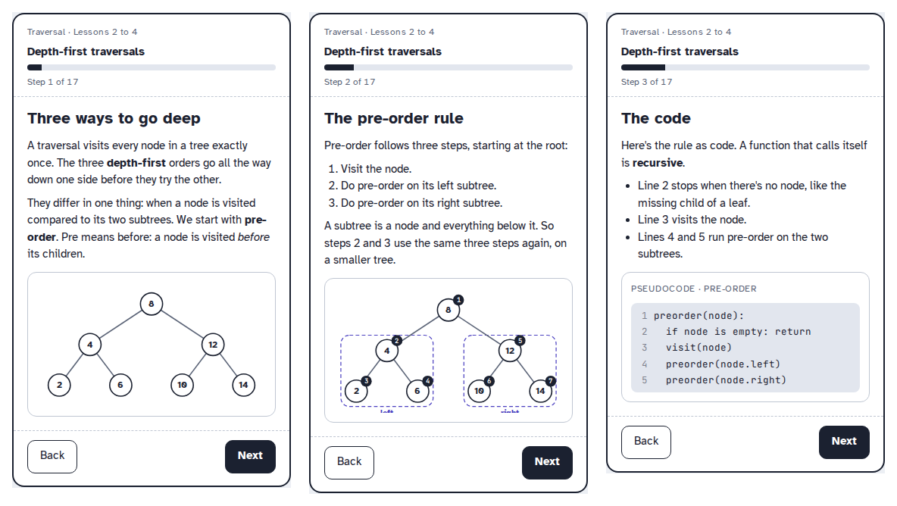

   *Figure 1: A · Code first, steps 1 to 3. Own work, low-fidelity prototype.*

4. The learner is walked through a trace of a small tree. As they step through the code, they also step through the tree and the call stack at the same time.

5. The learner is shown why a call waits on the call stack until the calls below it are done.

6. The learner is shown a larger tree and can step through it, viewing the tree, code and call stack at the same time.

   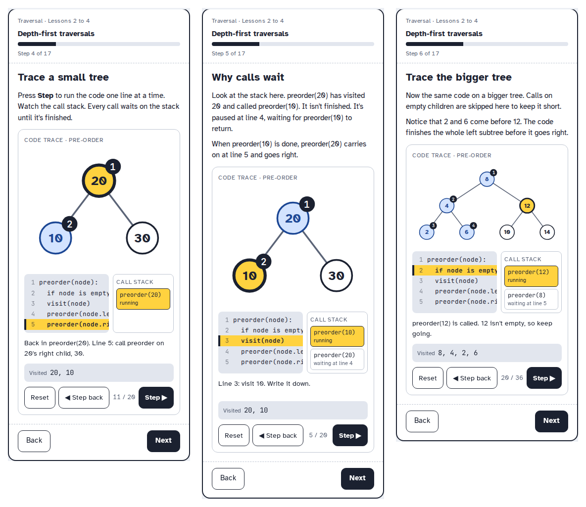

   *Figure 2: A · Code first, steps 4 to 6. Own work, low-fidelity prototype.*

7. The learner learns where pre-order is used: copying a tree and prefix expressions.

8. The learner moves the visit line between the two recursive calls and traces the result. That is in-order.

9. The learner watches the keys of a search tree land on a number line in sorted order.

   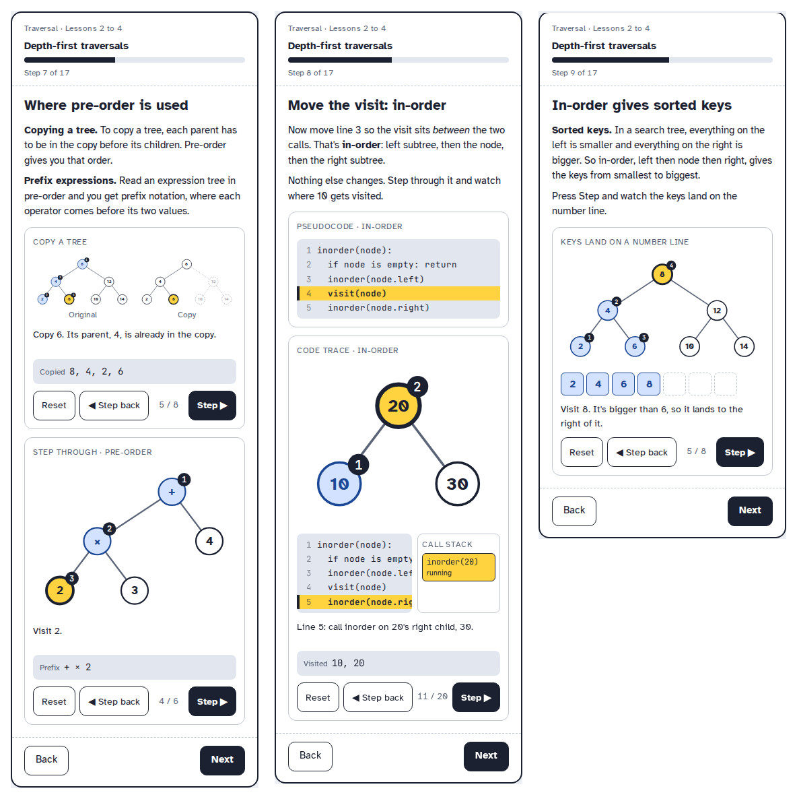

   *Figure 3: A · Code first, steps 7 to 9. Own work, low-fidelity prototype.*

10. The learner sees that the learning path map is drawn in in-order, left to right.

11. The learner moves the visit line to the end and traces the result. That is post-order.

12. The learner learns where post-order is used: deleting a whole tree and working out heights.

    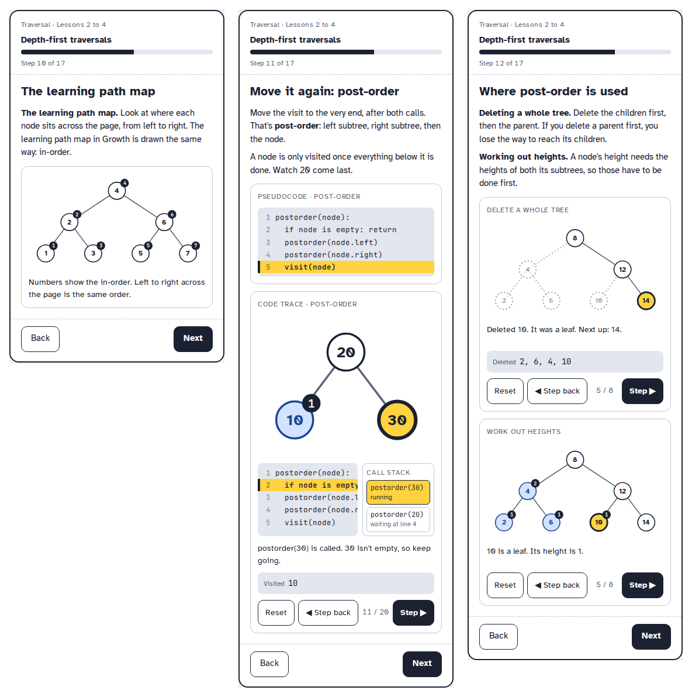

    *Figure 4: A · Code first, steps 10 to 12. Own work, low-fidelity prototype.*

13. The learner steps through an expression tree in post-order and gets a postfix expression.

14. The learner sees all three orders on one tree, next to the three code blocks.

15. The learner is given a quick multiple choice quiz.

    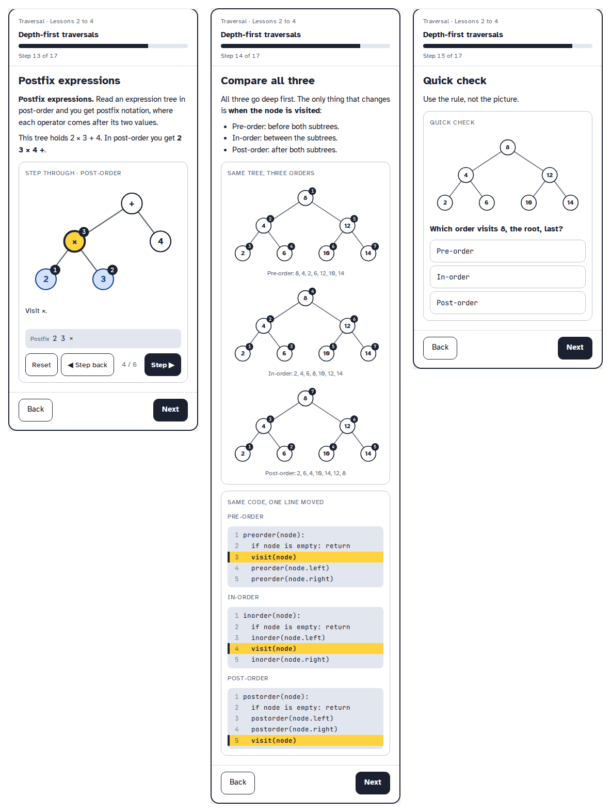

    *Figure 5: A · Code first, steps 13 to 15. Own work, low-fidelity prototype.*

16. The learner is taken to a playground where they can trace random trees in a random order.

17. The learner makes notes on what they just learned.

    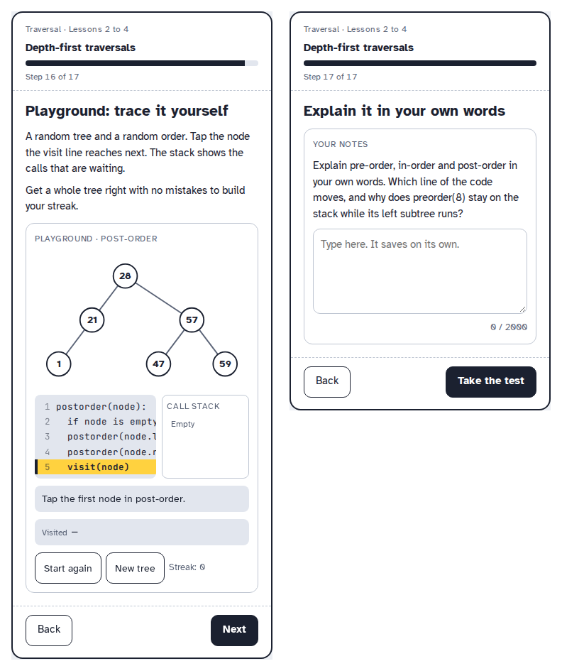

    *Figure 6: A · Code first, steps 16 and 17. Own work, low-fidelity prototype.*

</Steps>

**Playground:** the learner gets a random tree and a random order, and taps the node the visit line reaches next. The code and the call stack update as they go. Each wrong tap gives a bigger hint. A tree with no mistakes adds to their streak.

## B: Walk around the tree

An ant walks around the outside of the tree. It passes every node three times, on its left, under it and on its right. Each order writes a node down on a different pass.

<Steps>

1. The learner drags the ant around a 3-node tree to see the walk and the three passes.

2. The learner drags the ant around the 7-node tree. Pre-order writes a node down on the first pass, and each node gets a number.

3. The learner sees why the first pass gives the rule: root, then left, then right.

   

   *Figure 7: B · Walk around the tree, steps 1 to 3. Own work, low-fidelity prototype.*

4. The learner walks the tree again. In-order writes a node down on the second pass, when the ant goes under it.

5. The learner sees that the second pass gives the keys of a search tree in sorted order.

6. The learner sees that the learning path map is drawn in in-order, left to right.

   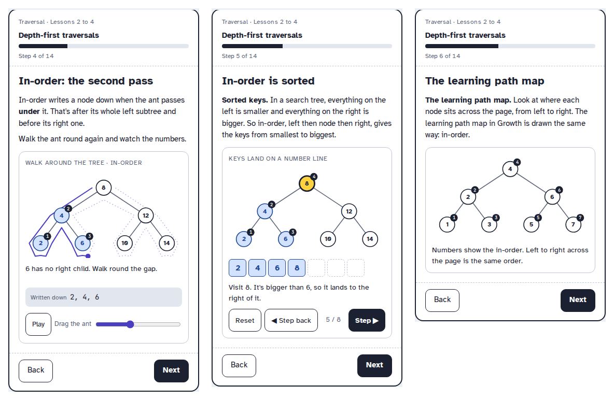

   *Figure 8: B · Walk around the tree, steps 4 to 6. Own work, low-fidelity prototype.*

7. The learner walks the tree a third time. Post-order writes a node down on the last pass, on its right side.

8. The learner walks a tree with a missing child, to see how gaps are handled.

9. The learner steps through the walk as code, with the call stack and the three code blocks.

   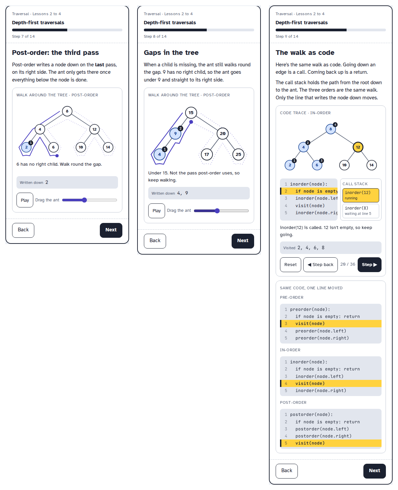

   *Figure 9: B · Walk around the tree, steps 7 to 9. Own work, low-fidelity prototype.*

10. The learner sees where pre-order is used: copying a tree and prefix expressions.

11. The learner sees where post-order is used: deleting a tree, heights and postfix expressions.

12. The learner sees all three orders on one tree and answers a quick quiz about where the ant is.

    

    *Figure 10: B · Walk around the tree, steps 10 to 12. Own work, low-fidelity prototype.*

13. The learner is taken to a playground where they tap nodes in the order the ant would write them, for a random order.

14. The learner makes notes.

    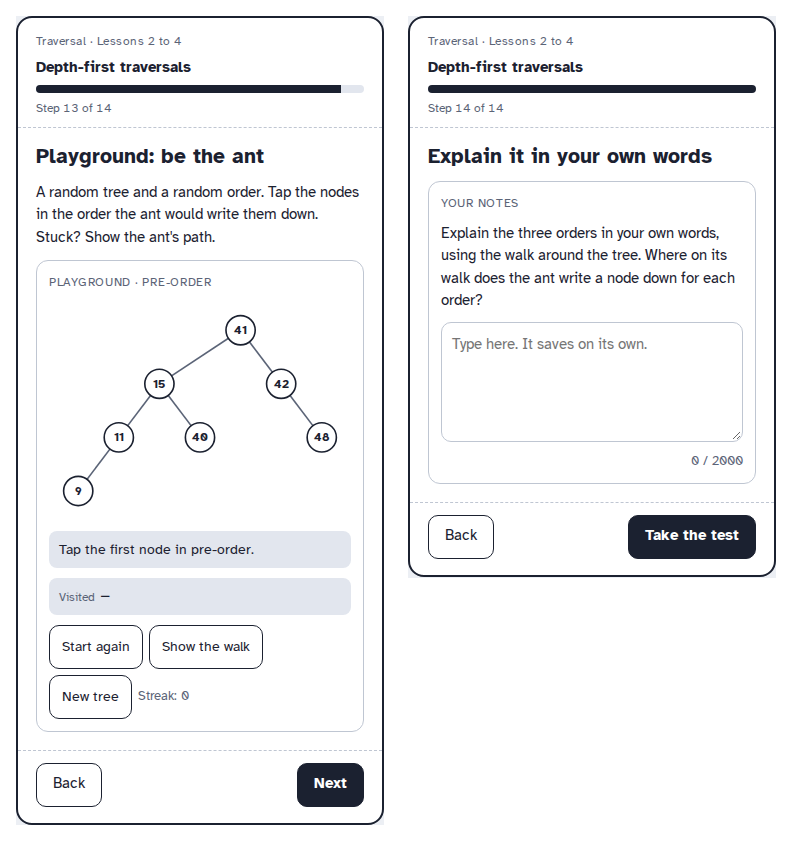

    *Figure 11: B · Walk around the tree, steps 13 and 14. Own work, low-fidelity prototype.*

</Steps>

**Playground:** a random tree and a random order. The learner taps nodes in the order the ant would write them down. "Show the walk" draws the ant's path as a hint.

## C: Guess first

The learner guesses the order, sees which parts they got right, and only then gets the rule. This repeats for each order.

<Steps>

1. The learner taps a 3-node tree in the order they think pre-order goes, then checks their guess.

2. The learner sees the right order and the rule.

3. The learner guesses the pre-order of the bigger 7-node tree.

   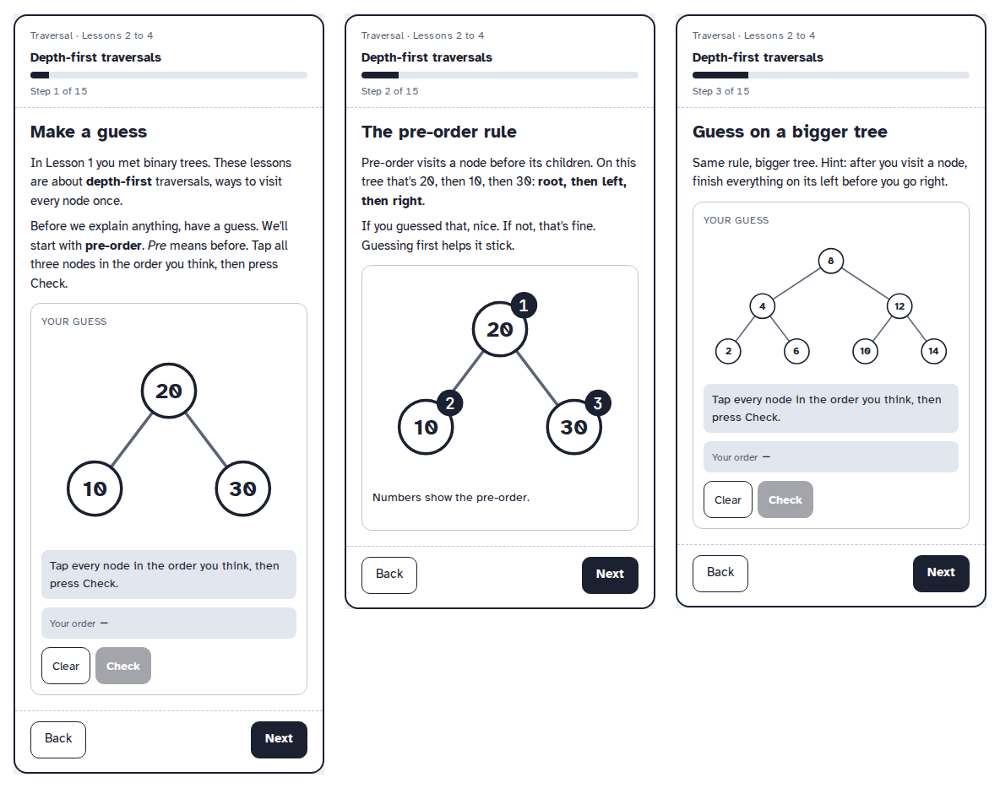

   *Figure 12: C · Guess first, steps 1 to 3. Own work, low-fidelity prototype.*

4. The learner reads about a common confusion with level-order.

5. The learner steps through how the computer does it, with the code trace and the call stack.

6. The learner guesses the stack.

   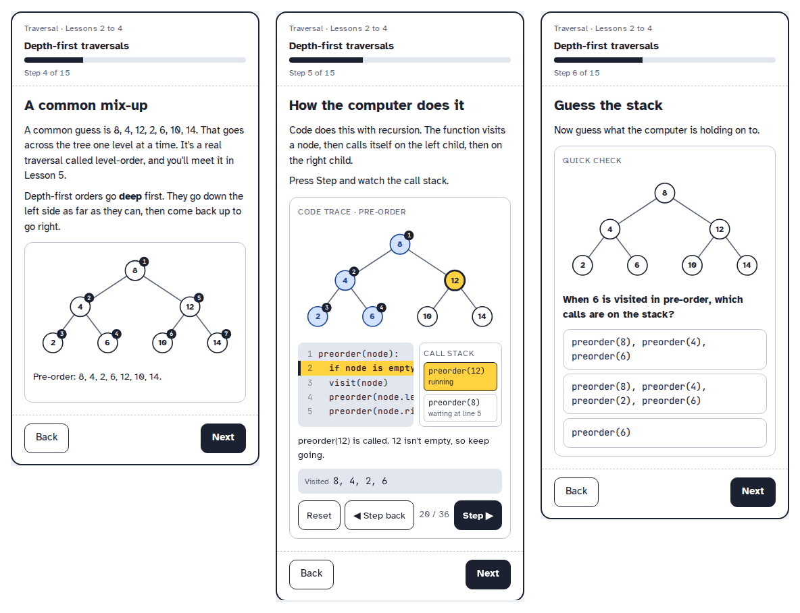

   *Figure 13: C · Guess first, steps 4 to 6. Own work, low-fidelity prototype.*

7. The learner guesses the in-order of the same 3-node tree.

8. The learner sees that the in-order of a search tree is sorted.

9. The learner sees that the learning path map is drawn in in-order.

   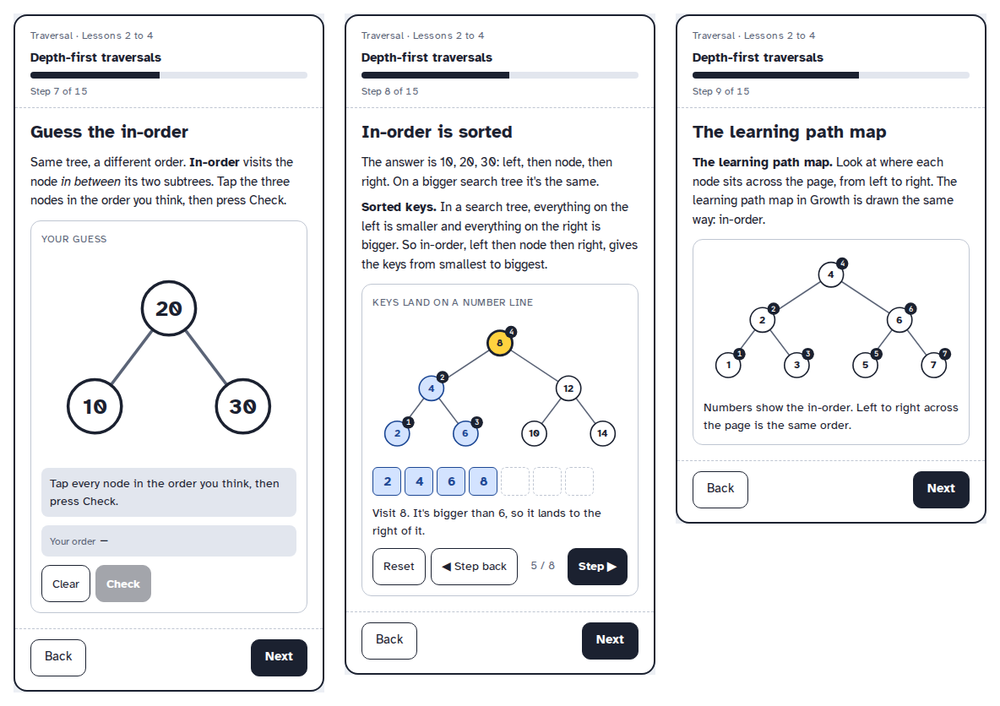

   *Figure 14: C · Guess first, steps 7 to 9. Own work, low-fidelity prototype.*

10. The learner guesses the post-order of the 3-node tree.

11. The learner guesses the post-order of an expression tree and gets a postfix expression.

12. The learner sees a tree being deleted and guesses what goes wrong if the root is deleted first.

    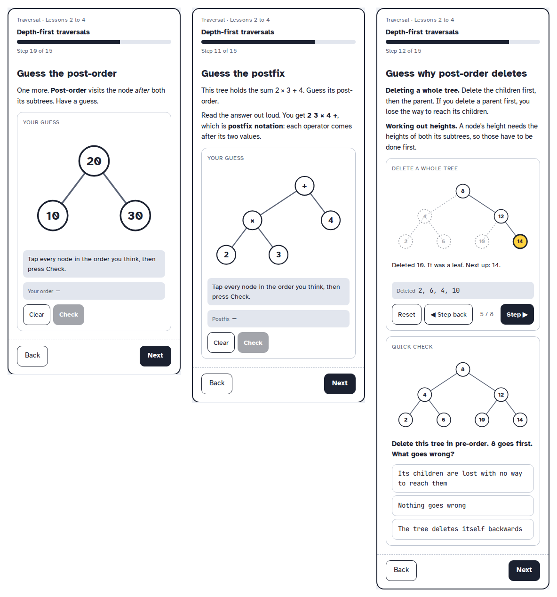

    *Figure 15: C · Guess first, steps 10 to 12. Own work, low-fidelity prototype.*

13. The learner sees all three orders on one tree and answers a quick quiz.

14. The learner is taken to a playground where they tap random trees in a random order.

15. The learner makes notes on what they guessed at first and what changed their mind.

    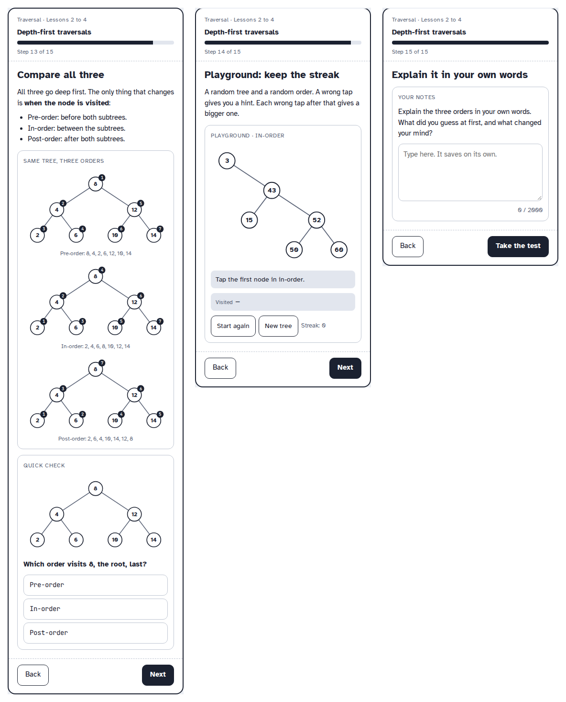

    *Figure 16: C · Guess first, steps 13 to 15. Own work, low-fidelity prototype.*

</Steps>

**Playground:** random trees in a random order, one after another. Each wrong tap gives a hint. A streak counter tracks trees with no mistakes.

## D: Start with a use

Each order comes in through a job it does: copying a tree and prefix expressions, then sorting, then deleting and postfix expressions.

<Steps>

1. The learner steps through copying a tree, one node at a time.

2. The learner sees that parents have to come first. That is pre-order.

3. The learner sees that trees can hold maths, and steps through an expression tree to get a prefix expression.

   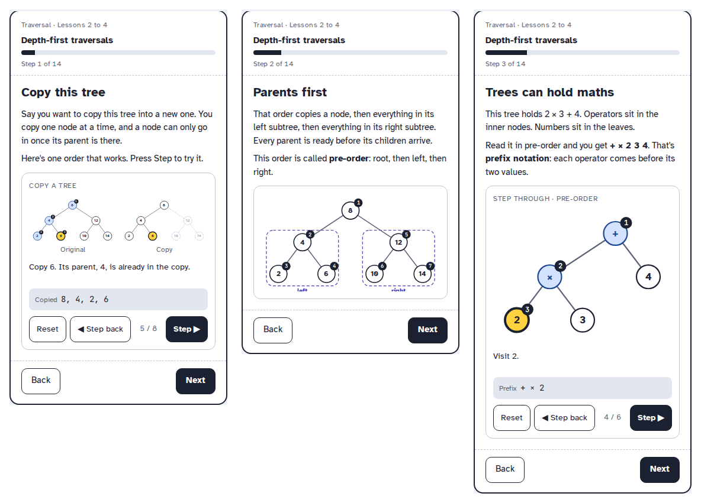

   *Figure 17: D · Start with a use, steps 1 to 3. Own work, low-fidelity prototype.*

4. The learner sees that prefix does not need brackets.

5. The learner is given a new job: sorting the keys of a search tree. In-order does it, with the keys landing on a number line.

6. The learner sees that the learning path map is drawn in in-order.

   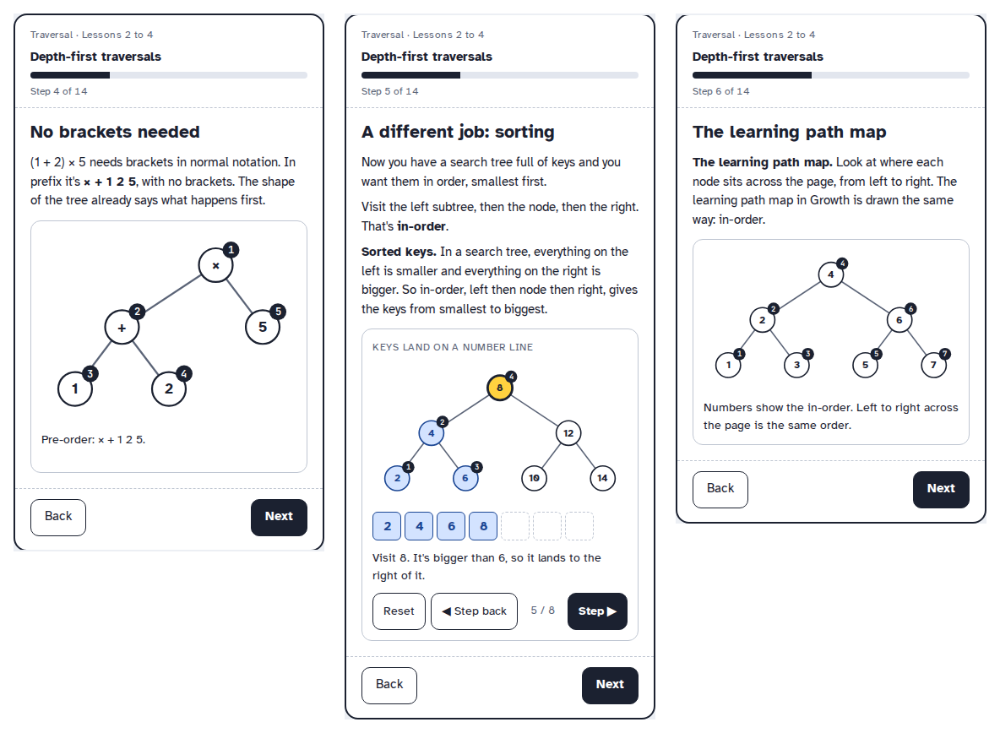

   *Figure 18: D · Start with a use, steps 4 to 6. Own work, low-fidelity prototype.*

7. The learner is given a third job: deleting a whole tree. Children have to go before the parent. That is post-order.

8. The learner works out the heights of the nodes, leaves first.

9. The learner steps through an expression tree in post-order and gets a postfix expression.

   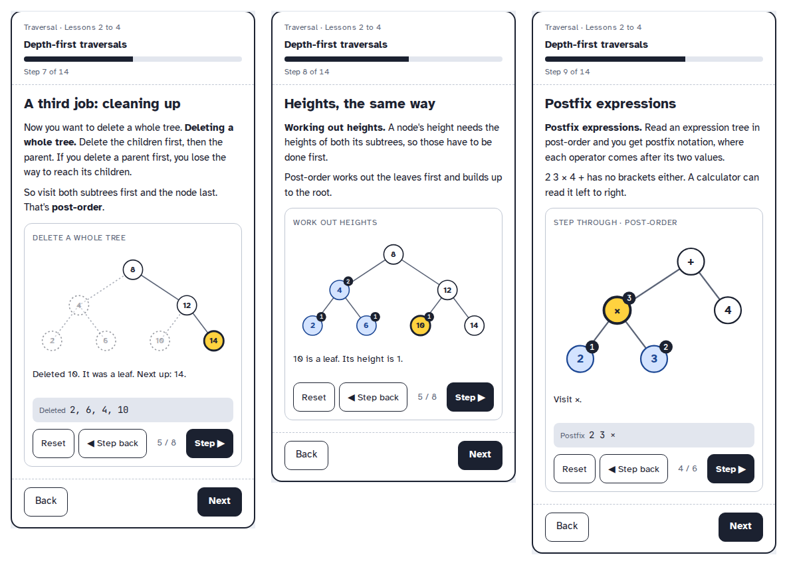

   *Figure 19: D · Start with a use, steps 7 to 9. Own work, low-fidelity prototype.*

10. The learner steps through how the code does it, with the call stack and the three code blocks.

11. The learner sees all three orders on one tree.

12. The learner answers a quick quiz about the postfix form of 7 − 2 × 3.

    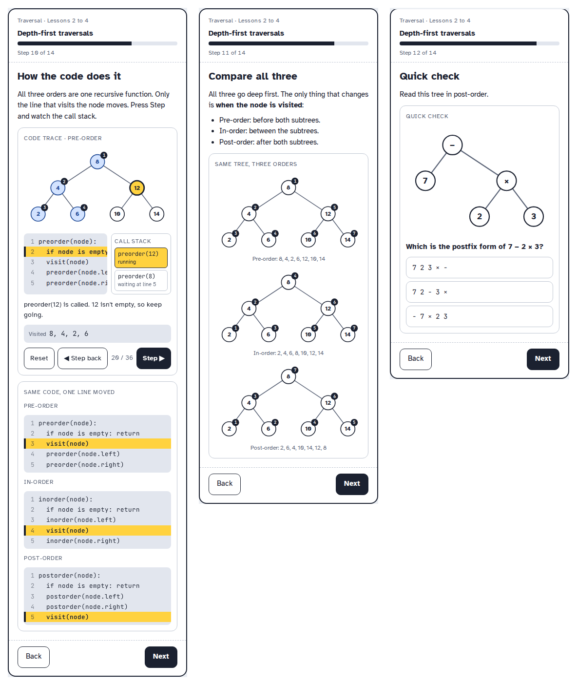

    *Figure 20: D · Start with a use, steps 10 to 12. Own work, low-fidelity prototype.*

13. The learner is taken to a playground where they build prefix or postfix expressions from random expression trees.

14. The learner makes notes on why copying needs each parent first and deleting needs each parent last.

    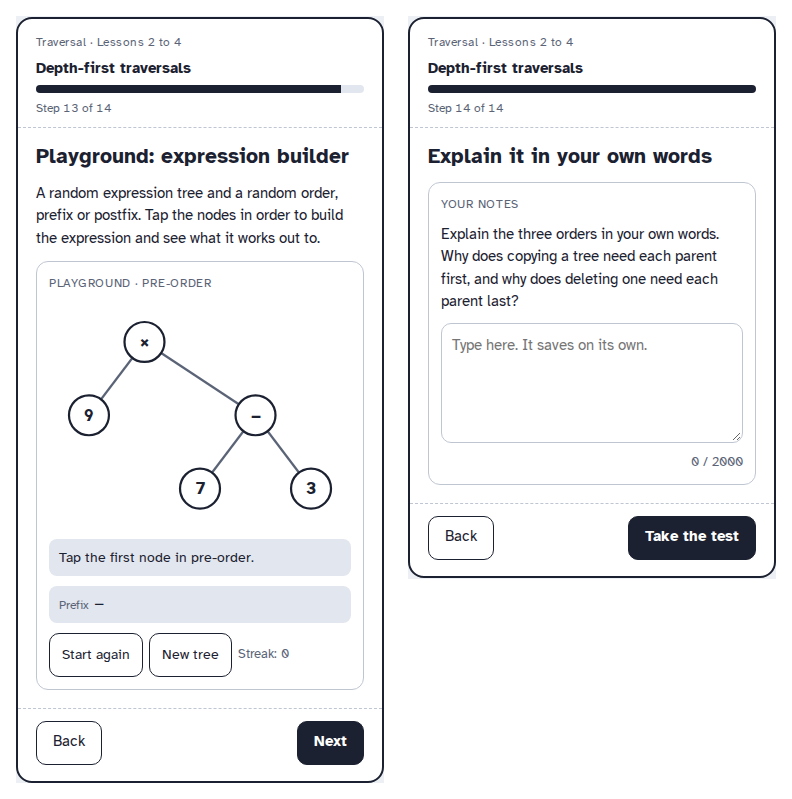

    *Figure 21: D · Start with a use, steps 13 and 14. Own work, low-fidelity prototype.*

</Steps>

**Playground:** random expression trees, with prefix or postfix picked at random. The learner taps the nodes in order to build the expression, then sees what it works out to.

## E: Examples that fade

Shows worked examples first, then the same task with less and less help until the learner does it alone. This repeats for each order.

<Steps>

1. The learner reads the pre-order rule and the pseudocode.

2. The learner steps through a fully worked trace on a 3-node tree.

3. The learner steps through a fully worked trace on the 7-node tree.

   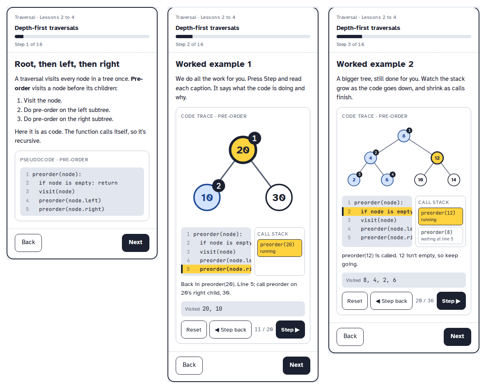

   *Figure 22: E · Examples that fade, steps 1 to 3. Own work, low-fidelity prototype.*

4. The learner finishes a pre-order with 3 nodes already done, with the call stack shown and hints.

5. The learner finishes a prefix expression with 2 nodes already done, and sees where copying a tree is used.

6. The learner sees a fully worked in-order trace, with the visit line moved between the two calls.

   

   *Figure 23: E · Examples that fade, steps 4 to 6. Own work, low-fidelity prototype.*

7. The learner finishes an in-order with 2 nodes already done, with smaller hints.

8. The learner sees that in-order gives sorted keys and that the learning path map is drawn in in-order.

9. The learner sees a fully worked post-order trace, with the visit line moved to the end.

   

   *Figure 24: E · Examples that fade, steps 7 to 9. Own work, low-fidelity prototype.*

10. The learner finishes a post-order with 3 nodes already done, with the call stack shown and hints.

11. The learner sees where post-order is used: deleting a whole tree and working out heights.

12. The learner finishes a postfix expression with 2 nodes already done.

    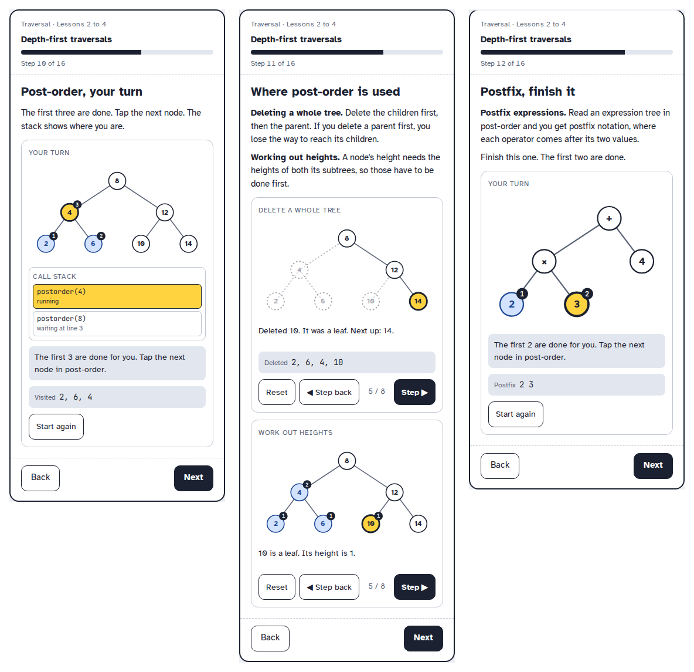

    *Figure 25: E · Examples that fade, steps 10 to 12. Own work, low-fidelity prototype.*

13. The learner sees all three orders on one tree, next to the three code blocks.

14. The learner does a whole tree on their own, in an order picked for them, with no stack and no hints.

    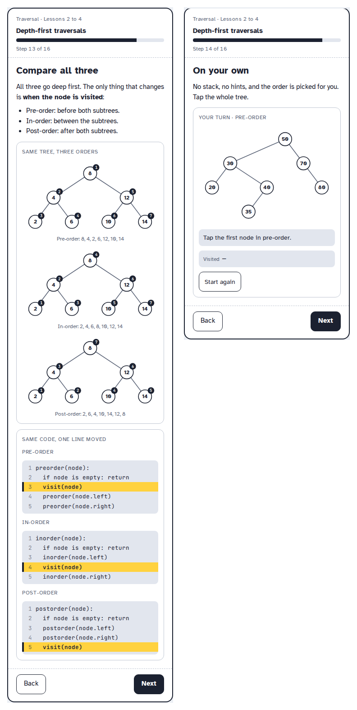

    *Figure 26: E · Examples that fade, steps 13 and 14. Own work, low-fidelity prototype.*

15. The learner is taken to a playground where they tap random trees in a random order with no help.

16. The learner makes notes explaining the three orders as if teaching a friend.

    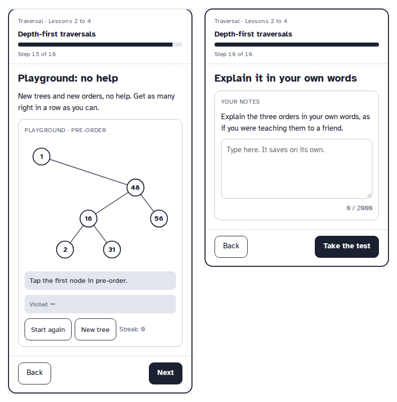

    *Figure 27: E · Examples that fade, steps 15 and 16. Own work, low-fidelity prototype.*

</Steps>

**Playground:** random trees in a random order with no stack and no hints. A streak counter tracks trees with no mistakes.

## Decision

<Aside type="tip" title="We picked A the code first approach">
</Aside>

### Why we chose the code first approach

- The app prepares learners for COS212 lectures, and COS212 expects the learners to be able to code the algorithms.
- The three orders are one line of code apart, so the code shows the difference exactly: the visit line sits before, between or after the two recursive calls. The other ideas need extra steps to link back to the code.
- Showing the call stack helps the learner understand how recursion works, and it stays the same for all three orders.
- The algorithm, code and captions are things that a learner can read. Having text also makes text-to-speech easy to implement, accommodating audio learners. The lesson also accommodates visual learners by showing the tree, call stack and code with lines highlighted.
- The pictures and number line from the other ideas still fit inside it as steps.

### Why we dropped the others

- **B: Walk around the tree.** It is easy to remember, and one walk covers all three orders, but it is a trick and not the algorithm COS212 asks for. Dragging the ant is fiddly on a small screen, and a screen reader needs a text version.
- **C: Guess first.** It is active from the first screen, but it repeats the guessing three times. A learner with no idea can guess at random, and in-order and post-order are guessed before the rule.
- **D: Start with a use.** It gives the best reason for each order, but prefix and postfix maths is a second new idea, and expression trees are not search trees. It was also the longest.
- **E: Examples that fade.** It is good scaffolding, but it starts with two steps of watching and repeats the same pattern three times, so the uses get the least time. We keep the idea for the playground, where help can fade as the streak grows.
