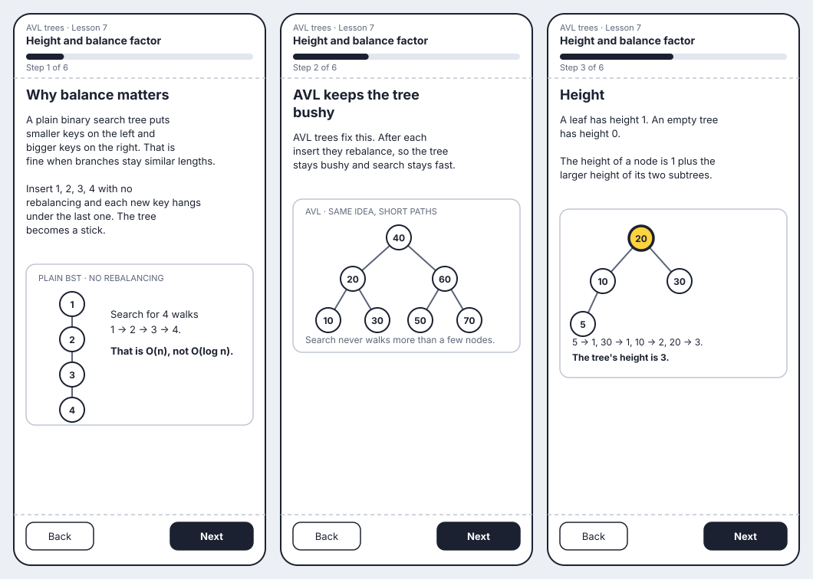
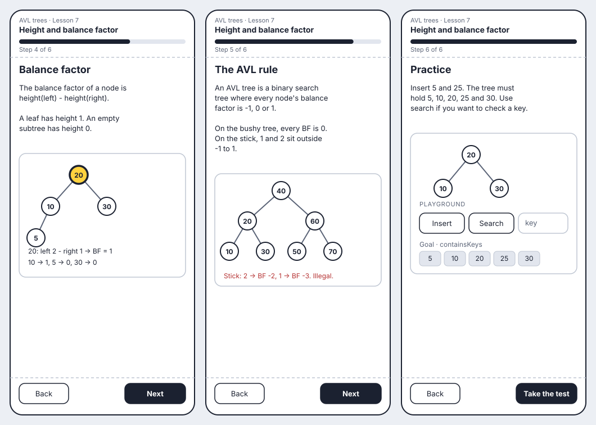
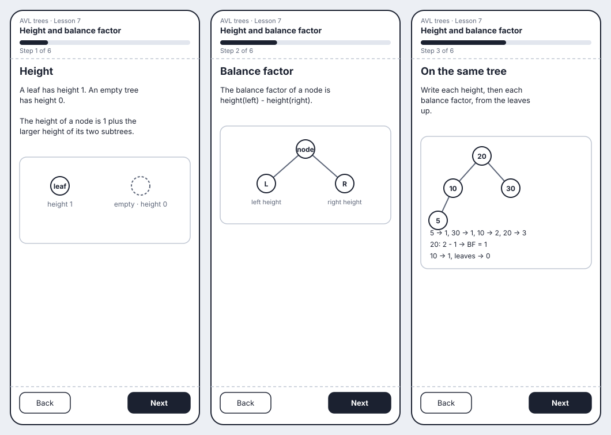
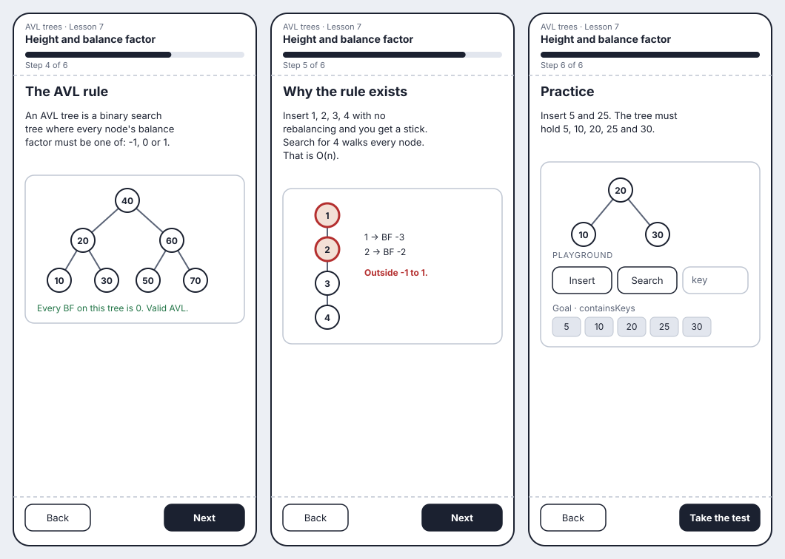
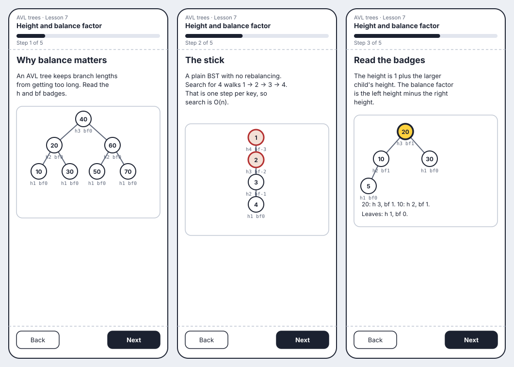
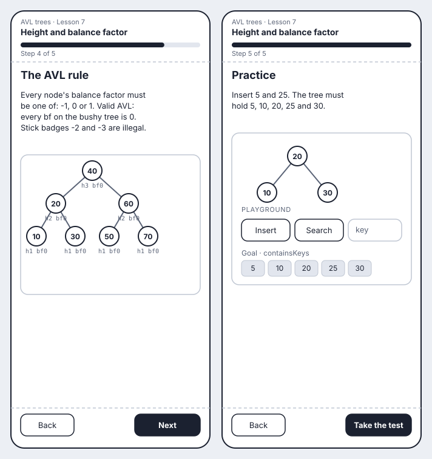
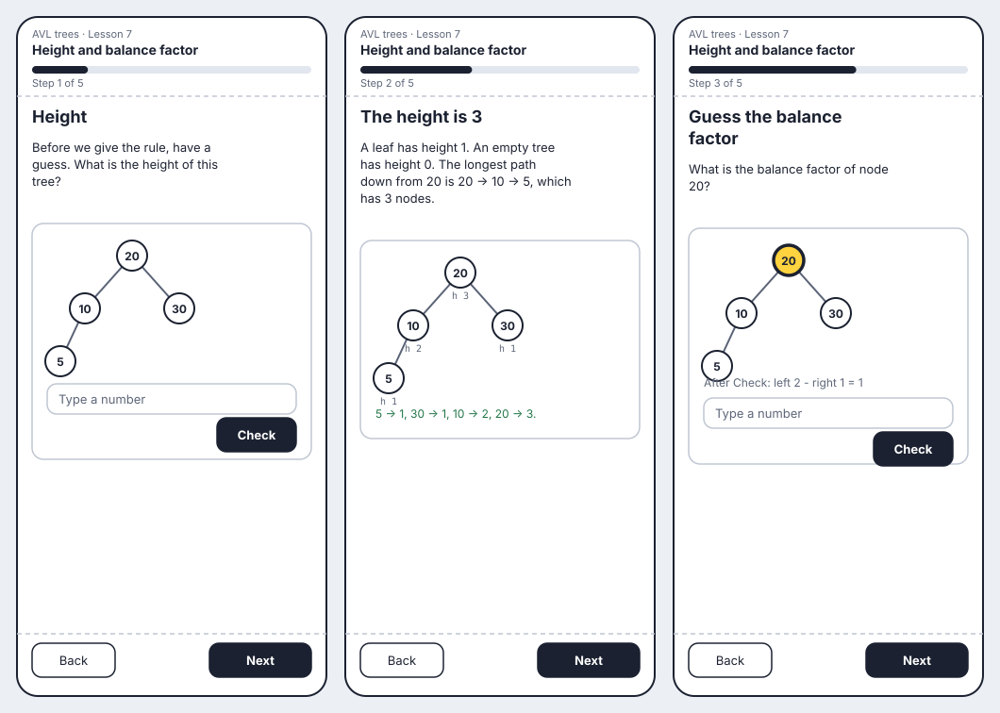
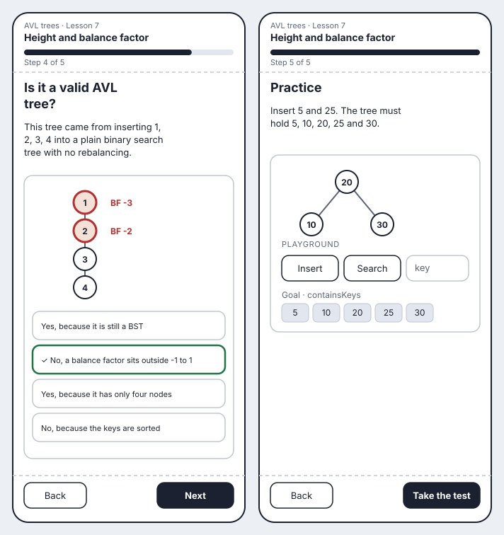
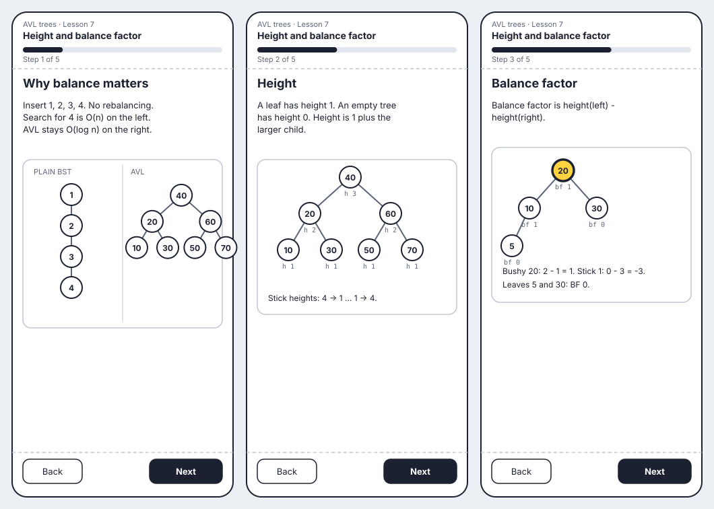
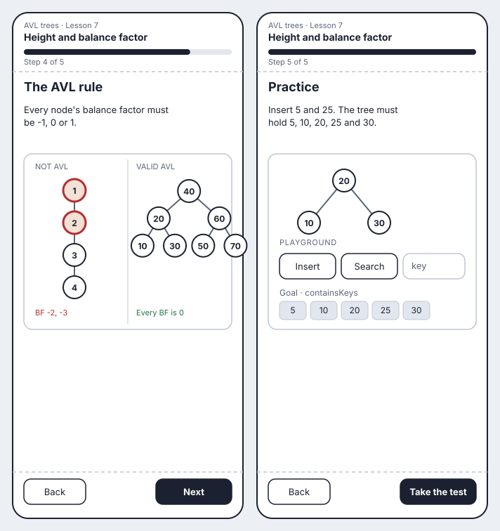

import { Aside, Steps } from "@astrojs/starlight/components";

Lesson 7 opens the AVL unit. The learner already knows binary search trees and traversals. This lesson teaches why a tree that is a line is slow, then defines height and balance factor, then the AVL rule that every balance factor is -1, 0 or 1. We made five low-fidelity storyboards. Each one covers the full lesson and the end playground, with the real student text.

Staging cannot draw a stick from `startingKeys` or animation inserts: those paths use AVL insert and rebalance. The stick lives in prose and ASCII. Diagrams show bushy trees. Height and balance numbers sit in captions and text, not on a `heights` block.

## A: Stick first

The lesson opens with the horror story: sorted inserts with no rebalancing turn a search tree into a stick, and search becomes O(n). Height and balance factor then explain *what* went wrong, and the AVL rule is the fix.

<Steps>

1. The learner reads why balance matters. Inserting `1`, `2`, `3`, `4` with no rebalancing makes a stick. Search for `4` walks every node, so it is O(n), not O(log n).

2. The learner sees a bushy AVL tree of the same idea: seven keys, short paths. AVL insert keeps the tree bushy. The on-screen tree is not a stick.

3. The learner reads the height rule. A leaf has height 1. An empty tree has height 0. Height is 1 plus the larger child height. On the tree `20, 10, 30, 5` the heights are `5 → 1`, `30 → 1`, `10 → 2`, `20 → 3`.

   

   *Figure 1: A · Stick first, steps 1 to 3. Own work, low-fidelity prototype.*

4. The learner reads that balance factor is left height minus right height. Node 20 is highlighted. Left height 2, right height 1, so BF = 1.

5. The learner reads the AVL rule: every BF is -1, 0 or 1. A bushy tree has every BF 0. The stick from the first step has BF -2 and -3, so it is not AVL.

6. The learner inserts 5 and 25 on a playground that starts with 20, 10 and 30. Search is allowed. The goal is that the tree contains 5, 10, 20, 25 and 30.

   

   *Figure 2: A · Stick first, steps 4 to 6. Own work, low-fidelity prototype.*

</Steps>

**Playground:** start with 20, 10 and 30. Insert 5 and 25. Allowed operations are insert and search. The goal is `containsKeys` for 5, 10, 20, 25 and 30. AVL insert keeps the tree valid while they work.

## B: Definition first

Height, then balance factor, then the AVL rule. The stick and the O(n) search come late, as the reason the rule exists.

<Steps>

1. The learner reads the height definition first: leaf 1, empty 0, node = 1 + max of the children.

2. The learner reads the balance-factor formula: left height minus right height.

3. The learner works the small tree `20, 10, 30, 5` and writes each height, then each BF.

   

   *Figure 3: B · Definition first, steps 1 to 3. Own work, low-fidelity prototype.*

4. The learner reads the AVL rule on a bushy tree where every BF is 0.

5. The learner finally sees why the rule matters: the stick from sorted inserts, heights 4 down to 1, BF -3 and -2, search O(n).

6. The same playground: insert 5 and 25.

   

   *Figure 4: B · Definition first, steps 4 to 6. Own work, low-fidelity prototype.*

</Steps>

**Playground:** the same insert / search task with `containsKeys`.

## C: Badge on every node

Every node shows `h` and `bf` under the circle, like a labelled diagram. The learner reads the numbers instead of computing them first.

<Steps>

1. The learner sees a bushy AVL tree with height and balance-factor badges on every node, and a short line that AVL keeps the tree bushy.

2. The same badges on the stick, written in text: `1` has height 4 and BF -3, `2` has height 3 and BF -2. Search walks the whole line.

3. The learner uses the badges to see that height is 1 plus the larger child, and BF is left minus right.

   

   *Figure 5: C · Badge on every node, steps 1 to 3. Own work, low-fidelity prototype.*

4. The AVL rule is checked against the badges: bushy tree all `bf 0`, stick `bf -2` and `-3` illegal.

5. The playground.

   

   *Figure 6: C · Badge on every node, steps 4 and 5. Own work, low-fidelity prototype.*

</Steps>

**Playground:** insert 5 and 25 so the tree holds 5, 10, 20, 25 and 30.

## D: Guess then reveal

The learner guesses height and balance factor on a small tree, then sees the worked answer. The AVL check is a multiple-choice guess on the stick.

<Steps>

1. The learner sees `20, 10, 30, 5` and guesses the height of the tree before the definition is given.

2. The answer is revealed: 3. Then the definition: leaf 1, empty 0.

3. The learner guesses the balance factor of 20, then sees BF = 2 − 1 = 1 and the formula.

   

   *Figure 7: D · Guess then reveal, steps 1 to 3. Own work, low-fidelity prototype.*

4. The learner guesses whether the stick `1, 2, 3, 4` is a valid AVL tree, then sees that node 1 has BF -3 and node 2 has BF -2.

5. The playground.

   

   *Figure 8: D · Guess then reveal, steps 4 and 5. Own work, low-fidelity prototype.*

</Steps>

**Playground:** the same insert / search task.

## E: Compare two trees

A split screen: plain BST stick on the left, bushy AVL on the right. Height, BF and the AVL rule are always a comparison.

<Steps>

1. Side by side: the stick from inserting 1, 2, 3, 4 with no rebalancing, versus a bushy AVL of seven keys. Search is O(n) on the left and O(log n) on the right.

2. Heights on the bushy tree, still next to the stick's heights in the caption.

3. Balance factors on the bushy tree, with node 20 highlighted.

   

   *Figure 9: E · Compare two trees, steps 1 to 3. Own work, low-fidelity prototype.*

4. The AVL rule on the same split: every BF 0 on the right, BF -2 and -3 illegal on the left.

5. The playground.

   

   *Figure 10: E · Compare two trees, steps 4 and 5. Own work, low-fidelity prototype.*

</Steps>

**Playground:** insert 5 and 25. Goal `containsKeys`.

## Decision

<Aside type="tip" title="We picked A the stick-first approach">
</Aside>

### Why we chose the stick-first approach

- The point of the AVL unit is *why* we rebalance. Opening with the stick makes that cost real before the definitions.
- COS212 asks for height, balance factor and the |BF| ≤ 1 rule. Those still get full steps, but they now answer a problem the learner has already seen.
- Staging cannot draw a non-AVL tree from inserts, so teaching the stick in prose first (and the bushy AVL as a diagram) matches what the product can actually show.
- Captions and transcripts carry the numbers. That works for reading, TTS, and the generators (`height`, `balance-factor`, `is-avl`), which use the same leaf-1 / empty-0 wording.
- The playground still lets the learner insert and search on a live tree without inventing a `validAvl` goal that would already be true after AVL inserts.

### Why we dropped the others

- **B: Definition first.** Clear and matches a textbook, but the learner spends three steps on formulas before they know why a stick is bad. Height without a reason to care is easy to skip.
- **C: Badge on every node.** Easy to read, but staging diagrams cannot draw per-node height or BF badges. Shipping this would promise UI we do not have. We keep the numbers in captions instead.
- **D: Guess then reveal.** Active early, but a learner with no definition guesses at random. The generators already do "apply height / BF / is-AVL" after the lesson; the lesson itself should teach first.
- **E: Compare two trees.** The contrast is strong, but a lasting split screen is two ideas at once, and the stick still cannot be a live `startingKeys` tree. A then a bushy diagram is the same contrast, in the order the product can render.
