import { Aside, Badge, Steps } from "@astrojs/starlight/components";

We made five low-fidelity storyboards of different ways to teach the pre-order traversal lesson.

## A: Code first 

This prototype leads with the algorithm. The learner reads the rules, then the code, then watches the code run with the call stack.

<Steps>

1. The learner reads what traversal is and what pre means.

2. The learner sees the left and the right subtrees with a box drawn around them on the tree, to better highlight them.

3. The learner is shown the pseudocode and talked through what each line does.

   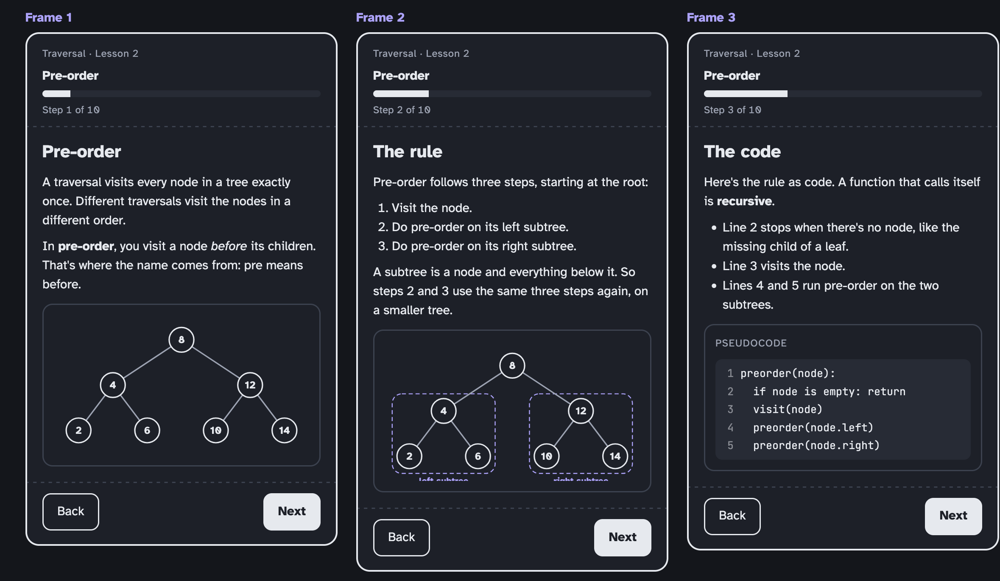

   *Figure 1: A · Code first, steps 1 to 3. Own work, low-fidelity prototype.*

4. The learner is walked through a trace of a small tree. As they step through the code, they also step through the tree and the call stack at the same time, so they see how one step affects both.

5. The learner is shown how the call stack works and why it behaves the way it does.

6. The learner is shown a larger tree and can step through it, viewing the tree, code and call stack all at the same time.

   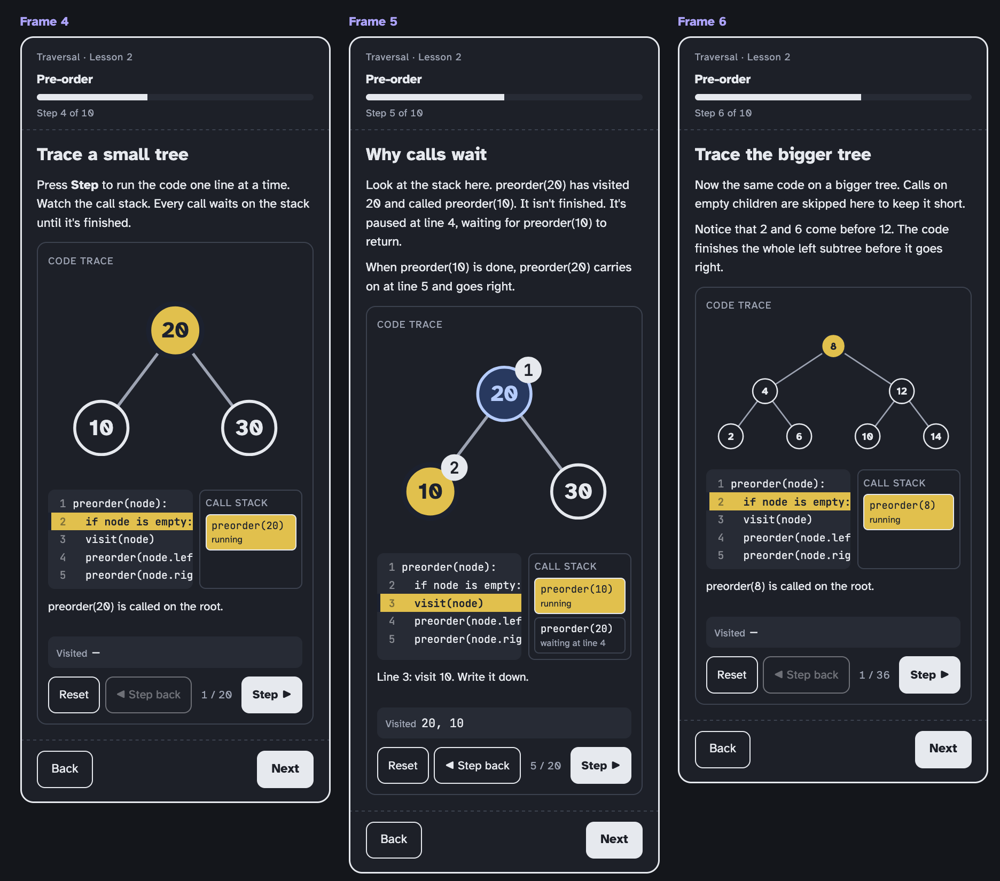

   *Figure 2: A · Code first, steps 4 to 6. Own work, low-fidelity prototype.*

7. The learner is given a quick multiple choice quiz.

8. The learner learns where a pre-order traversal would be used.

9. The learner is taken to a playground where they can trace random trees.

   

   *Figure 3: A · Code first, steps 7 to 9. Own work, low-fidelity prototype.*

10. The learner makes notes on what they just learned.

    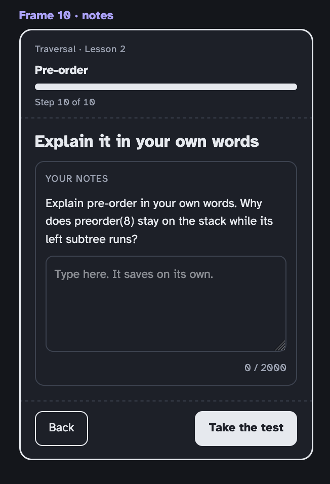

    *Figure 4: A · Code first, step 10, the notes step. Own work, low-fidelity prototype.*

</Steps>

**Playground:** the learner taps the node that line 3 visits next. The code and the call stack update as they go. Each wrong tap gives a bigger hint. A tree with no mistakes adds to their streak.

## B: Walk around the tree

An ant walks around the outside of the tree and writes a node down the first time it passes it, on its left side.

<Steps>

1. The learner drags the ant around a 3-node tree to see the walk.

2. The learner drags the ant around the 7-node tree, and each node gets a number when the ant first passes it.

3. The learner sees why the walk gives the rule: root, then left, then right.

   

   *Figure 5: B: Walk around the tree, steps 1 to 3. Own work, low-fidelity prototype.*

4. The learner walks a tree with a missing child, to see how gaps are handled.

5. The learner steps through the walk as code, with the call stack.

6. The learner answers a quick quiz 

   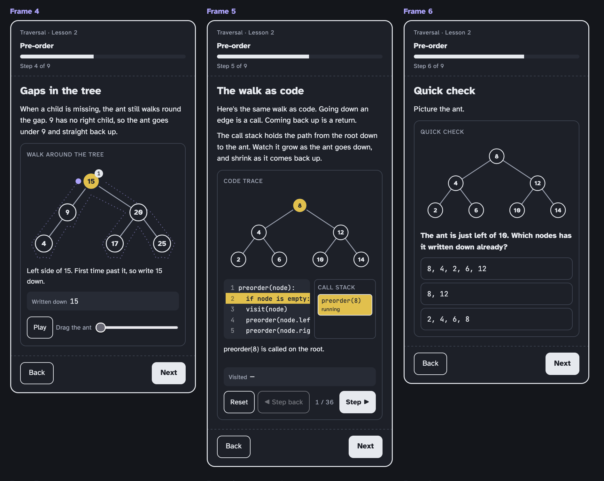

   *Figure 6: B: Walk around the tree, steps 4 to 6. Own work, low-fidelity prototype.*

7. The learner sees where pre-order traversal is used.

8. The learner is taken to a playground where they tap nodes in the order the ant would write them.

9. The learner makes notes.

   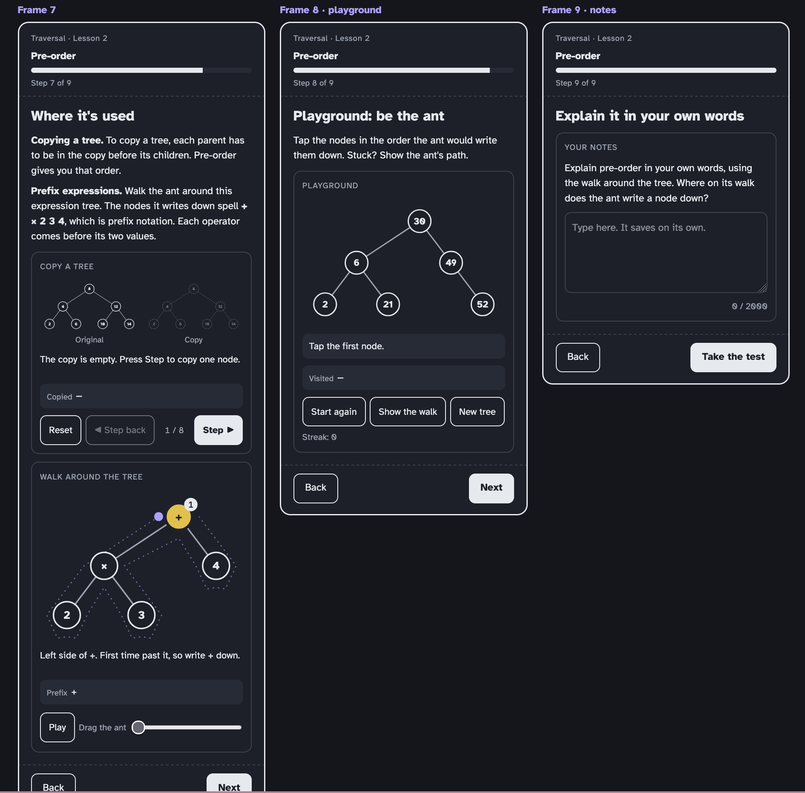

   *Figure 7: B · Walk around the tree, steps 7 to 9. Own work, low-fidelity prototype.*

</Steps>

**Playground:** random trees. The learner taps nodes in the order the ant would write them down. "Show the walk" draws the ant's path as a hint. 

## C: Guess first

The learner guesses the order, sees which parts they got right, and only then gets the rule.

<Steps>

1. The learner taps a 3-node tree in the order they think it goes, then checks their guess.

2. The learner sees the right order and the rule.

3. The learner guesses the order of the bigger 7-node tree.

   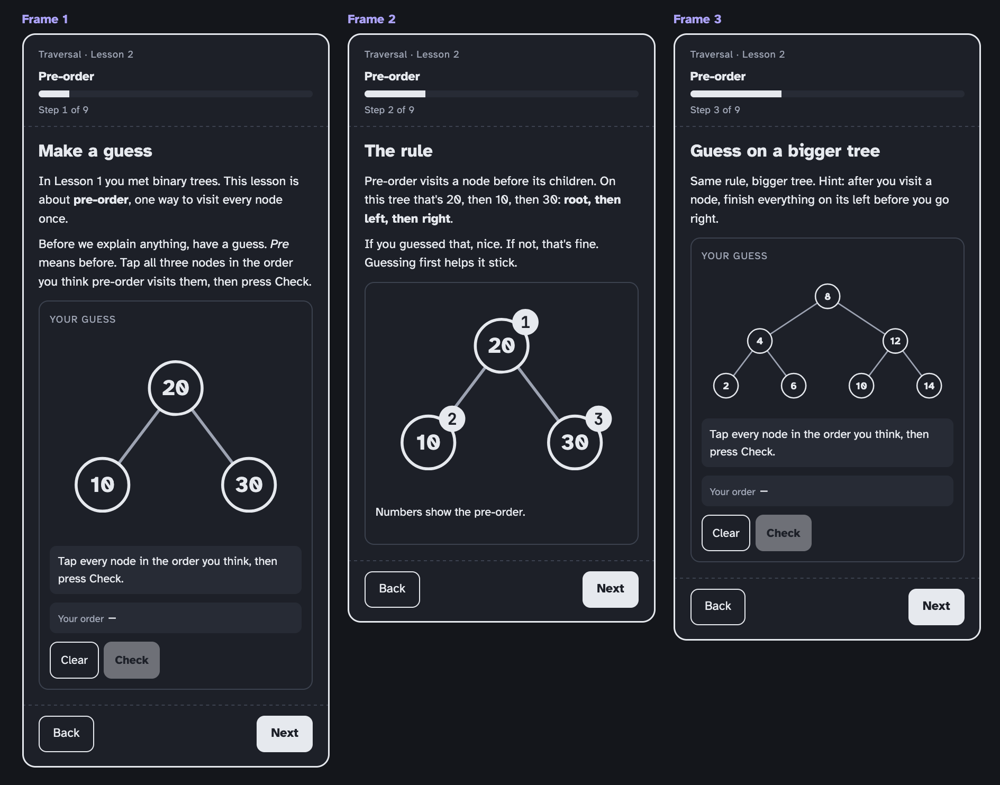

   *Figure 8: C · Guess first, steps 1 to 3. Own work, low-fidelity prototype.*

4. The learner reads about a common confusion 

5. The learner steps through how the computer does it, with the code trace and the call stack.

6. The learner guesses the stack.

   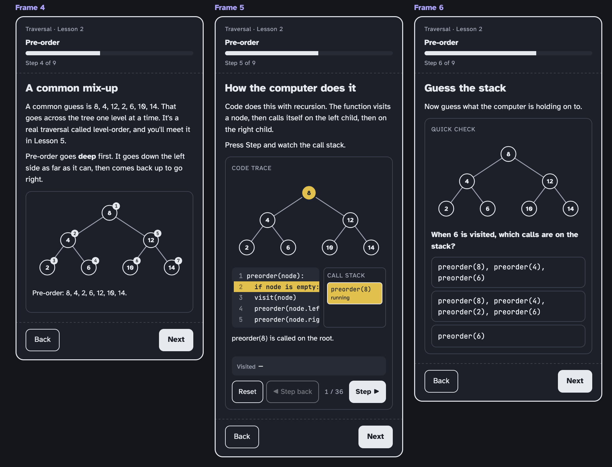

   *Figure 9: C · Guess first, steps 4 to 6. Own work, low-fidelity prototype.*

7. The learner guesses the pre-order of an expression tree.

8. The learner is taken to a playground where they tap random trees in pre-order.

9. The learner makes notes on what they guessed at first and what changed their mind.

   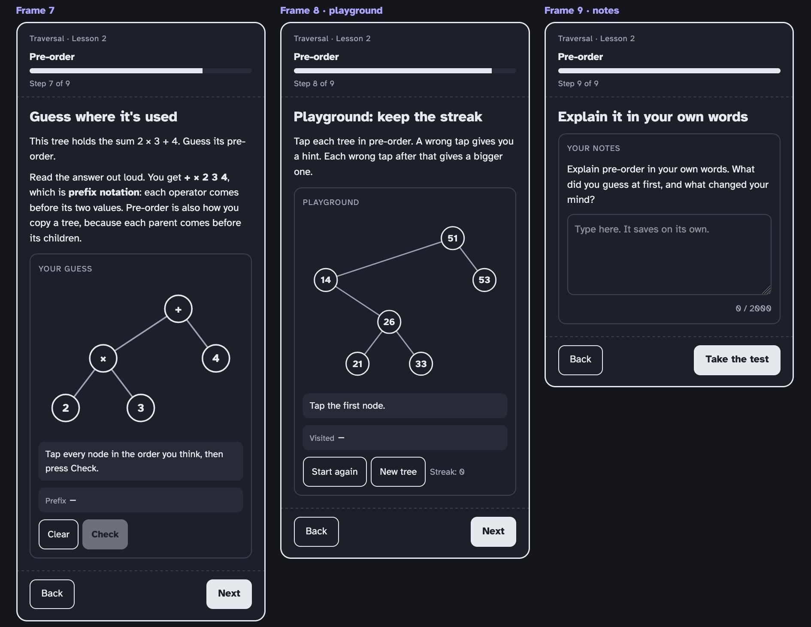

   *Figure 10: C · Guess first, steps 7 to 9. Own work, low-fidelity prototype.*

</Steps>

**Playground:** random trees, one after another. Each wrong tap gives a hint. A streak counter tracks trees with no mistakes.

## D: Start with a use

Copying a tree and prefix expressions are introduced first.

<Steps>

1. The learner steps through copying a tree, one node at a time.

2. The learner sees that parents have to come first.

3. The learner sees that trees can hold maths, and steps through an expression tree.

   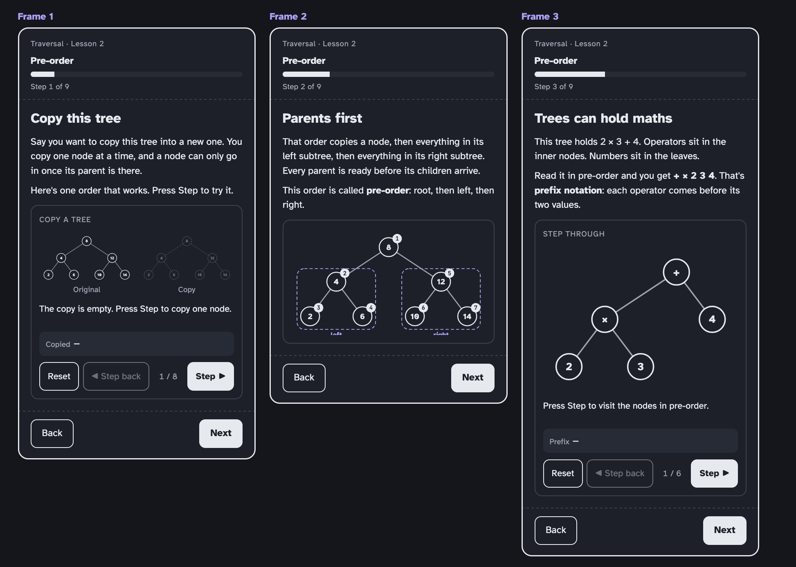

   *Figure 11: D · Start with a use, steps 1 to 3. Own work, low-fidelity prototype.*

4. The learner works a prefix expression down to one number.

5. The learner sees that prefix does not need brackets

6. The learner steps through how the code does it, with the call stack.

   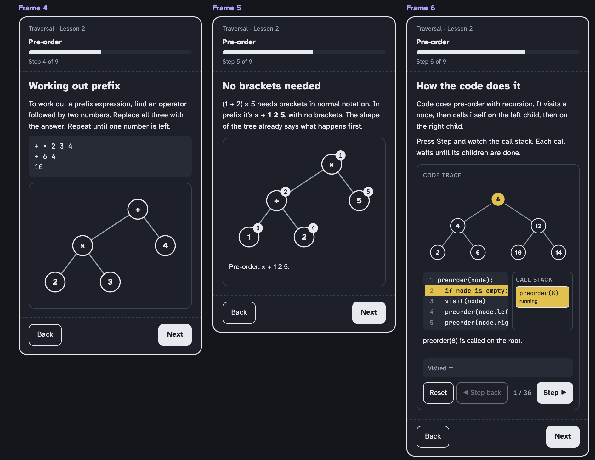

   *Figure 12: D · Start with a use, steps 4 to 6. Own work, low-fidelity prototype.*

7. The learner answers a quick quiz.

8. The learner is taken to a playground where they build prefix expressions from random expression trees.

9. The learner makes notes on why copying needs each parent before its children.

   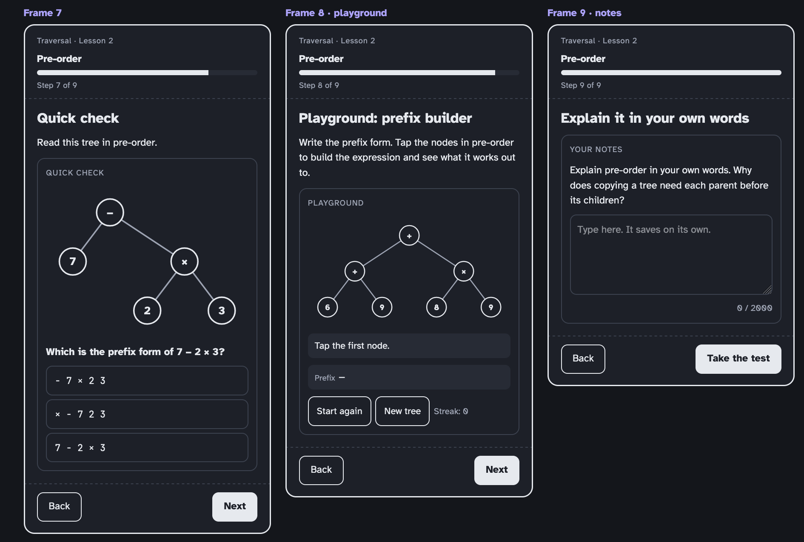

   *Figure 13: D · Start with a use, steps 7 to 9. Own work, low-fidelity prototype.*

</Steps>

**Playground:** random expression trees. The learner taps the nodes in pre-order to build the prefix expression.

## E: Examples that fade

Shows worked examples first, then the same task with less and less help until the learner does it alone.

<Steps>

1. The learner reads the rules and the pseudocode.

2. The learner steps through a fully worked trace on a 3-node tree.

3. The learner steps through a fully worked trace on the 7-node tree.

   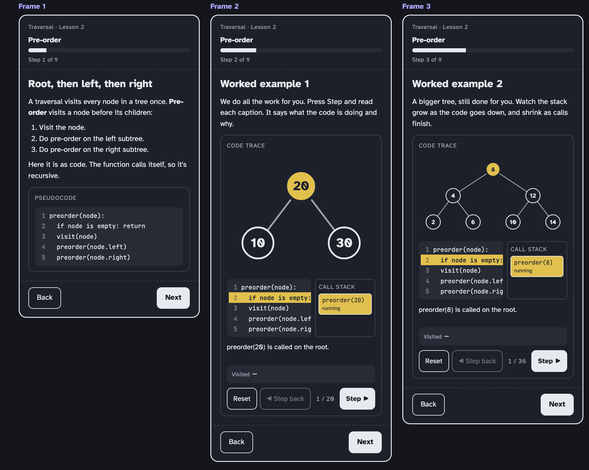

   *Figure 14: E · Examples that fade, steps 1 to 3. Own work, low-fidelity prototype.*

4. The learner finishes a tree with 3 nodes already done, with the call stack shown and hints.

5. The learner finishes a tree with only the root done, with smaller hints.

6. The learner does a whole tree on their own, with no stack and no hints.

   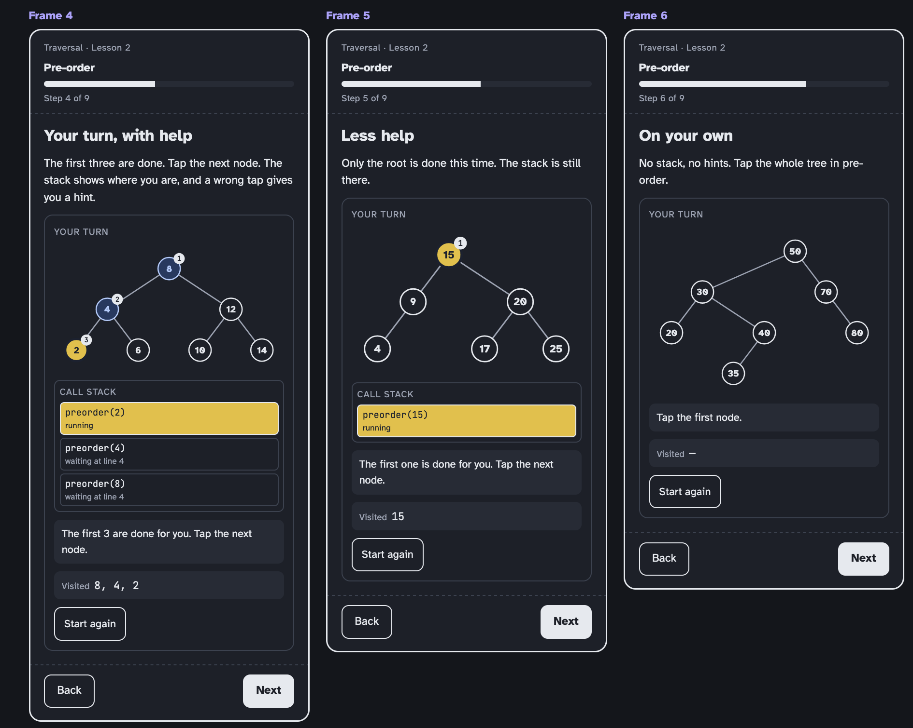

   *Figure 15: E · Examples that fade, steps 4 to 6. Own work, low-fidelity prototype.*

7. The learner sees use cases where pre-order is used

8. The learner is taken to a playground where they tap random trees with no help.

9. The learner makes notes explaining pre-order as if teaching a friend.

   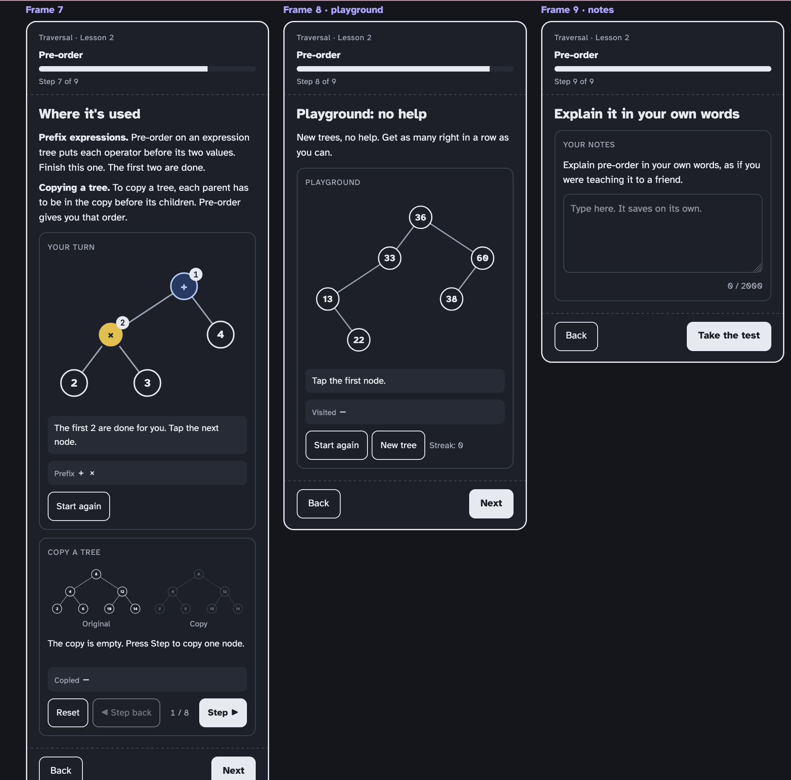

   *Figure 16: E · Examples that fade, steps 7 to 9. Own work, low-fidelity prototype.*

</Steps>

**Playground:** random trees with no stack and no hints. A streak counter tracks trees with no mistakes.

## Decision

<Aside type="tip" title="We picked A the code first approach">
</Aside>

### Why we chose the code first approach 

- The app prepares learners for COS212 lectures, and COS212 expects the learners to be able to code the algorithm. 
- Showing and teaching about the call stack helps the learner better understand how recursion affects the call stack.
- The algorithm, code and captions are things that a learner can read. Having text also makes text-to-speech easy to implement accomodating audio learners. The lesson also has visual accomodates visual learners by showing the tree, call stack and code with lines highlighted. 
