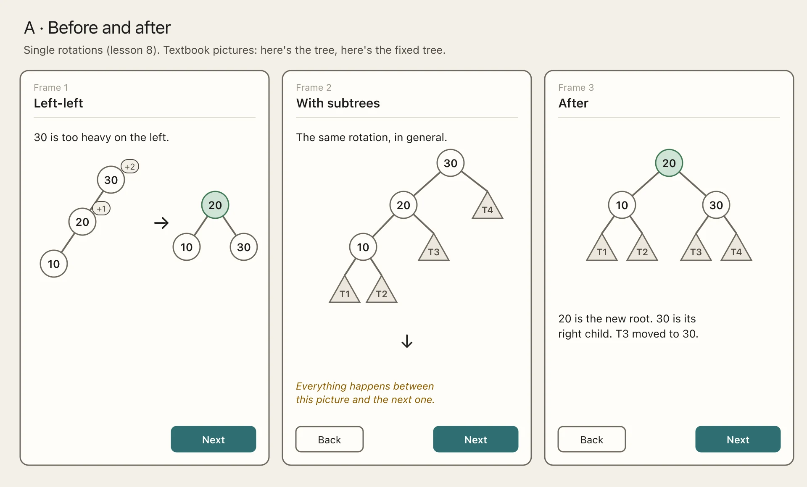
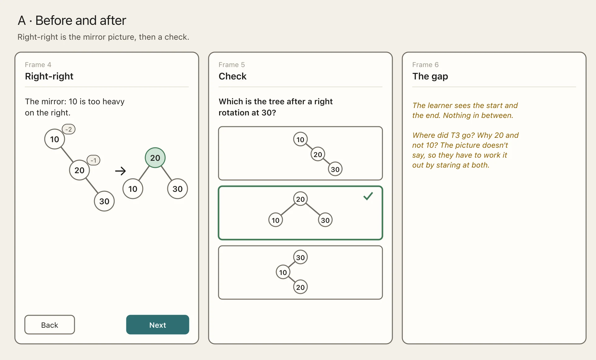
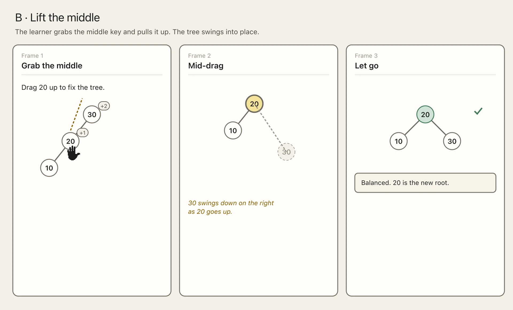
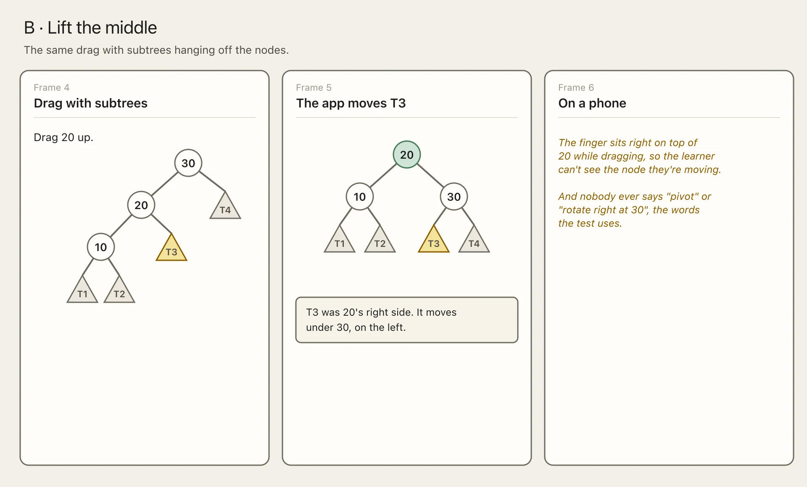
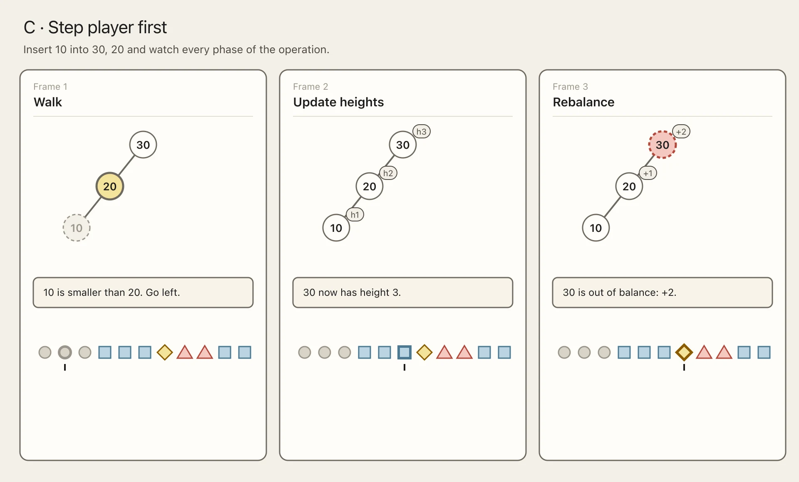
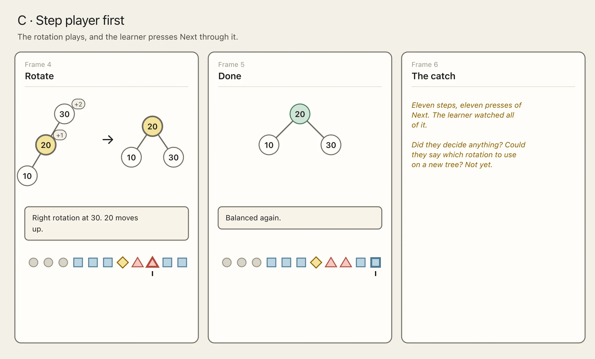
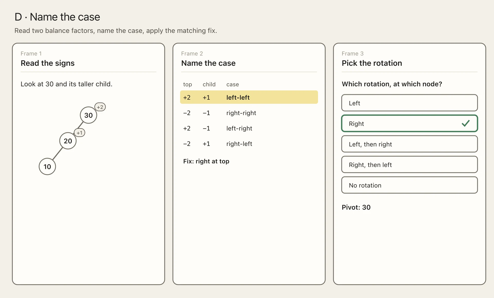
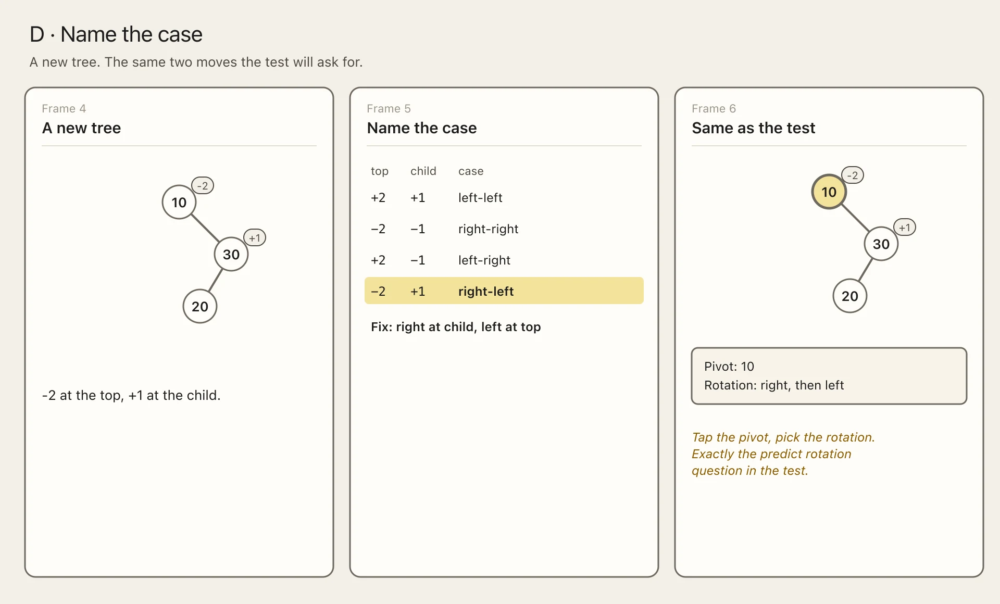
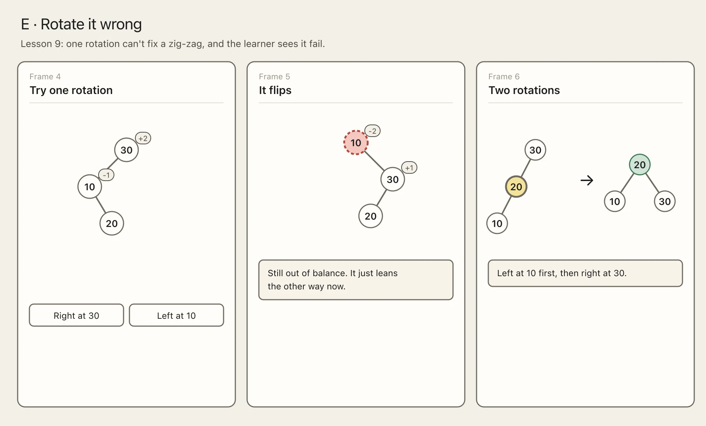

import { Aside, Steps } from "@astrojs/starlight/components";

Rotations are the hardest part of the course. The learner arrives from lesson 7 knowing what height and balance factor are. The learner does not know what to do on an AVL tree when a node has a balance factor of +2 or -2. Lesson 8 tackles single rotations and covers left-left and right-right. Lesson 9 tackles double rotations and covers left-right and right-left.

Lesson 8's objective is for the learner to be able to "Fix a left-left or right-right imbalance with one rotation" and Lesson 9's objective is for the learner to be able to "Fix a left-right or right-left imbalance with two rotations". The [objectives](../../../objectives/) page splits both into recognising the case (Analyse) and doing the rotation (Apply). That split is why the lessons should let the learner name the case before anything moves.

We designed both lessons together over three rounds of [SAM 2](../../../approach/).

## Savvy start

### A: Before and after

A picture of the unbalanced tree, an arrow, a picture of the fixed tree. Then the same with subtrees, then the mirror case.

<Steps>

1. The learner sees the left-left chain 30, 20, 10 with +2 and +1 on it, an arrow, and the balanced tree with 20 on top.

2. The learner sees the same rotation drawn with subtree triangles T1 to T4 hanging off 30, 20 and 10.

3. The learner sees the result, with 20 on top and T3 now under 30.

   

   *Figure 1: A · Before and after, left-left*

4. The learner sees the mirror picture, a right-right chain 10, 20, 30, fixed the same way.

5. The learner picks which of three trees comes after a right rotation at 30.

   

   *Figure 2: A · Before and after, right-right and a check*

</Steps>

### B: Lift the middle

The learner grabs the middle key and drags it up, and the rest of the tree swings into place under it.

<Steps>

1. The learner drags 20 up out of the chain 30, 20, 10.

2. The learner sees 30 swing down on the right as 20 rises.

3. The learner lets go and sees the balanced tree with a tick.

   

   *Figure 3: B · Lift the middle, the chain*

4. The learner drags 20 up again, this time with subtrees T1 to T4 hanging off the nodes.

5. The learner sees T3 move from under 20 to under 30, with a message saying why.

   

   *Figure 4: B · Lift the middle, with subtrees*

</Steps>

### C: Step player first

Insert 10 into 30, 20 and let the step player walk through every phase. Each phase has its own shape in the dot row.

<Steps>

1. The learner watches 10 walk down the tree, on a grey circle dot.

2. The learner watches the heights update up the path, on blue square dots.

3. The learner sees 30 marked +2 on a yellow diamond dot.

   

   *Figure 5: C · Step player first, the walk, heights and rebalance*

4. The learner watches the right rotation at 30 on red triangle dots, with 20 moving up.

5. The learner sees the balanced tree and every dot passed.

   

   *Figure 6: C · Step player first, the rotation*

</Steps>

### D: Name the case

Read two balance factors, the unbalanced node's and its taller child's, look up which of the four cases that is, and the case tells you the fix.

<Steps>

1. The learner reads +2 on 30 and +1 on 20.

2. The learner finds +2 and +1 in the case table and sees "left-left, fix: right at top".

3. The learner picks Right from five rotation options and sees 30 named as the pivot.

   

   *Figure 7: D · Name the case, left-left*

4. The learner reads -2 on 10 and +1 on its child 30.

5. The learner finds right-left in the table: right at the child, then left at the top.

6. The learner taps 10 as the pivot and picks "Right, then left".

   

   *Figure 8: D · Name the case, right-left*

</Steps>

### E: Rotate it wrong

The learner gets the buttons before the rule, picks a node and a direction, and finds out for themselves why the pivot and the case matter.

<Steps>

1. The learner is asked to fix the chain 30, 20, 10 by picking a node and a direction.

2. The learner rotates right at 20 and gets a zig-zag that's still +2 at 30.

3. The learner rotates right at 30 instead and reads that the pivot is the lowest node that's out of balance.

   

   *Figure 9: E · Rotate it wrong, the wrong pivot*

4. The learner tries one rotation on the zig-zag 30, 10, 20.

5. The learner sees it flip into 10, 30, 20, leaning the other way and still out of balance.

6. The learner sees two rotations fix it, left at 10 and then right at 30.

   

   *Figure 10: E · Rotate it wrong, the zig-zag*

</Steps>

### Review

We went through all five as a team.

A didn't work. Everything important happens between the two pictures.

B was the most fun, but the learner never has to name anything.

C let you step through the whole thing, which we liked. But after eleven presses of Next, the learner still hasn't decided anything.

D was the [predict rotation](../../assessment/question-types/) question from the test, taught slowly.

E was a guessing game on single rotations. With three nodes and two buttons you could guess it correctly.

What we carried forward:

- D's case table as the spine of both lessons.
- C's step player to show each fix happening, now that the learner knows what to expect.
- E as the opener for lesson 9 only.
- B's drag as an optional block for kinesthetic learners.

## Design 2

### Name the case, then watch it

Each case gets named first and then the step player plays the fix, so the learner watches a rotation they've already predicted. Both lessons end in the playground with auto-balance off, so the learner can tip a tree on purpose and fix it.

<Steps>

1. The learner reads +2 on 30 and +1 on 20 and picks left-left.

2. The learner watches the step player rotate right at 30 and reads that 20 moves up and 30 becomes its right child.

3. The learner sees the same rotation with subtrees, with T3 moving from 20 to 30.

   

   *Figure 11: Design 2 · Name the case, then watch it, lesson 8*

4. The learner opens lesson 9 and is asked whether a right rotation at 30 fixes the zig-zag 30, 10, 20.

5. The learner finds left-right in the case table, with its two-rotation fix.

6. The learner tips a tree in the playground with auto-balance off, picks the pivot and rotates it.

   

   *Figure 12: Design 2 · Name the case, then watch it, lesson 9 and the playground*

</Steps>

### Review

Naming then watching worked. You make your call, then the step player shows you if you were right. And the lesson 9 opener landed.

Two problems. The full case table on step 1 was too much. Four rows of signs and words, and the learner hasn't seen a single rotation yet. So design 3 teaches left-left on its own, then right-right as its mirror, and saves the table for the end of lesson 8. Lesson 9 adds its two rows.

The subtrees came too soon too. Two steps after the chain, four triangles moving at once was hard to follow.

We also decided to bring B's drag back, as a kinesthetic block on the subtree step.

## Design 3

### Name the case, then watch it, one case at a time

Lesson 8 teaches left-left on its own, chain first and subtrees after, then right-right as its mirror. The case table only shows up at the end, once the learner has seen both cases.

<Steps>

1. The learner reads that a node is out of balance at +2 or -2, and that the fix is a rotation at that node, the pivot.

2. The learner reads +2 on 30 and +1 on 20, hears that this is left-left, and learns its fix: rotate right at 30.

3. The learner presses Step through the right rotation in the step player, watching 20 rise on the red triangle dots.

   :::caution[Add screenshot]
   Lesson 8, step 3: the step player on 30, 20, 10 at the first rotate step, with the dot row showing the walk, height, rebalance and rotate shapes and the message "Right rotation at 30."
   :::

4. The learner steps through the same rotation with subtrees T1 to T4, with T3 highlighted as it moves from 20 to 30, or drags 20 up themselves if the kinesthetic block is picked for them.

5. The learner gets right-right as the mirror, on 10, 20, 30, and steps through the left rotation at 10.

6. The learner watches an AVL insert in the step player and sees the rotation come right after the yellow diamond, the moment the rebalance check finds +2.

7. The learner sees the left-left and right-right rows of the case table side by side, with the fix for each.

8. The learner inserts keys in the playground with auto-balance off until a node tips, then picks the pivot and the rotation to fix it.

9. The learner writes a note on how to tell which way to rotate.

</Steps>

Lesson 9 runs the same way, with three changes. It opens with the learner trying one rotation on a zig-zag and watching it fail. Its cases are left-right and right-left, and the step player plays each one as two rotations. And the case table at the end has all four rows.

### Review

We checked design 3 against the predict rotation question line by line. The question asks for the pivot, and step 1 names the pivot. It asks for the rotation, and steps 2 and 5 name the case and its rotation. "No rotation" is an option in the test too, so step 6's insert includes keys that don't tip anything. Nothing the test asks for is missing from the lesson.

## Decision

<Aside type="tip" title="We picked design 3, name the case then watch it">
Read two balance factors, name the case, pick the rotation, then watch the step player do it, one case at a time.
</Aside>

### Why we picked it

We picked design 3 because the learner practises the same thing the test asks for. In the predict rotation question they pick the node and the rotation, and in design 3 they do that too, before the step player shows them the answer.

We went one case at a time because there's a lot going on in a rotation, and our [learners](../../../learners/) only learned about balance factors in the lesson before. Showing all four cases at once in design 2 was too much.

### CCAF

For lesson 8, step 3, the first rotation in the step player.

| | |
| --- | --- |
| **Context** | The learner is on step 3 of "Single rotations". They've just named 30, 20, 10 as left-left and read that the fix is a right rotation at 30. The step player is paused at the first step, with the dot row underneath. |
| **Challenge** | Follow the rotation and say where 30 ends up. |
| **Activity** | The learner presses Step, or taps the red triangle dot to jump to the rotation, and steps through it at their own pace. |
| **Feedback** | 20 slides up into 30's place and 30 slides down to its right. The message says "Right rotation at 30. 20 moves up, 30 becomes its right child." The balance badges reset to 0, and Listen reads the message out. |

## Design proof

Lesson 8 was built first, as block files in `backend/prisma/content/08-single-rotations/blocks/`. Lesson 9 followed in `09-double-rotations/blocks/`. Both use the step player, the predict rotation question (`predict-rotation-question.tsx`) and the playground with auto-balance off.

![Step 3 of 7 in "Single rotations", "Where the inner subtree goes", as built. The text says the tree has 50 at the root, 30 on its left with children 20 and 40, and 70 on its right. Inserting 10 makes 50 unbalanced with a balance factor of +2, and 30 leans left at +1, so this is left-left. It explains that 40 is the inner subtree and moves across to become the left child of 50 when 30 moves up, and asks the learner to press Play and watch 40 move. Below is the tree 50, 30, 70, 20, 40 with 50 highlighted, the message "50 is here, so this spot isn't empty." at step 1 of 37, and a row of step dots in four shapes, one per phase. A Listen button sits top right, with Back and Continue at the bottom.](../../../../../assets/id/prototypes/rotations/design-proof-inner-subtree.webp)

*Figure 13: Design proof · Lesson 8, step 3, where the inner subtree goes, as built*
