import { Aside, Steps } from "@astrojs/starlight/components";

Lessons 2 to 5 teach the learner how to traverse a tree. The learner does these lessons after lesson 1. At this point it is assumed they have surface-level knowledge of binary search trees and the terminology.

We followed [SAM 2](../../../approach/) and the savvy start generated five ideas which we built on in design 2 and design 3. The five of us reviewed every round.

## Savvy start

### A: Code first

The learner reads the rule, then the code, then traces the running code with the call stack beside it.

<Steps>

1. The learner reads what a traversal is and that the three depth-first orders differ in when a node is visited. They start with pre-order.

2. The learner sees the left and the right subtrees with a box drawn around them on the tree, to highlight them.

3. The learner is shown the pseudocode and talked through what each line does.

   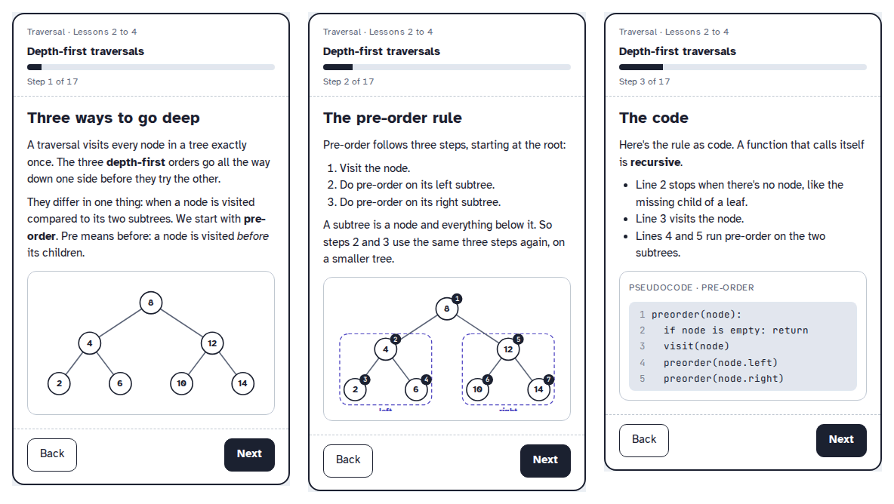

   *Figure 1: A · Code first, steps 1 to 3*

4. The learner is walked through a trace of a small tree. As they step through the code, they also step through the tree and the call stack at the same time.

5. The learner is shown why a call waits on the call stack until the calls below it are done.

6. The learner is shown a larger tree and can step through it, viewing the tree, code and call stack at the same time.

   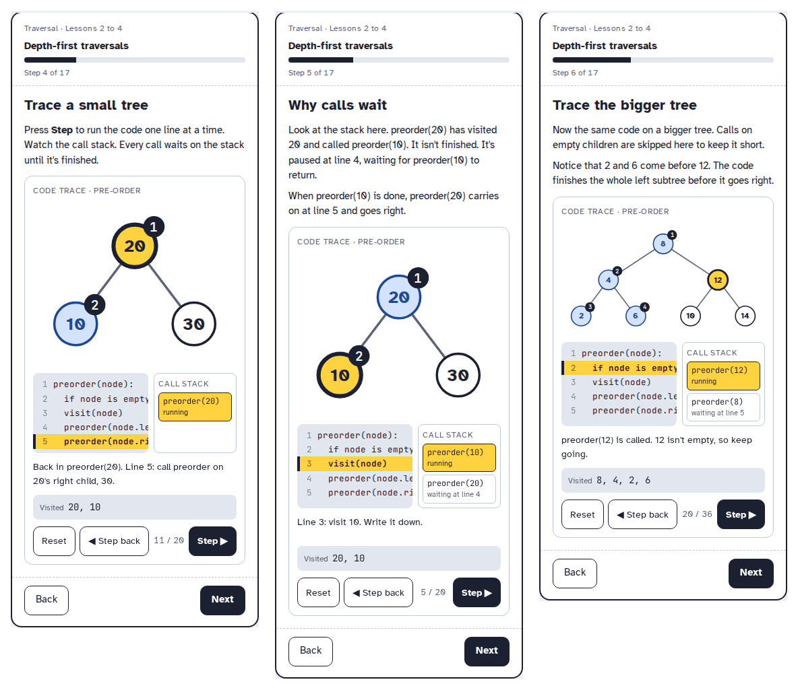

   *Figure 2: A · Code first, steps 4 to 6*

7. The learner learns what pre-order is used for (copying and expressions).

8. The learner moves the visit line between the two recursive calls and traces the result.

9. The learner watches the keys of a search tree land on a number line in sorted order.

   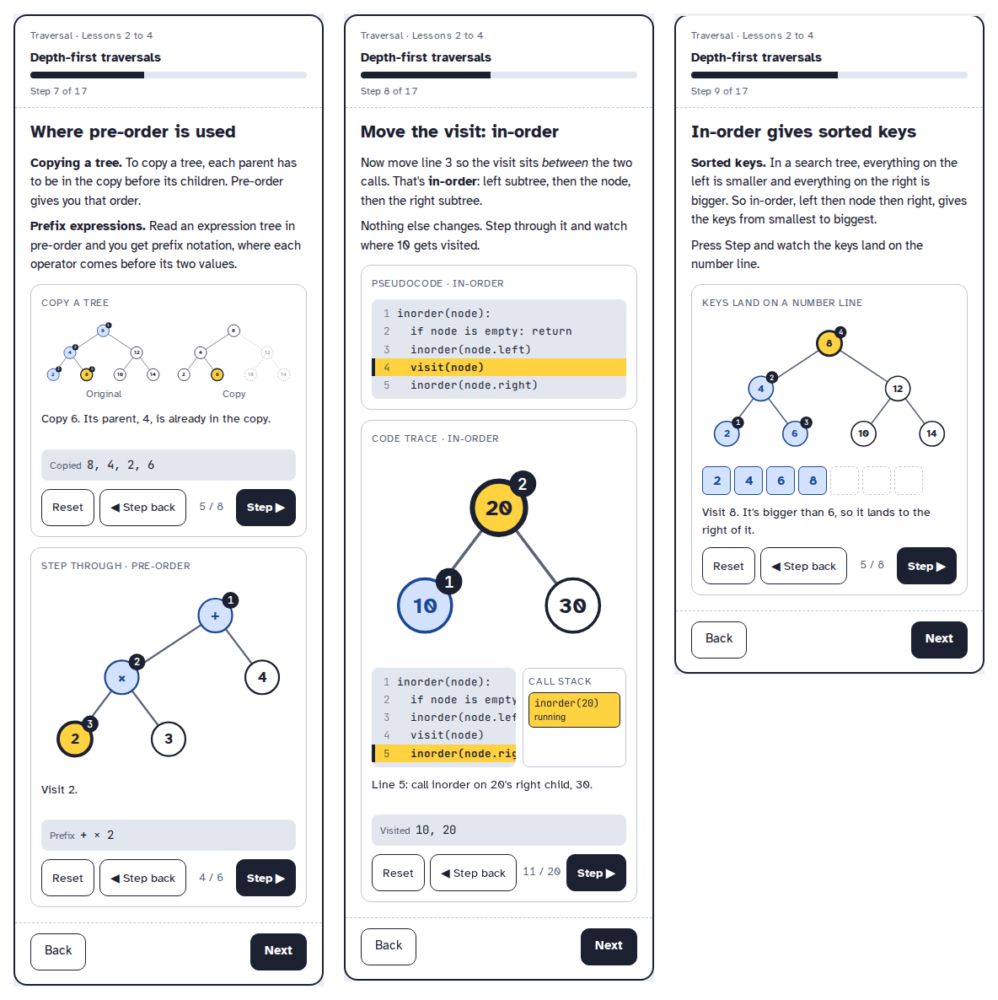

   *Figure 3: A · Code first, steps 7 to 9*

10. The learner sees that the learning path map is drawn in in-order, left to right.

11. The learner moves the visit line to the end and traces the result. That is post-order.

12. The learner learns what post-order is used for (deleting a tree and working out heights).

    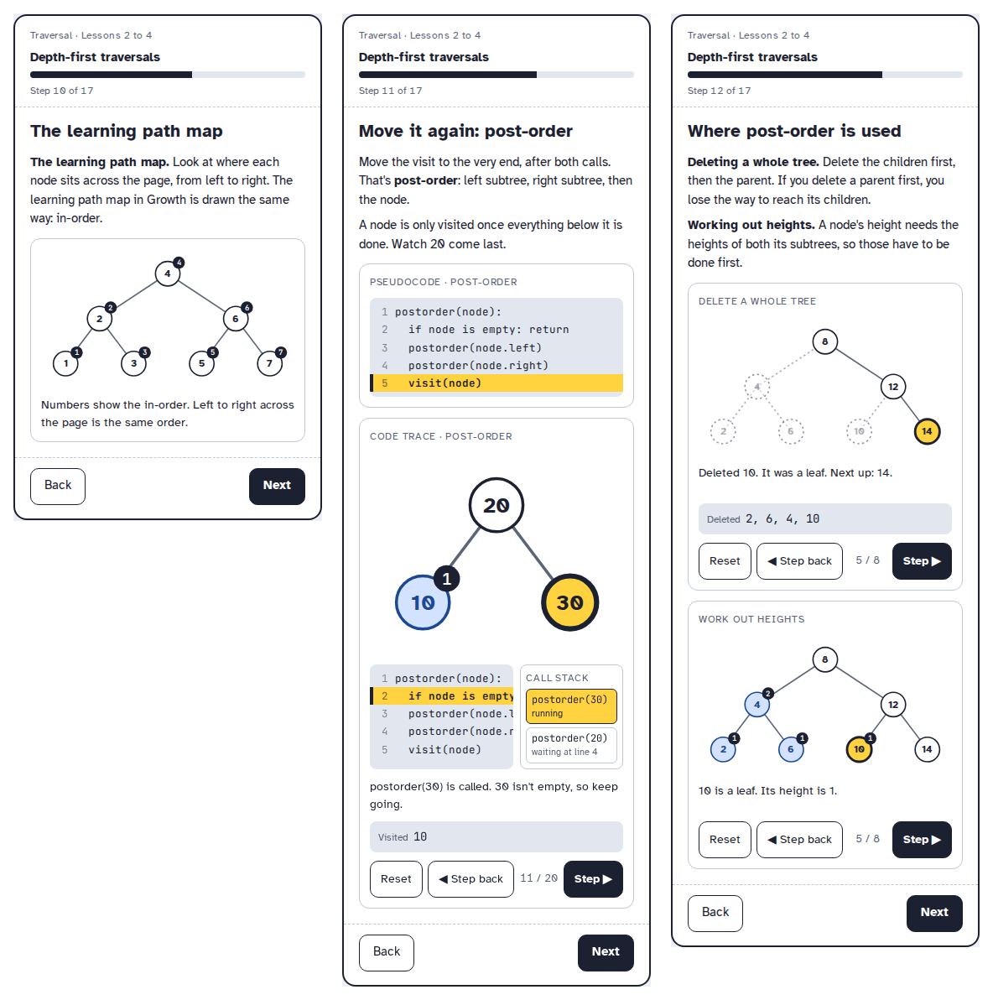

    *Figure 4: A · Code first, steps 10 to 12*

13. The learner steps through an expression tree in post-order and gets a postfix expression.

14. The learner sees all three orders on one tree, next to the three code blocks.

15. The learner is given a quick multiple choice quiz.

    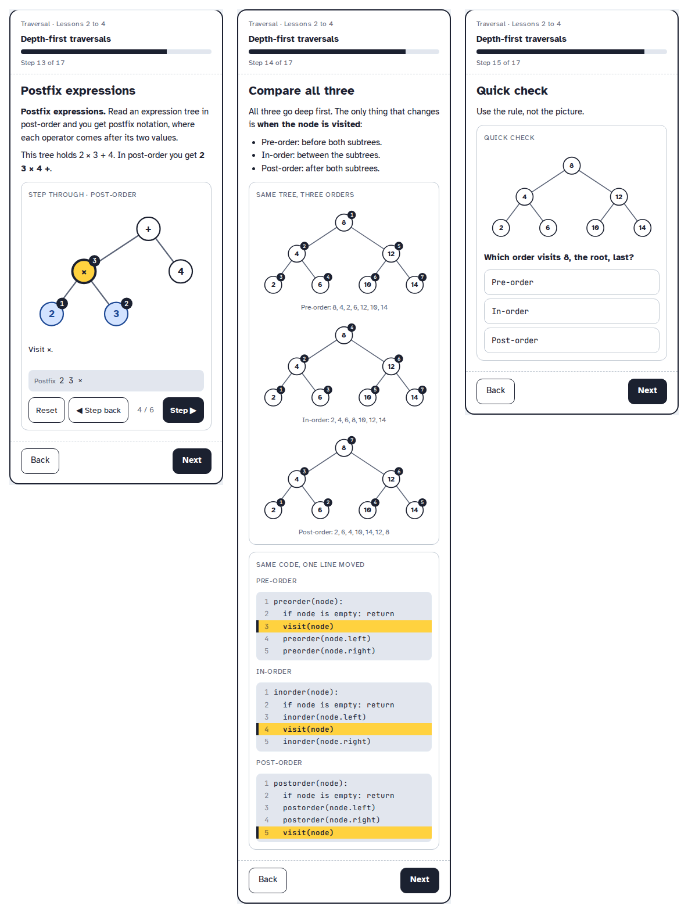

    *Figure 5: A · Code first, steps 13 to 15*

16. The learner is taken to a playground where they can trace random trees in a random order.

17. The learner makes notes on what they just learned.

    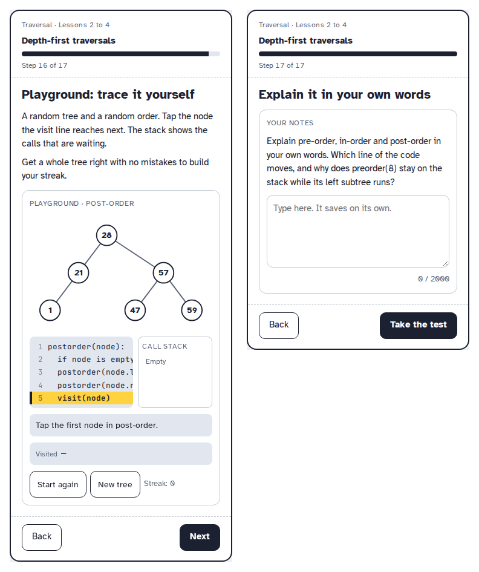

    *Figure 6: A · Code first, steps 16 and 17*

</Steps>

### B: Walk around the tree

An ant walks around the outside of the tree. It passes every node three times, on its left, under it and on its right. Each order writes a node down on a different pass.

<Steps>

1. The learner drags the ant around a 3-node tree to see the walk and the three passes.

2. The learner drags the ant around the 7-node tree. Pre-order writes a node down on the first pass, and each node gets a number.

3. The learner sees why the first pass gives the rule: root, then left, then right.

   

   *Figure 7: B · Walk around the tree, steps 1 to 3*

4. The learner walks the tree again. In-order writes a node down on the second pass, when the ant goes under it.

5. The learner sees that the second pass gives the keys of a search tree in sorted order.

6. The learner sees that the learning path map is drawn in in-order, left to right.

   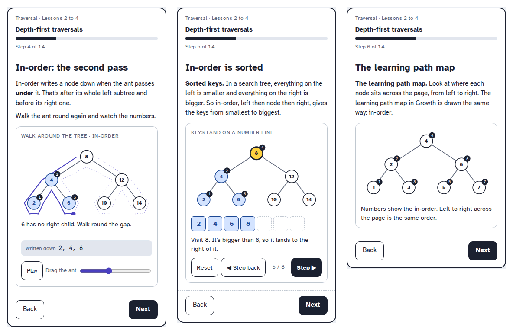

   *Figure 8: B · Walk around the tree, steps 4 to 6*

7. The learner walks the tree a third time. Post-order writes a node down on the last pass, on its right side.

8. The learner walks a tree with a missing child, to see how gaps are handled.

9. The learner steps through the walk as code, with the call stack and the three code blocks.

   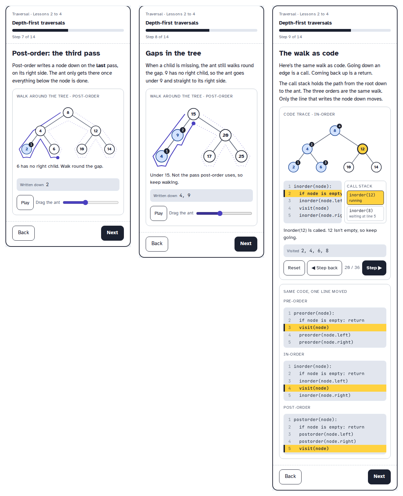

   *Figure 9: B · Walk around the tree, steps 7 to 9*

10. The learner sees that pre-order is used to copy a tree and to write prefix expressions.

11. The learner sees that post-order is used to delete a tree, work out heights and write postfix expressions.

12. The learner sees all three orders on one tree and answers a quick quiz about where the ant is.

    

    *Figure 10: B · Walk around the tree, steps 10 to 12*

13. The learner is taken to a playground where they tap nodes in the order the ant would write them, for a random order.

14. The learner makes notes.

    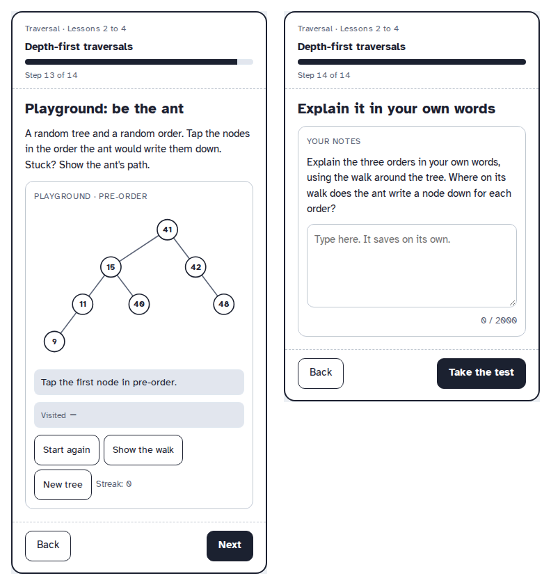

    *Figure 11: B · Walk around the tree, steps 13 and 14*

</Steps>

### C: Guess first

The learner guesses the order, sees which parts they got right, and only then gets the rule. This repeats for each order.

<Steps>

1. The learner taps a 3-node tree in the order they think pre-order goes, then checks their guess.

2. The learner sees the right order and the rule.

3. The learner guesses the pre-order of the bigger 7-node tree.

   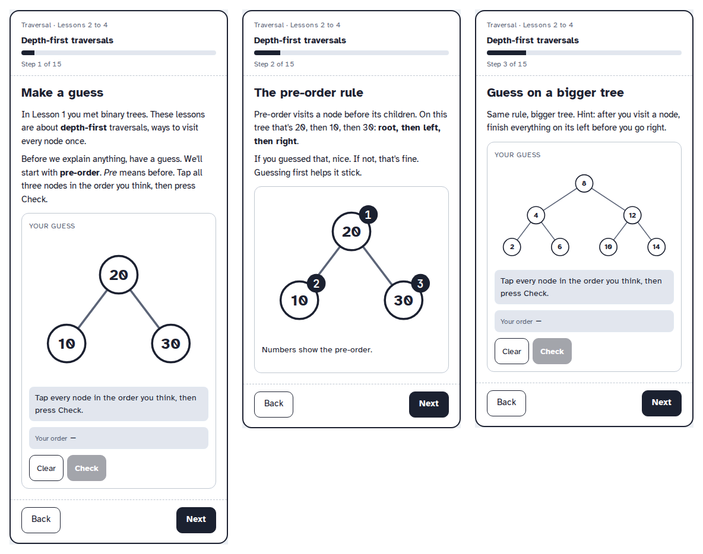

   *Figure 12: C · Guess first, steps 1 to 3*

4. The learner reads about a common confusion with level-order.

5. The learner steps through how the computer does it, with the code trace and the call stack.

6. The learner guesses the stack.

   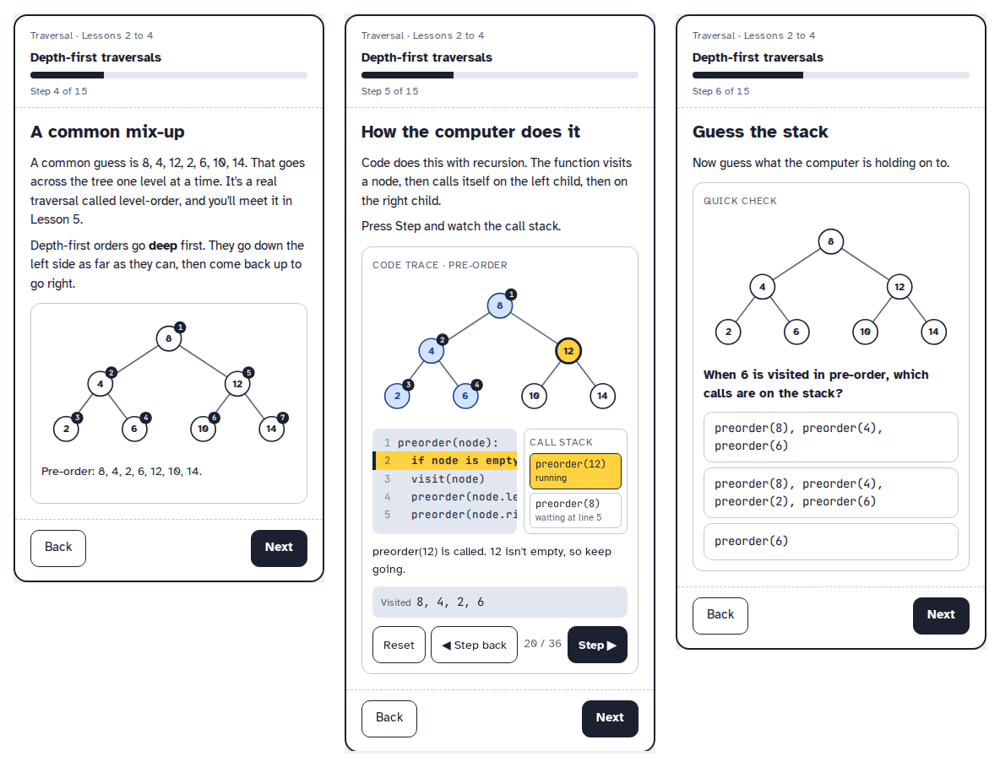

   *Figure 13: C · Guess first, steps 4 to 6*

7. The learner guesses the in-order of the same 3-node tree.

8. The learner sees that the in-order of a search tree is sorted.

9. The learner sees that the learning path map is drawn in in-order.

   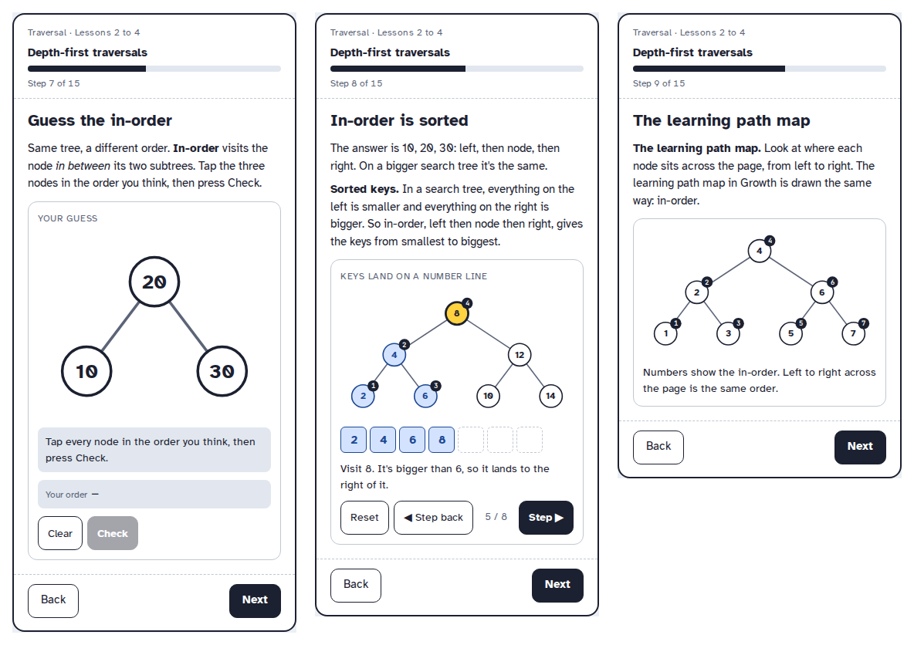

   *Figure 14: C · Guess first, steps 7 to 9*

10. The learner guesses the post-order of the 3-node tree.

11. The learner guesses the post-order of an expression tree and gets a postfix expression.

12. The learner sees a tree being deleted and guesses what goes wrong if the root is deleted first.

    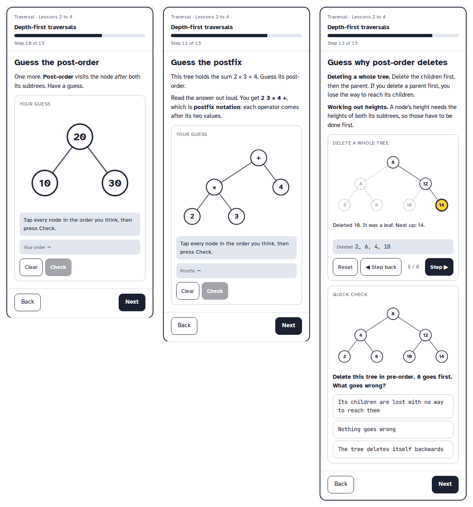

    *Figure 15: C · Guess first, steps 10 to 12*

13. The learner sees all three orders on one tree and answers a quick quiz.

14. The learner is taken to a playground where they tap random trees in a random order.

15. The learner makes notes on what they guessed at first and what changed their mind.

    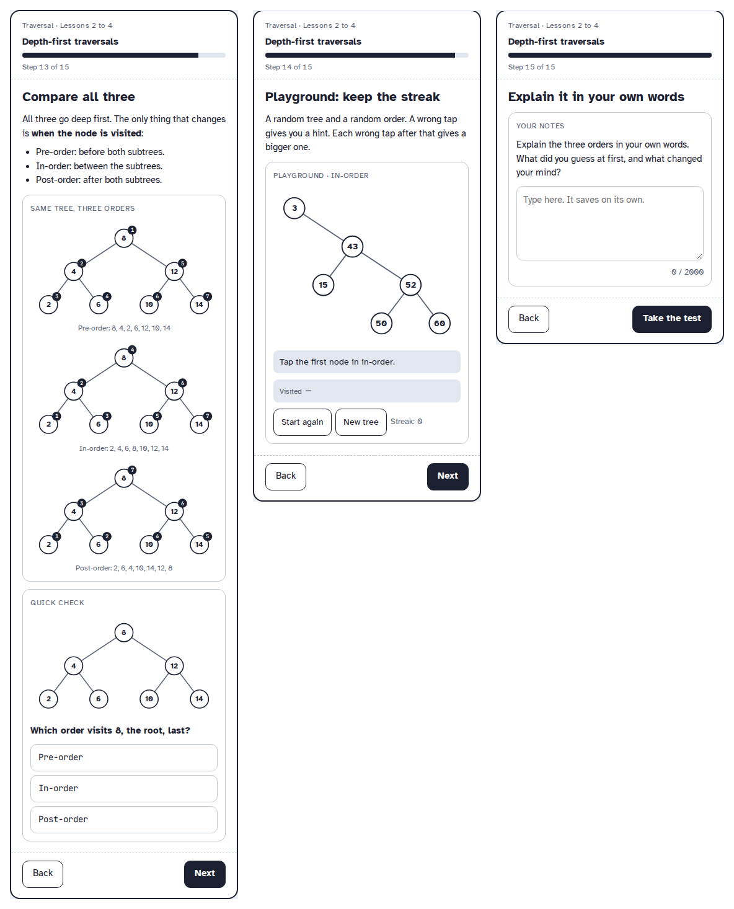

    *Figure 16: C · Guess first, steps 13 to 15*

</Steps>

### D: Start with a use

Each order is introduced by its use case.

<Steps>

1. The learner steps through copying a tree, one node at a time.

2. The learner sees that parents have to come first. That is pre-order.

3. The learner sees that trees can hold maths, and steps through an expression tree to get a prefix expression.

   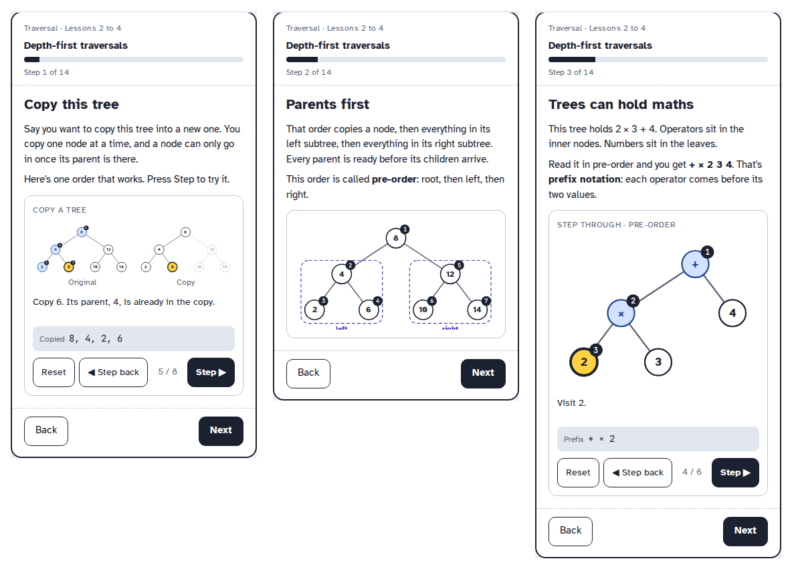

   *Figure 17: D · Start with a use, steps 1 to 3*

4. The learner sees that prefix does not need brackets.

5. The learner is given a new job: sorting the keys of a search tree. In-order does it, with the keys landing on a number line.

6. The learner sees that the learning path map is drawn in in-order.

   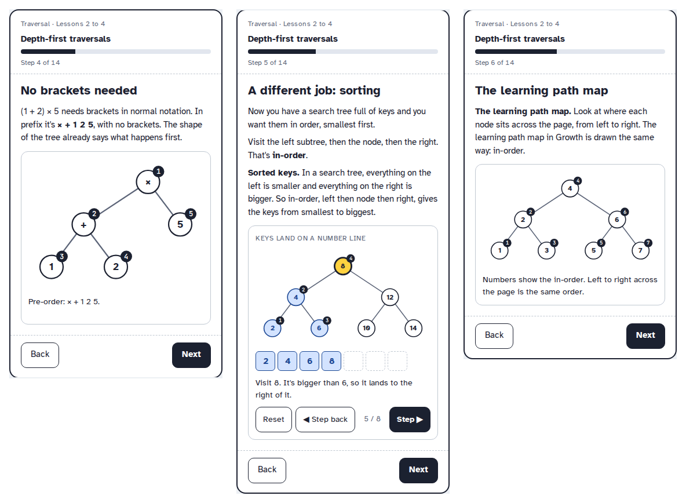

   *Figure 18: D · Start with a use, steps 4 to 6*

7. The learner is given a third job: deleting a whole tree. Children have to go before the parent. That is post-order.

8. The learner works out the heights of the nodes, leaves first.

9. The learner steps through an expression tree in post-order and gets a postfix expression.

   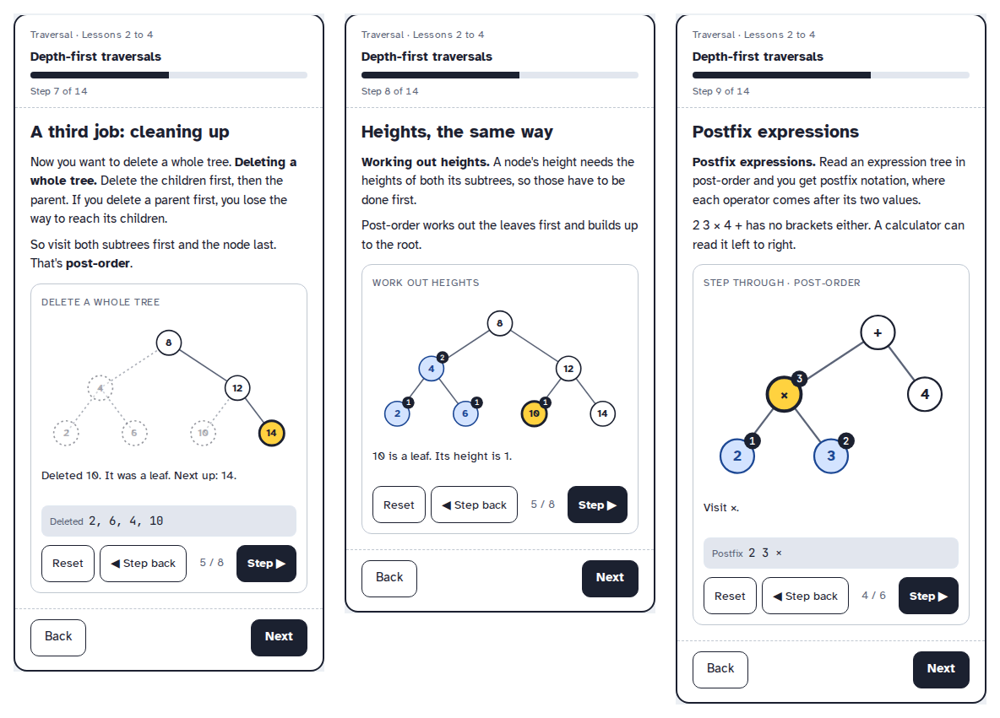

   *Figure 19: D · Start with a use, steps 7 to 9*

10. The learner steps through how the code does it, with the call stack and the three code blocks.

11. The learner sees all three orders on one tree.

12. The learner answers a quick quiz about the postfix form of 7 − 2 × 3.

    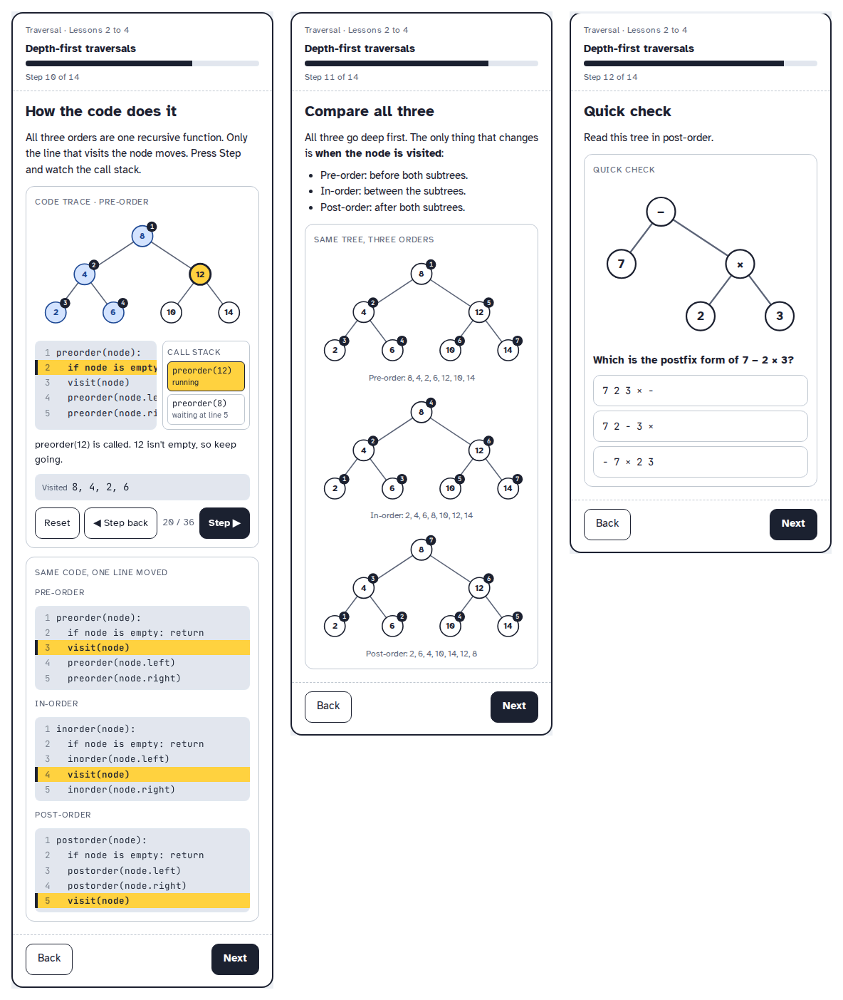

    *Figure 20: D · Start with a use, steps 10 to 12*

13. The learner is taken to a playground where they build prefix or postfix expressions from random expression trees.

14. The learner makes notes on why copying needs each parent first and deleting needs each parent last.

    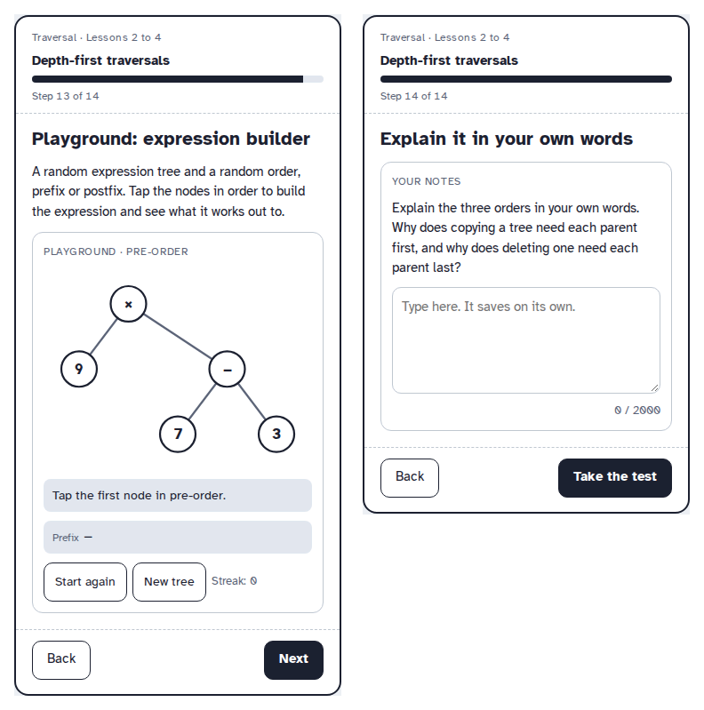

    *Figure 21: D · Start with a use, steps 13 and 14*

</Steps>

### E: Examples that fade

Shows worked examples first, then the same task with less and less help until the learner does it alone. This repeats for each order.

<Steps>

1. The learner reads the pre-order rule and the pseudocode.

2. The learner steps through a fully worked trace on a 3-node tree.

3. The learner steps through a fully worked trace on the 7-node tree.

   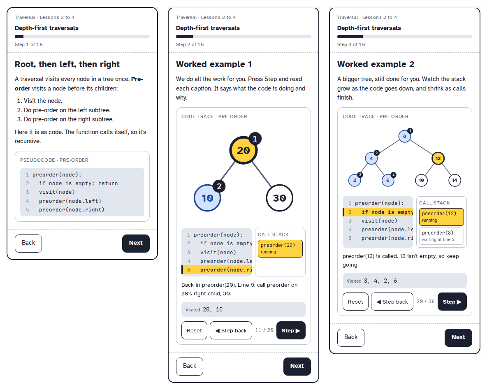

   *Figure 22: E · Examples that fade, steps 1 to 3*

4. The learner finishes a pre-order with 3 nodes already done, with the call stack shown and hints.

5. The learner finishes a prefix expression with 2 nodes already done, and sees where copying a tree is used.

6. The learner sees a fully worked in-order trace, with the visit line moved between the two calls.

   

   *Figure 23: E · Examples that fade, steps 4 to 6*

7. The learner finishes an in-order with 2 nodes already done, with smaller hints.

8. The learner sees that in-order gives sorted keys and that the learning path map is drawn in in-order.

9. The learner sees a fully worked post-order trace, with the visit line moved to the end.

   

   *Figure 24: E · Examples that fade, steps 7 to 9*

10. The learner finishes a post-order with 3 nodes already done, with the call stack shown and hints.

11. The learner sees where post-order is used: deleting a whole tree and working out heights.

12. The learner finishes a postfix expression with 2 nodes already done.

    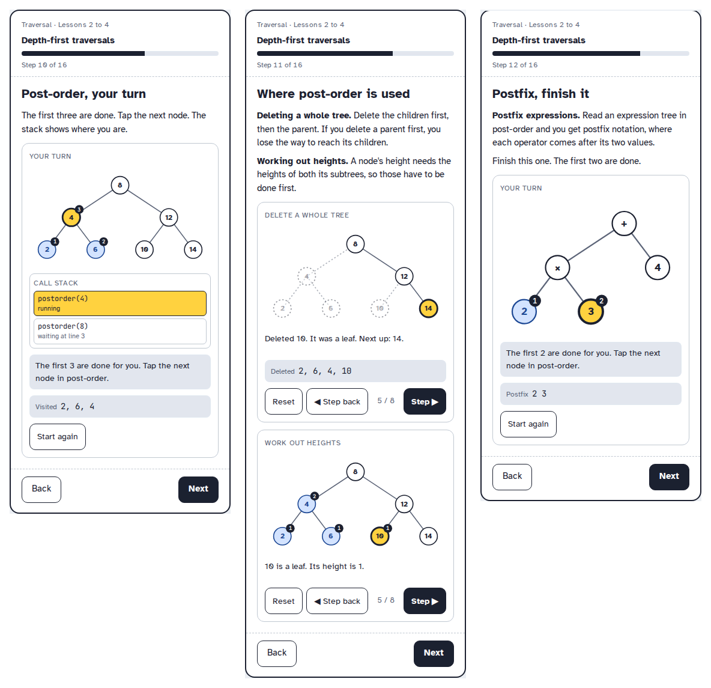

    *Figure 25: E · Examples that fade, steps 10 to 12*

13. The learner sees all three orders on one tree, next to the three code blocks.

14. The learner does a whole tree on their own, in an order picked for them, with no stack and no hints.

    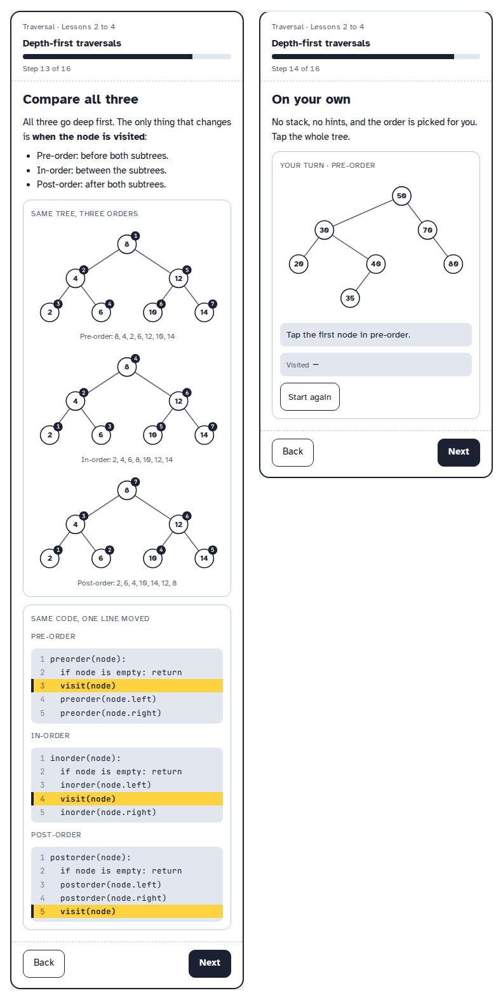

    *Figure 26: E · Examples that fade, steps 13 and 14*

15. The learner is taken to a playground where they tap random trees in a random order with no help.

16. The learner makes notes explaining the three orders as if teaching a friend.

    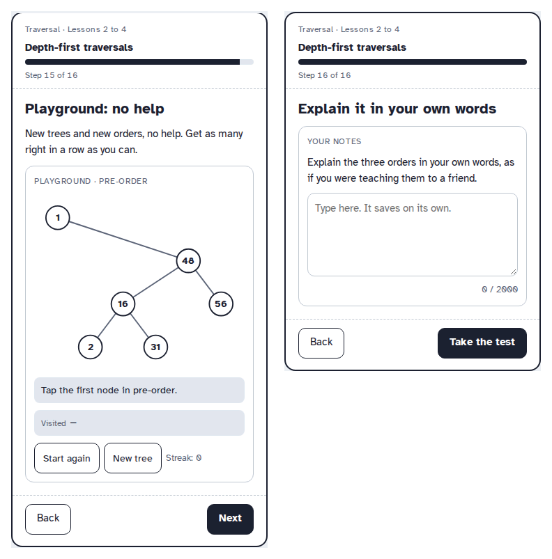

    *Figure 27: E · Examples that fade, steps 15 and 16*

</Steps>

### Review

The team liked A. The orders differ by one line, where the visit sits relative to the recursive calls, and the call stack is shown and explained.

B is a trick, not the algorithm. The ant was fiddly on a phone and invisible to a screen reader.

C asked learners to guess before they'd seen any rule, so they guessed at random.

D answered "why would I do this?" best, but ran longest, and expression trees add a second new idea.

E started slow and repeated itself, leaving the uses the least time.

We kept A's code and call stack idea, and gave D's uses their own steps. None of them fixed the length of the lesson. The team thinks that three orders in seventeen steps is too much for one sitting.

## Design 2

### Code first, with uses

Each lesson shows the rule and code, a small trace, a big trace, then use cases. In-order and post-order open by pointing at the line that moved.

We also decided to add level-order as a fifth lesson.

<Steps>

1. The learner opens lesson 2 and sees eight steps: the rule, a small trace, why calls wait, a big trace, two uses, the playground and a note.

2. The learner copies the 7-node tree node by node and sees that 6 can only go in after its parent, 4.

3. The learner opens lesson 3 on the same code with `visit(node)` moved from line 3 to line 4.

   

   *Figure 28: Design 2 · Code first, with uses, lessons 2 and 3*

4. The learner taps a random tree in post-order in the playground and sees their streak go to 3.

5. The learner reaches lesson 5 and sees a stack next to a queue, with a note that a stack dives down and a queue goes across.

6. The learner sees the 7-node tree four times, numbered in each order.

   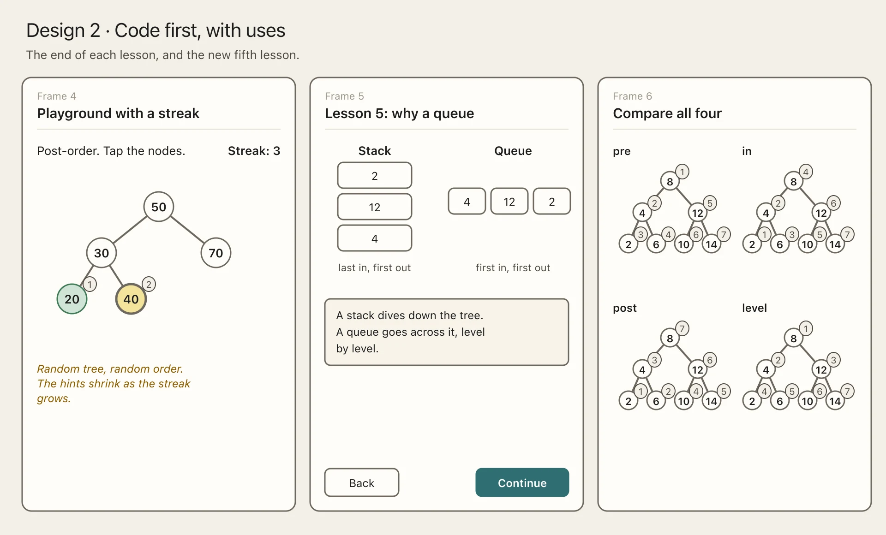

   *Figure 29: Design 2 · Code first, with uses, the playground and lesson 5*

</Steps>

### Review

We liked splitting the orders. Now each lesson has around 8 steps, which resolves the issue of the long lesson.

Two things didn't work. First, every step was "read the code, watch the trace", which only suits learners who like code.

Second, random orders meant lesson 2's playground could ask for in-order before the learner had seen it. Now each lesson's playground sticks to its own order on one fixed tree, with a goal to finish. Random trees and streaks moved to the playground page, where the learner picks the order.

## Design 3

### Pre-order

In-order, post-order and level-order follow the same steps.

<Steps>

1. The learner reads that pre-order visits a node before either of its subtrees, and sees the lesson's three objectives.

2. The learner reads the three-step rule and the five lines of code. The style block picked for them adds one more way in. An auditory learner gets "Say the rule". A reading and writing learner writes down each line that runs on the 5-node tree, then presses Show answer to check. A kinesthetic learner taps 20, then its left side, then its right side, and is told after each tap whether it was right.

   

   *Figure 30: Design 3 · Step 2, the auditory block*

   

   *Figure 31: Design 3 · Step 2, the reading and writing block*

   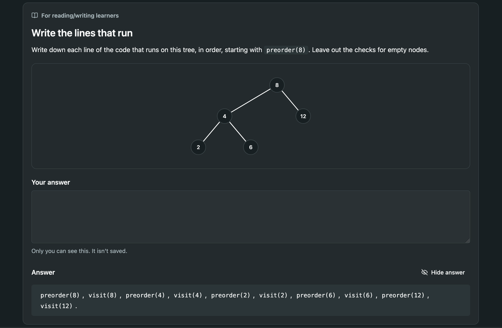

   *Figure 32: Design 3 · Step 2, the same block after Show answer*

   

   *Figure 33: Design 3 · Step 2, the kinesthetic block*

3. The learner presses Step through the code on 20, 10 and 30 and watches each call go onto the stack and come off when it finishes, with paper cards if that's their block.

   

   *Figure 34: Design 3 · Step 3, the card pile*

4. The learner watches the call stack on its own, with the code hidden, and sees `preorder(20)` wait while `preorder(10)` runs.

5. The learner writes the order they expect for the 7-node tree, if they have the "Predict first" block, then steps through it and sees 2 and 6 come before 12.

6. The learner watches the tree get copied one node at a time in pre-order, each node going in after its parent.

7. The learner steps through the expression tree for 2 × 3 + 4 and reads off + × 2 3 4.

8. The learner taps the nodes of 28, 21, 57, 1, 47, 59 in pre-order in the playground until the goal ticks off.

9. The learner writes a note on pre-order and why `preorder(8)` stays on the stack while its left subtree runs.

</Steps>

In-order (lesson 3) opens on the rule with the moved line, then a small trace, a big trace, and sorted keys as its use. Post-order (lesson 4) adds deleting a tree, heights and postfix, then a compare step with all three orders on one tree. Level-order (lesson 5) keeps the small and big traces, swaps "why calls wait" for "why a queue", adds where it's used, and ends with a compare step across all four.

### Review

We walked design 3 against the objectives for all four lessons. Pre-order's "which calls wait on the call stack" got its own step (step 4, with the code hidden so the stack is the only thing moving). Every other objective had at least one step and one test question. Level-order's "why a queue" is the only one without a picture on screen. It's explained in words, and with paper cards for kinesthetic learners.

## Decision

<Aside type="tip" title="We picked design 3, code first">
One order per lesson: the rule and the code, a small trace, a big trace, the order's uses, then the playground and a note.
</Aside>

### Why we picked it

COS212 expects learners to code these algorithms, and code first is the only idea that builds every step around the code. The code also shows the difference between orders.

The call stack is important to teach since COS212 is the first module where students are exposed to recursion.

The small trace before the big one allows us to slowly introduce the concept, and as the learner becomes more confident they can work on a more complex tree.

### CCAF

For step 5 of "Pre-order", the big trace.

| | |
| --- | --- |
| **Context** | The learner is on step 5 of 9 of "Pre-order". They've traced the 3-node tree and seen why calls wait. On screen is the 7-node tree from lesson 1 (8 at the root), the pre-order code and an empty call stack. A "Predict first" block may be picked for them. |
| **Challenge** | Say the order pre-order visits the 7 nodes, and why 2 and 6 come before 12. |
| **Activity** | The learner writes the order they expect (if they have the block), then presses Step through the trace and ticks each key as it's visited. |
| **Feedback** | The current line lights up, the call stack grows to `preorder(8)`, `preorder(4)`, `preorder(2)` and shrinks again, and the visited list builds to 8, 4, 2, 6, 12, 10, 14. The message points out that the code finishes the whole left subtree before it goes right. Listen reads it out. |

## Design proof

Pre-order was the first traversal lesson we built. Its content is eight block files in `backend/prisma/content/02-pre-order/blocks/`, plus the learning style variants.

![Step 2 of 9 in "Pre-order", "Algorithm", as built. The text lists the three steps: visit the node, visit all the nodes in the left subtree, visit all the nodes in the right subtree. Below is the five-line pseudocode for preorder(node), with notes on what lines 2, 3, 4 and 5 do. Under "Picked for you" is a card for reading/writing learners, "Write the lines that run", asking the learner to write down each line of the code that runs, starting with preorder(8). A Listen button sits top right, with Back and Continue at the bottom.](../../../../../assets/id/prototypes/depth-first/design-proof-algorithm.webp)

*Figure 35: Design proof · Step 2, the algorithm, as built*

*Figure 36: Design proof · Step 3, the small trace, as built*
