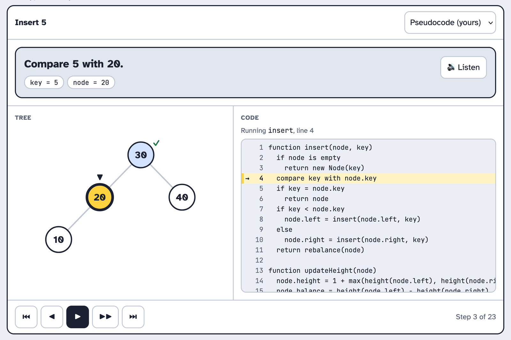
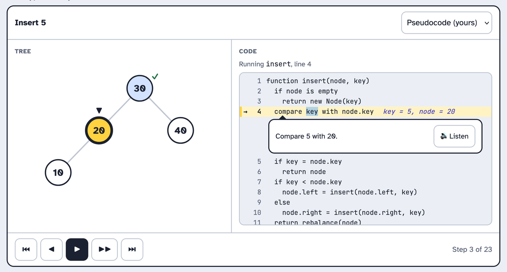
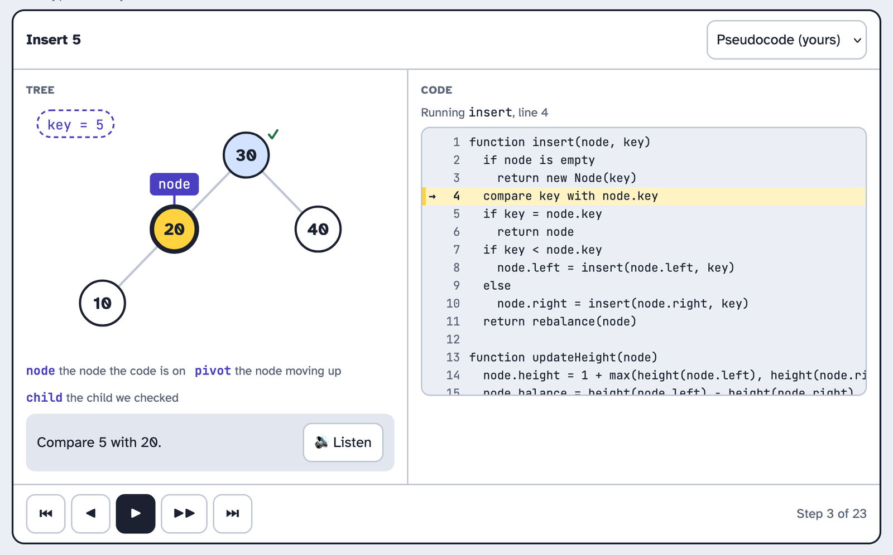
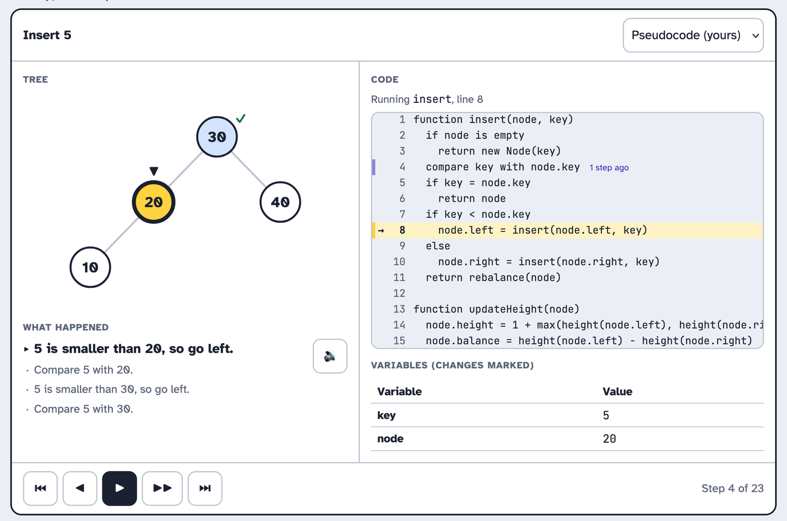

import { Aside, Steps } from "@astrojs/starlight/components";

The code trace sits next to the tree, in the playground and in every lesson that runs an algorithm. It shows the line of code that's running and the values of the variables on that line. As the learner steps through the tree the line moves with it.

The code trace allows the learner to see how the recursive calls affect the call stack. Additionaly, the learner will be able to see how the traversal algorithms differ.

We designed the code trace over three rounds, following [SAM 2](../../../approach/). In the savvy start each of us sketched a storyboard for an idea of a code trace. We reviewed all five together and took the Debugger idea forward. Design 2 added a trail and a call stack onto it. Design 3 is the version we built, and the design proof is the first working build in the app.

## Savvy start

### A: Debugger

This storyboard looks like the debugger in a code editor. The tree is on the left, the code is on the right with a variables table under it, and one message bar runs along the bottom.

<Steps>

1. The learner presses play and sees the tree on the left and the code on the right.

2. The learner follows the arrow to the line that's running, and reads the variables in the table under the code.

3. The learner reads the step's message in the bar along the bottom, and presses Listen to hear it.

   

   *Figure 1: A · Debugger*

</Steps>

### B: Narrator first

A large message card sits on top, with the variables inside it as chips. The tree and the code sit underneath it.

<Steps>

1. The learner reads the step's message at the top.

2. The learner looks down at the tree and the code to see the step happen.

   

   *Figure 2: B · Narrator first*

</Steps>

### C: Inline values

The variables are written at the end of the running line in faint text, and the message hangs under the line as a speech bubble.

<Steps>

1. The learner follows the arrow to the line that's running, and reads the variables written at the end of it.

2. The learner reads the message in the bubble under the line, and presses Listen to hear it.

   

   *Figure 3: C · Inline values*

</Steps>

### D: Variables on the tree

Variables that point at nodes become tags on the tree itself. The key being inserted sits in the corner.

<Steps>

1. The learner sees a "node" tag on the node the code is working on, and the key to insert in the corner.

2. The learner reads what each tag means in the key under the tree, and reads the message under it.

   

   *Figure 4: D · Variables on the tree*

</Steps>

### E: Trail

This one shows where the learner came from. The last three lines keep a fading mark, the variables table flags what changed, and a log lists every message so far.

<Steps>

1. The learner sees the line that's running and a fading mark on the line before it.

2. The learner sees which variables changed in the table.

3. The learner reads the newest message at the top of the log, with the earlier ones under it.

   

   *Figure 5: E · Trail*

</Steps>

### Review

All five of us went through the storyboards and decided A was our favourite idea. 
The code and the tree sat side by side. B focused to heavily on the banner message. C looked like it would cause issues for responsive design. We liked the tagges D added but decided against them as it would interfear with another design we had planned. The team liked E's markers and wanted to oncorporate them into design 2.

## Design 2

### Debugger with a trail

This design built off A from the savvy start round with two additions. Firstly, a fading mark on the previous line and secondly a call stack panel under the variables so the learner would be able to see what calls are waiting.

<Steps>

1. The learner presses Step and watches the arrow move to the next line, with a faded mark left on the one it came from.

2. The learner reads the variables table, where a value that just changed is bold.

3. The learner looks at the call stack under the table and sees `insert(20)` waiting while `insert(10)` runs.

4. The learner reads the message in the bar along the bottom and presses Listen.

   ![Step 6 of 26. The tree 30, 20, 40, 10 is on the left with 10 marked active. The arrow is on line 1 of the pseudocode, "function insert(node, key)", in the call for 10. Line 8, "node.left = insert(node.left, key)", has a faded mark that says "insert(20) waits here". The variables table shows key 5 and node 10 in bold. The call stack lists insert(30) and insert(20) waiting on line 8, and insert(10) running. The bar along the bottom says "Call insert on 10, the left child of 20. insert(20) waits on line 8 until it returns." with a Listen button.](../../../../../assets/id/prototypes/code-trace/debugger-with-a-trail.webp)

   *Figure 6: Debugger with a trail*

</Steps>

### Review

The team liked the call stack idea but not the trail. On a narrow laptop screen the faded mark and running line did not look good and in the colour blind schema the colours ended up being the same shade.

## Design 3

### Debugger, built for every screen

We designed the debugger so that a running line is marked in three ways so it never fully depends on colour alone. There is a dot in the gutter, a highlight across the line and a `aria-current="step"` for screen readers. 

<Steps>

1. The learner presses Step and sees the gutter dot and the lime band land on the next line.

2. The learner reads the variables under the code, and the call stack under those.

3. The learner switches from pseudocode to Java and sees the same line marked in the Java version.

   ![Step 8 of 37. The tree 30, 20, 40, 10 is on the left with 10 marked active and a balance badge on each node. The Java insert is on the right with a gutter dot and a lime band on line 5, "if (key < node.key)". Under the code, the variables show key 5 and node 10, and the call stack shows insert(30), insert(20) and insert(10), with insert(10) running. The message bar says "Is 5 smaller than 10? Yes." with a Listen button. Under it is a row of step dots, one shape per phase, with "8 of 37" over the current dot, then the step buttons and a 0.5×, 1× and 2× speed picker.](../../../../../assets/id/prototypes/code-trace/debugger-for-every-screen.webp)

   *Figure 7: Debugger*

</Steps>

### Review

We checked the design and were all happy with it.

## Decision

<Aside type="tip" title="We picked design 3, the Debugger">
Tree on one side, code on the other, the running line marked with a dot and a band, and the variables and call stack underneath.
</Aside>

### Why we picked it

The debugger design allows the learner to see the tree and code side by side for comparison. The line is marked three ways, so it still reads in every colour scheme, which is one of our [presentation](../../../presentation/) rules.

The message and the Listen button are for learners who don't read code fluently yet, and Listen also reads it aloud for anyone who'd rather hear it, which lines up with what we wrote about [learning styles](../../../learning-styles/). 

### CCAF

| | |
| --- | --- |
| **Context** | The learner is midway through the pre-order lesson. A 7-node tree is on the left, the pseudocode is on the right, and the call stack holds `preorder(8)`. |
| **Challenge** | Work out which line runs next and what `node` will be when it does. |
| **Activity** | The learner presses Step, or taps the next dot on the step player, and watches the gutter dot move. |
| **Feedback** | The line lights up, the variables show `node = 4`, a new call joins the stack, and the message says "4 isn't empty, so visit it." Listen reads it aloud. |

## Design proof

The design proof was the `CodeTrace` and `TraceLayout` components on the playground page.

We ran it at 375, 768 and 1280 pixels wide, in the default, high-contrast and colour-blind schemes, and stepped through a full insert with a double rotation in each. 

:::caution[Add screenshot]
The built code trace in the playground at 1280 px, mid-way through an insert, with the lime band, gutter dot, variables and call stack showing.
:::
