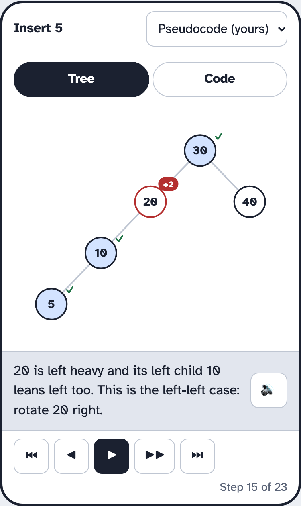
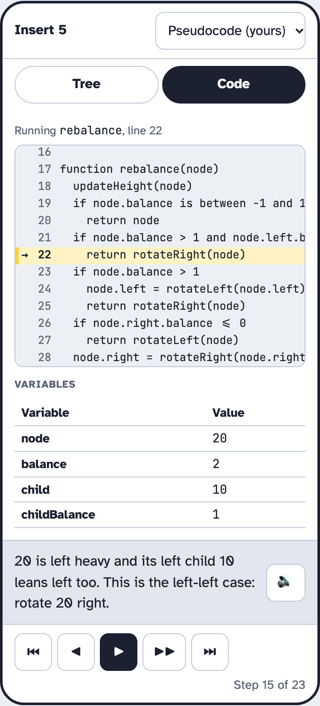
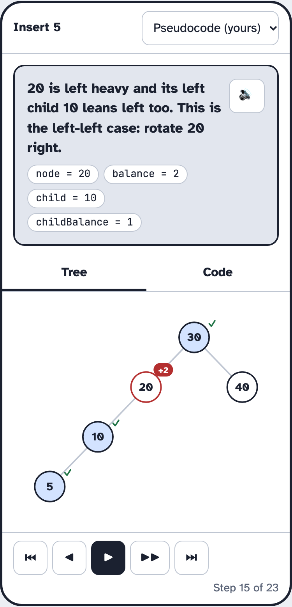
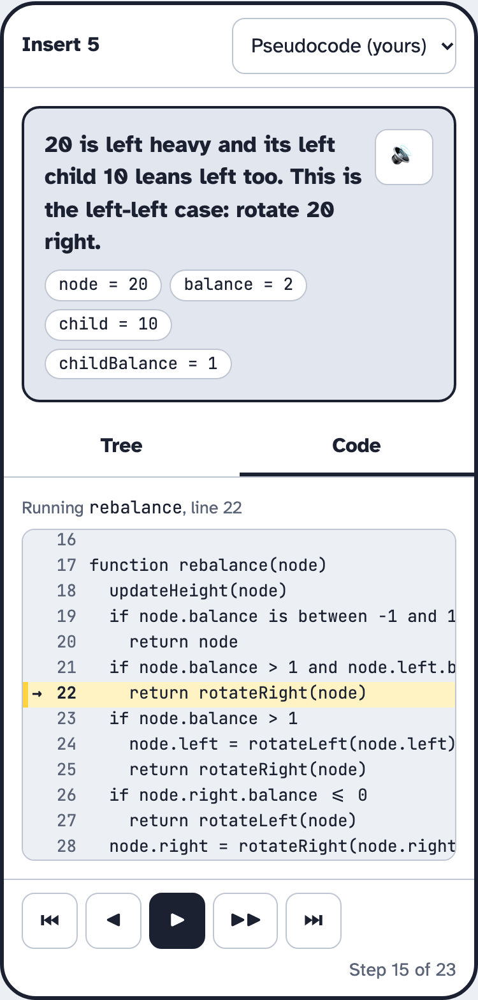
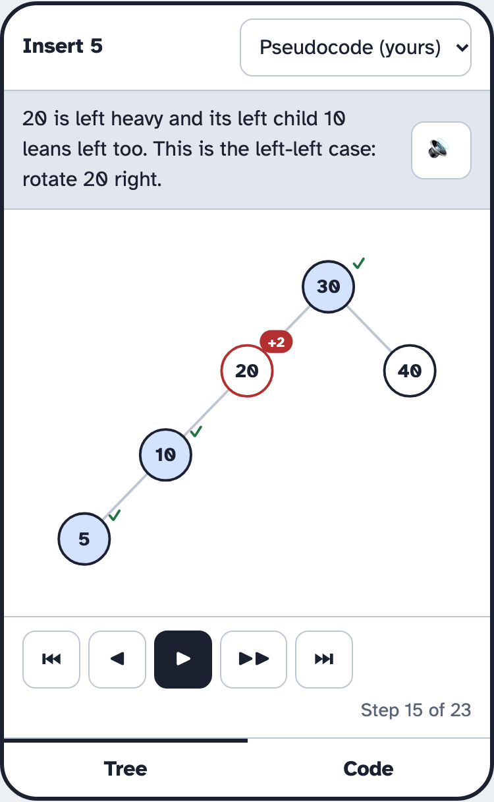
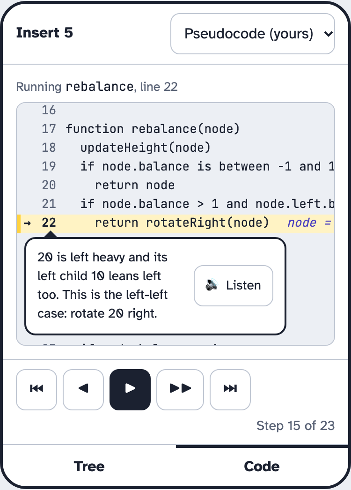
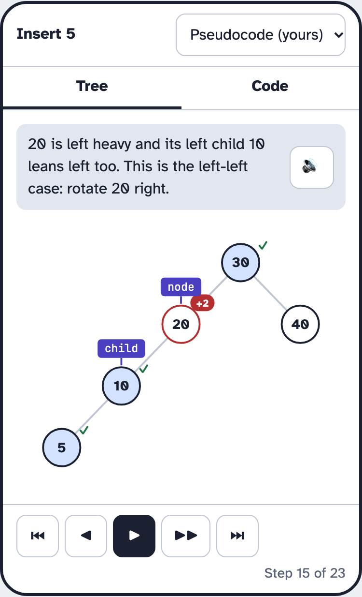
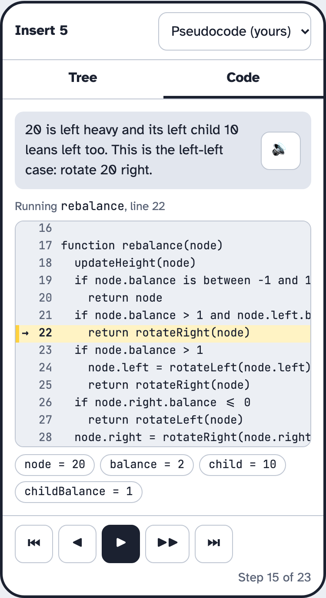
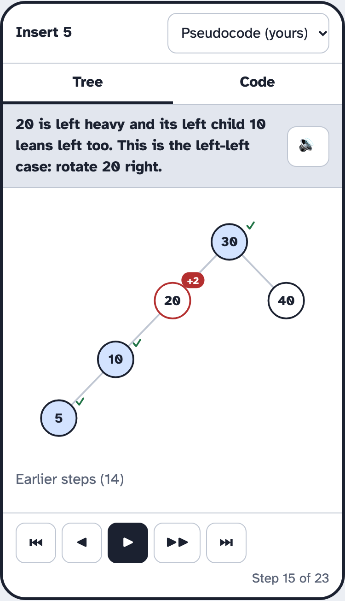
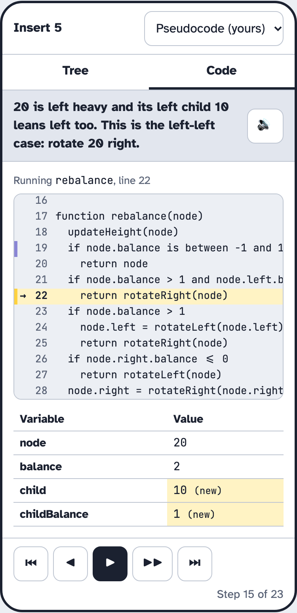

import { Aside, Steps } from "@astrojs/starlight/components";

The code trace panel sits next to the tree in the playground and in lessons. 
As a step plays, it shows the line of code that is running and the variables. 

## A: Debugger

This prototype looks like the debugger in a code editor. The tree is on the left, 
the code is on the right with a variables table under it, and one message bar 
runs along the bottom.

<Steps>

1. The learner presses play and sees the tree on the left and the code on the right.

2. The learner follows the arrow to the line that is running, and reads the variables in the table under the code.

3. The learner reads the step's message in the bar along the bottom, and presses Listen to hear it.

   

   *Figure 1: A · Debugger on a desktop*

4. On a phone, the learner switches between the Tree and Code tabs at the top. The message bar stays under both tabs.

   

   *Figure 2: A · Debugger on a phone, Tree tab*

   

   *Figure 3: A · Debugger on a phone, Code tab*

</Steps>

## B: Narrator first

This prototype has a large message card, with the variables inside it as chips. The tree and the code sit underneath it.

<Steps>

1. The learner reads the step's message at the top.

2. The learner looks down at the tree and the code to see the step happen.

   

   *Figure 4: B · Narrator first on a desktop*

3. On a phone, the message card stays pinned above the Tree and Code tabs, so it shows on both.

   

   *Figure 5: B · Narrator first on a phone, Tree tab.*

   

   *Figure 6: B · Narrator first on a phone, Code tab.*

</Steps>

## C: Inline values

The variables are written at the end of the line in faint text, 
and the message hangs under the line as a speech bubble.

<Steps>

1. The learner follows the arrow to the line that is running, and reads the variables written at the end of it.

2. The learner reads the message in the bubble under the line, and presses Listen to hear it.

   

   *Figure 7: C · Inline values on a desktop*

3. On a phone, the learner switches tabs with a bar at the bottom of the screen. On the Tree tab, the message is a strip above the tree.

   

   *Figure 8: C · Inline values on a phone, Tree tab*

   

   *Figure 9: C · Inline values on a phone, Code tab.*

</Steps>

## D: Variables on the tree

This prototype draws the variables that point at nodes as tags on the tree. The key being inserted sits in the corner.

<Steps>

1. The learner sees a "node" tag on the node the code is working on, and the key to insert in the corner.

2. The learner reads what each tag means in the key under the tree, and reads the message under it.

   

   *Figure 10: D · Variables on the tree on a desktop*

3. On a phone, the message follows the learner to the Code tab. There the variables show as chips, because the tree is out of sight.

   

   *Figure 11: D · Variables on the tree on a phone, Tree tab.*

   

   *Figure 12: D · Variables on the tree on a phone, Code tab.*

</Steps>

## E: Trail

This prototype shows where the learner came from. The last three lines keep a fading mark, the variables table shows what changed, and a log lists every message so far.

<Steps>

1. The learner sees the line that is running and a fading mark on the line before it.

2. The learner sees which variables changed in the table.

3. The learner reads the newest message at the top of the log, with the earlier ones under it.

   

   *Figure 13: E · Trail on a desktop*

4. On a phone, the newest message stays pinned under the tabs. The log folds away under the tree.

   

   *Figure 14: E · Trail on a phone, Tree tab.*

   

   *Figure 15: E · Trail on a phone, Code tab.*

</Steps>

## Decision

<Aside type="tip" title="We picked A, the Debugger">
</Aside>

### Why we chose the Debugger

- It best links each line of code to what it does in the tree. The tree and the code sit side by side, so the learner sees how the code and the change to the tree go together.
- It doesn't overwhelm the learner with extra information. Each part has one job.
- The arrow and the highlighted line show exactly where the learner is in the operation, whether that's an insert, a height update, a rebalance or a delete.
- The values are always shown under the code, so the learner can check them whenever they're unsure.
- The message explains each step in plain words, for learners who aren't yet comfortable reading code.
- The Listen button reads the message aloud, for learners who learn best by listening and for learners with a visual impairment.
- The highlight can be adapted for learners with a visual impairment, such as colour blindness. The arrow marks the line too, so it never relies on colour alone.

