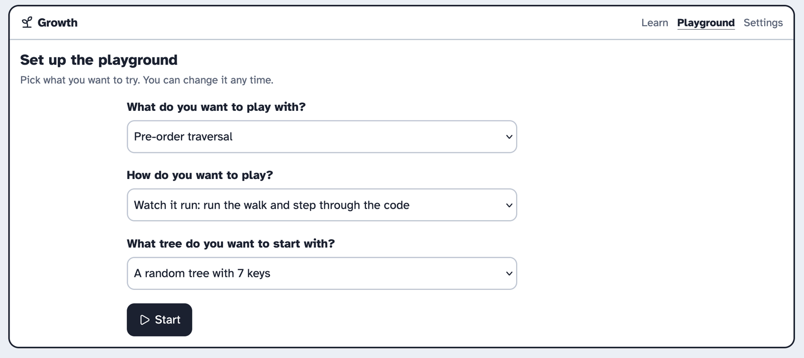
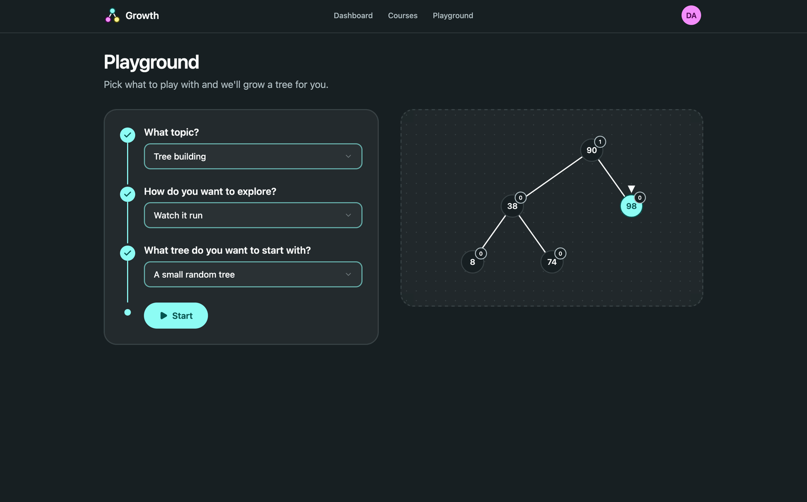

import { Aside, Steps } from "@astrojs/starlight/components";

The playground is where a learner goes outside the lessons to build their own trees and break them. It puts the tree, the code trace and the step player on one page, so whatever the learner does to the tree, they see the code that did it. We've already done storyboards for the tree, code trace and step player so this round was for how we incorporate all three on the same page.

The playground page provides the practice side of most [learning objectives](../../../objectives/) in the course. The playground will enable the learner to list the nodes of a tree in pre-order, in-order, post order and level order. Additionally the playground enables the learner to insert a new key and fix imbalances in an AVL tree

We followed [SAM 2](../../../approach/) over three rounds. The savvy start had four rough ideas for the controls. After each round the team reviewed the storyboards, kept what worked and built the next round from it. Design 2 reworked the console. Finally, design 3 split the page in two, a setup form and the playground, and that's what we built as the design proof.

## Savvy start

### A: Command bar

One toolbar above the tree and code holds every kind of operation.

<Steps>

1. The learner types a key from 1 to 99 and presses Insert, Delete or Search.

2. The learner picks a walk from the dropdown and presses Run, or turns auto-balance off.

   

   *Figure 1: A · Command bar*

</Steps>

### B: Tool panel

A side panel splits the tools into four sections: build, change, walk and balance.

<Steps>

1. The learner opens a section in the side panel to see its tools.

2. The learner types a key under Change and presses Insert, Delete or Search, or picks an order under Walk and presses "Walk the tree".

   

   *Figure 2: B · Tool panel*

</Steps>

### C: Console

The learner types commands into a prompt under the code. Every run is kept in a history and can be run again.

<Steps>

1. The learner types a command like `insert 25`, or taps one of the chips under the prompt to fill it in.

2. The learner steps through the run with the step player while the code trace follows along.

3. The learner presses the replay button on a line in the history to run it again.

   

   *Figure 3: C · Console*

</Steps>

### D: Touch the tree

The learner works on the tree directly. Every empty spot has a + button, and tapping a node opens a small menu with search, delete or rotate.

<Steps>

1. The learner taps a + and types a key. The menu says which keys that spot takes, and says why if the key can't go there.

2. The learner taps a node to search for it, delete it or rotate it.

3. The learner taps one of the walk buttons at the top to run that walk.

   

   *Figure 4: D · Touch the tree*

</Steps>

### Review

The team selected option C, the console. Each command matches what the code trace runs and the history keeps a record of what the learner tried throughout the session. However, the team identified two gaps with the initial approach. Firstly, there was no way for the learner to say if they wanted to work on AVL trees or traversals, the commands were mixed together. Secondly, the leaner could only type commands. The team liked option D's apporach that allowed the user to use their hands to add a node so we wanted to find a way to incorporate that into the final design.

The team decided against using A, B and C. Option A had all the AVL operations and traversals in a single row. Option B's panel used up a lot of screen width which could be an issue on smaller screens. Option D had a hidden menu that we throught the user would struggle to find.

## Design 2

### C reworked

This idea fixes the two issues the team had with the initial idea of option C. There is now a switch at the top of the page allowing the learner to pick between AVL tree or traversals. Additionally, the learner has the option to drag nodes on the tree.

<Steps>

1. The learner picks AVL tree or Traversals at the top, or types `mode avl` or `mode walk`. The chips under the prompt change to match.

2. The learner types a command, or types a key in the New key box and drags its chip to the spot where it belongs.

3. The learner drags a node onto the bin to delete it, and sees each drag in the history as its command.

   

   *Figure 5: C reworked · Console with a mode switch and drag and drop*

</Steps>

### Review

The team did not like the design of this storyboard.
A learner who only wants to watch one pre-order walk still sees the drag tools. A learner who wants to drag still sees the console. Neither of them would want to see the other. We thought it would be better for the learner to say what they want first, so the page could show only the tools that the learner wants to see.

## Design 3

### Set up, then play

This design has a short setup form that the use completes first. the learner is asked to pick their topic, how they want to play and what they want their starting tree to look like. The playground then shows the learner only what they selected. The console from see becomes a "Watch it run" option and the drag and drop from design 2 becomes the "Interact with the tree".

A short setup form comes first. The learner picks their topic, how to play and a starting tree, and the playground then shows only what they picked, with a bar at the top that says what they chose. The console from C becomes "Watch it run", and the drag and drop from design 2 becomes "Interact with the tree".

<Steps>

1. The learner answers "What do you want to play with?". The next question only shows once this one has an answer.

2. The learner picks how to play, either watching it run or moving the nodes themselves, then picks a starting tree and presses Start.

   

   *Figure 6: Design 3 · Setup form*

3. The learner sees pills for their choices at the top, and only the tools for that setup. For a pre-order walk that's "Walk the tree pre-order", New tree and a console that only takes pre-order commands.

4. The learner presses Change setup to go back to the form with their answers filled in.

   

   *Figure 7: Design 3 · Playground after setup*

</Steps>

### Review

When the team reviewed this design and had no more suggestions or issues.

## Decision

<Aside type="tip" title="We picked design 3, set up, then play">
A setup form asks what the learner wants, and the playground after it only shows the tools for the selected options.
</Aside>

### Why we picked it

This design allows the learner to define what they want to do and the page is customised based on their selection. This allows the learner to have a more personalised experiance and keeps the playground screen simple. This design also keeps the console from the initial savvy start phase and incorporates the drag and drop feature from design 2. 

Additionally, when the learner drags a key, every empty spot lights up so none of them is marked as the right one. This allows the learner to work out where a key goes, and a wrong drop gets refused with the reason, which incorporates a small aspect of [assessment](../../../assessment/).

We allows the learner to change their configuration by clicking the "Change Setup" button keeping the change low cost as part of the [motivation](../../../motivation/) story: a playground should feel safe to mess up in.

### CCAF

| | |
| --- | --- |
| **Context** | The learner has finished the AVL insert lesson and opened the playground. They picked "Tree building", "Interact with the tree" and a random tree with 7 keys. |
| **Challenge** | Put the key 25 where it belongs, and predict whether the tree will need a rotation. |
| **Activity** | The learner drags the 25 chip onto one of the empty spots. On a keyboard, they press Enter on the chip instead. |
| **Feedback** | A right spot inserts 25, the trace plays the insert and any rotation, and the history logs `insert 25` with a "dragged" tag. A wrong spot refuses the drop and the message says why, like "25 is bigger than 20, so it goes right." |

## Design proof

The design proof was the real `/playground` setup page and `/playground/play`.

The setup lives only in the URL, so a learner can refresh or share the link and land on the same playground. Picking a random starting tree adds a seed, so the preview on the form and the tree in the playground grow the same way. Building a tree showed us a few limits we hadn't decided on. We capped the tree at 50 keys and the console at 160 characters, which still fits `insert` with fifty two-digit keys. We also tried a little rotation tag floating on the tree during a rotate, and took it out again. 

   

   *Figure 8: The playground form *

   

   *Figure 9: The built playground in "watch it run" with the key 67 being inserted*
