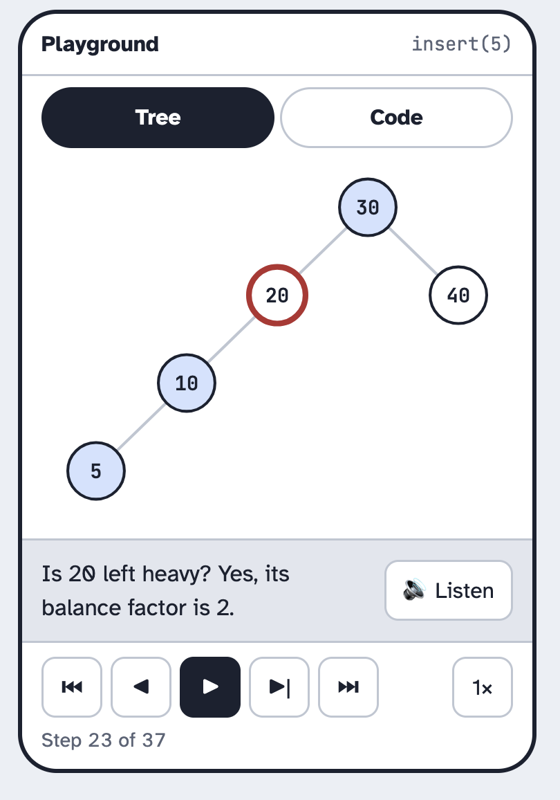
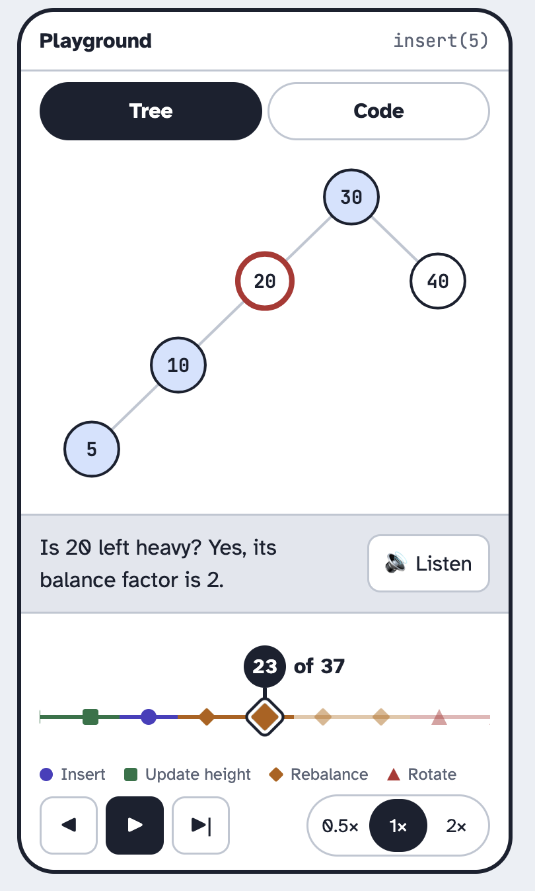
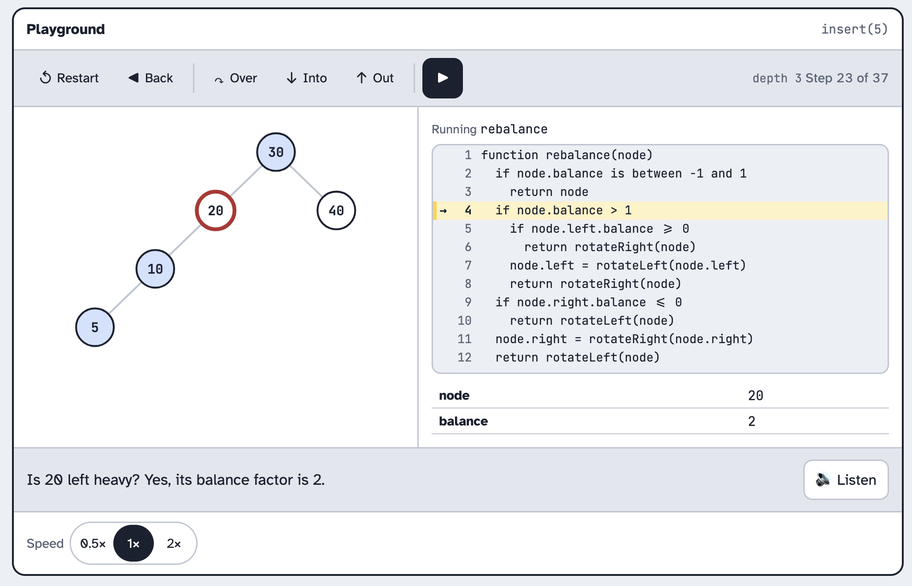
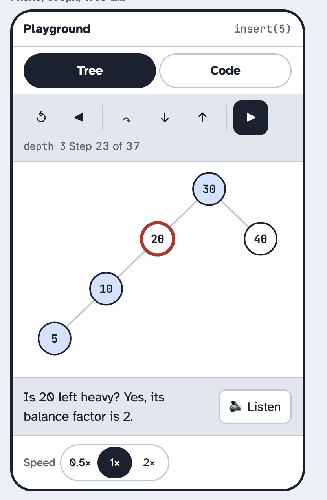
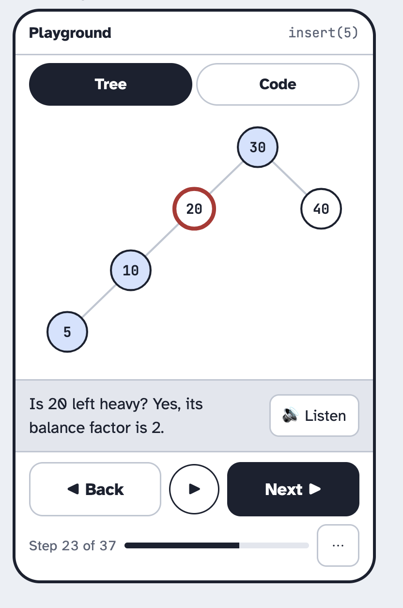
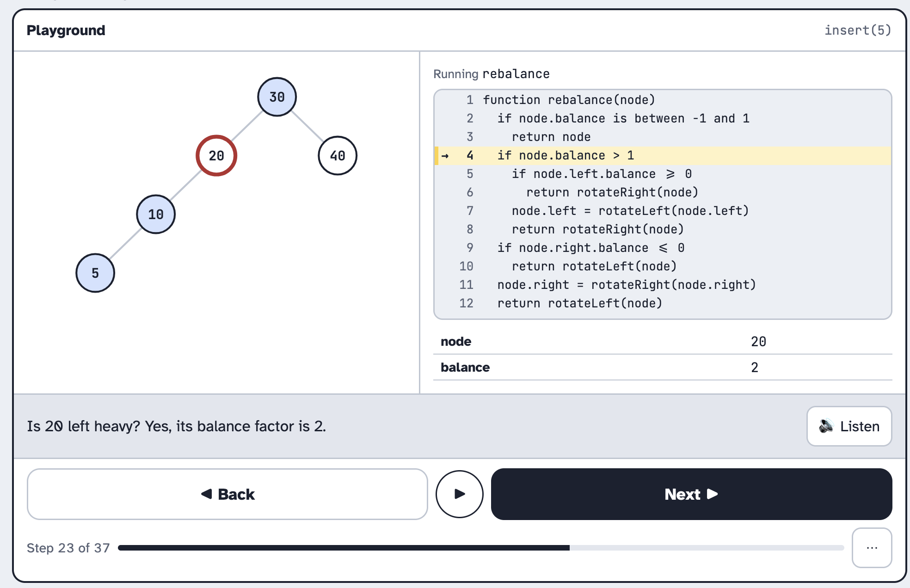
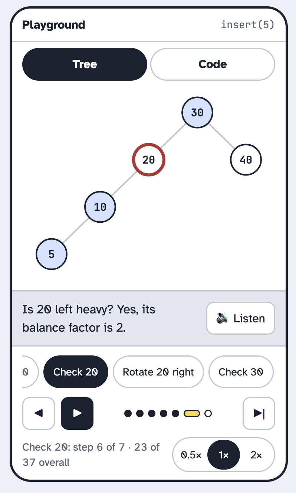

import { Aside, Steps } from "@astrojs/starlight/components";

The step player sits under the tree and the code trace in the playground and in lessons.
It moves through an operation one step at a time, plays steps on its own, and sets the speed.

## A: Media bar

This prototype has one row of buttons like a video player.

<Steps>

1. The learner presses forward to move one step, or play to watch the steps go by.

2. The learner picks a speed of 0.5×, 1× or 2×, and reads which step they are on.

   

   *Figure 1: A · Media bar on a desktop*

3. On a phone, the same row fits under the message, and the speed is one button that cycles through 0.5×, 1× and 2×.

   

   *Figure 2: A · Media bar on a phone*

</Steps>

## B: Scrubber

This prototype is a line with a dot for every step. Each dot's colour and shape shows what the
code is doing. A circle for insert, a square for update height, a diamond for rebalance and a
triangle for rotate. A pin above the line marks the step the learner is on.

<Steps>

1. The learner sees the whole operation as one line, and where the rotation comes.

2. The learner taps any dot to jump to that step, or uses back, play and forward.

   

   *Figure 3: B · Scrubber on a desktop*

3. On a phone, every dot keeps a full-size tap target and the line scrolls sideways. It stays centred on the pin as the steps play.

   

   *Figure 4: B · Scrubber on a phone*

</Steps>

## C: Debugger toolbar

This prototype is a toolbar above the code.
Into moves one step. Over skips a whole call, and Out finishes the call the learner is in.

<Steps>

1. The learner steps into the code one line at a time.

2. The learner steps over a call they already understand, or steps out of the one they are in.

   

   *Figure 5: C · Debugger toolbar on a desktop*

3. On a phone, the words drop off and only the icons are left.

   

   *Figure 6: C · Debugger toolbar on a phone*

</Steps>

## D: Thumb buttons

This prototype puts two big Back and Next buttons where the learner's thumbs are, with play
between them. The speed, first and last are in a menu behind a ⋯ button.

<Steps>

1. The learner presses Next to move one step, or the round play button to watch.

2. The learner sees how far through they are on the progress bar.

   

   *Figure 7: D · Thumb buttons on a phone*

3. On a desktop, the same buttons stretch across the panel.

   

   *Figure 8: D · Thumb buttons on a desktop*

</Steps>

## E: Chapters

This prototype groups the steps into chapters that say what is happening.

<Steps>

1. The learner reads the chapter names to see the plan for the whole operation.

2. The learner taps a chapter to jump to its start, and follows the dots for the steps inside it.

   

   *Figure 9: E · Chapters on a desktop*

3. On a phone, the chapter row scrolls sideways and stays on the current chapter.

   

   *Figure 10: E · Chapters on a phone*

</Steps>

## Decision

<Aside type="tip" title="We picked B, the Scrubber">
</Aside>

### Why we chose the Scrubber

- The learner can jump to any step they want with a single action.
- Each phase has its own colour so you can easily tell the operations apart. Additionally, each operation has its own shape to accomodate users who are colour blind.
