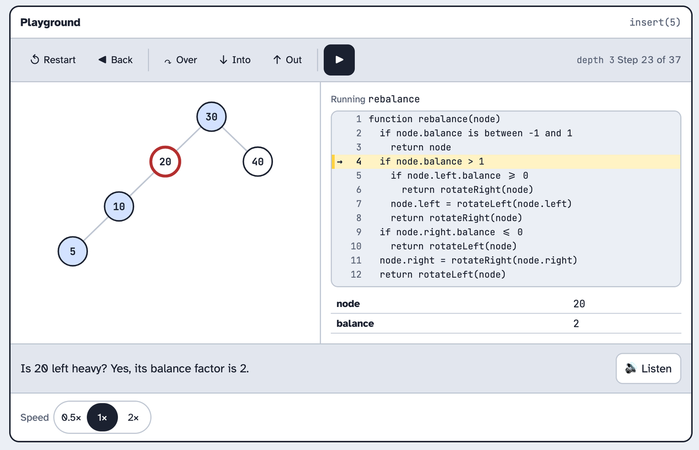
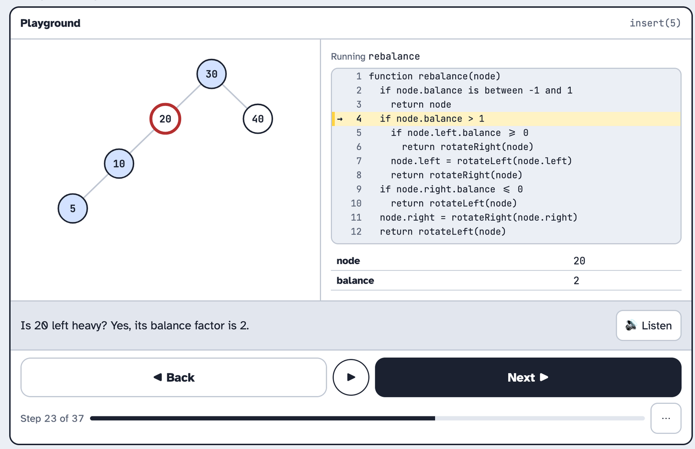
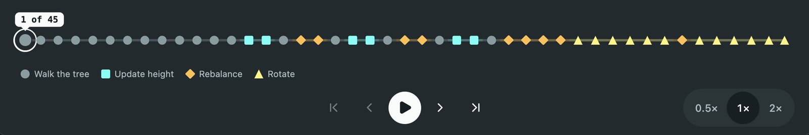

import { Aside, Steps } from "@astrojs/starlight/components";

The step player sits under the tree and the code trace, in the playground and in lessons. It moves through an operation one step at a time, plays the steps on its own if the learner wants, and sets the speed. An AVL insert of one key can run to forty steps. Without a way to see where the rotation is in those forty, the learner just presses Next until something happens.

It serves the same [learning objectives](../../../objectives/) as the code trace, because it's what drives the trace. It enables learners to view how the call stack works, step slowly through rotations and operations such as insert and delete.

We followed [SAM 2](../../../approach/) over three rounds. The savvy start gave us five step players. We took the Scrubber into design 2 and gave it chapter names from E. Design 3 is what we built and ran as a design proof.

## Savvy start

### A: Media bar

One row of buttons, like a video player.

<Steps>

1. The learner presses forward to move one step, or play to watch the steps go by.

2. The learner picks a speed of 0.5×, 1× or 2×, and reads which step they're on.

   

   *Figure 1: A · Media bar on a desktop*

</Steps>

### B: Scrubber

A line with a dot for every step. Each dot's colour and shape shows what the code is doing: a circle for insert, a square for update height, a diamond for rebalance and a triangle for rotate. A pin above the line marks the step the learner is on.

<Steps>

1. The learner sees the whole operation as one line, and where the rotation comes.

2. The learner clicks any dot to jump to that step, or uses back, play and forward.

   

   *Figure 2: B · Scrubber on a desktop*

</Steps>

### C: Debugger toolbar

A toolbar above the code. Into moves one step, Over skips a whole call, and Out finishes the call the learner is in.

<Steps>

1. The learner steps into the code one line at a time.

2. The learner steps over a call they already understand, or steps out of the one they're in.

   

   *Figure 3: C · Debugger toolbar on a desktop*

</Steps>

### D: Thumb buttons

Two big Back and Next buttons with play between them. Speed, first and last hide in a menu behind a ⋯ button.

<Steps>

1. The learner presses Next to move one step, or the round play button to watch.

2. The learner sees how far through they are on the progress bar.

   

   *Figure 4: D · Thumb buttons on a desktop*

</Steps>

### E: Chapters

The steps are grouped into chapters that say what's happening.

<Steps>

1. The learner reads the chapter names to see the plan for the whole operation.

2. The learner clicks a chapter to jump to its start, and follows the dots for the steps inside it.

   

   *Figure 5: E · Chapters on a desktop*

</Steps>

### Review

The team liked A, B and E the most. The team did not like C as it could seem unfamiliar to learners who have never used a debugger before and could discourage them from learning. B showed a rotation before it came which is nice if the learner wants to step around the tree and repeat rotations to see how they work without replaying the entire operation. The team liked A as it was already incorporated into B. D was too simple and did not offer the fine grained options that B had. E had the same idea as B but instead of shapes used words which may be easier for learners to understand. So design 2 was B with E's names.

## Design 2

### Scrubber with chapters

B's dot line, with the dots grouped under short chapter labels from E: "Walk down", "Update heights", "Rebalance 20", "Rotate". The speed picker from A sits at the end of the row.

<Steps>

1. The learner sees the dot line split into labelled groups, and reads where the rotation chapter starts.

2. The learner taps the first dot of "Rotate" to jump straight there.

3. The learner sets the speed to 0.5× and presses play to watch the rotation slowly.

   ![Desktop view at step 23 of 37. The tree is on the left with 20 ringed in red, and the rebalance code is on the right with the arrow on line 4. Under the message bar is the dot line, split into groups with a label under each: "Walk down", "Update heights", "Rebalance 20", "Rotate" and "Update heights" again. A dark pin reading "23 of 37" sits over a diamond in the "Rebalance 20" group, which is in bold. The dots after the pin are faded. Back, play and forward buttons are under the line, with the speed picker set to 0.5× at the end of the row.](../../../../../assets/id/prototypes/player/scrubber-with-chapters-desktop.webp)

   *Figure 6: Scrubber with chapters on a desktop*

</Steps>

### Review

The labels did not look good on smaller screens. We decided to rather make a key under the stepper and remove the groupings.

## Design 3

### Scrubber, built

We now have one dot per step, each dot keeps its colour and shape. The current dot gets a ring and `aria-current="step"`. We have four phases each with a colour and shape. Walk is a grey circle, height is a square, rebalance is a diamond and rotate is a triangle. We made the normal walk grey so the AVL content such as rotations would stand out to the learner.

<Steps>

1. The learner sees the yellow diamonds and triangles ahead of the pin and knows a rotation is coming.

2. The learner taps a dot, or presses the arrow keys, to jump to that step.

3. The learner presses play at 0.5× and watches the rotation without touching anything.

4. The learner reaches the last step, and the forward button stays focused but stops moving, so the keys still work.

   ![Desktop view at step 23 of 37. The tree is on the left with 20 ringed in red, and the rebalance code is on the right with the arrow on line 4. Under the message bar is a line of 37 dots with no groups: grey circles for walking the tree, teal squares for update height, orange diamonds for rebalance and yellow triangles for rotate. A dark pin reading "23 of 37" sits over a ringed orange diamond, and the dots after it are faded. A key under the line names the four shapes. Back, play and forward buttons are under the key, with the speed picker set to 1× at the end of the row.](../../../../../assets/id/prototypes/player/scrubber-design-3-desktop.webp)

   *Figure 7: Design 3 · Scrubber on a desktop*

</Steps>

### Review

The team reviewed design 3 and we were all happy with the new design.

## Decision

<Aside type="tip" title="We picked design 3, the Scrubber">
A line of dots representing one dot per step, with a colour and a shape for each phase and a pin on the step you're on.
</Aside>

### Why we picked it

The stepper design we chose was the only one that showed the operation before you stepped through it. The stepper allows the user to go back to an operation they are struggling to understand and slow it down.

We allow the user to control how fast or slow they'd like to step through the operations. This links back to [scaffolding](../../../scaffolding/) allowing the user to skip to the part they are struggling with and ignore the easy parts if they wish to do so.

With this stepper colour is not the only way to tell where an operation occurs, we also used shapes and the current step has a ring around it. The stepper also accommodates screen readers. We got this out of our [presentation](../../../presentation/) rules.

### CCAF

| | |
| --- | --- |
| **Context** | The learner has just inserted 25 into a seven-node AVL tree in the playground. The trace has 37 steps, and they're on step 1. |
| **Challenge** | Find the moment the tree goes out of balance and see which rotation fixes it. |
| **Activity** | The learner scans the dot line for the first yellow diamond, taps it, then presses play at 0.5×. |
| **Feedback** | The pin jumps to the diamond, the tree marks the unbalanced node, and the message says which case it is. The triangles that follow play the rotation one step at a time. |

## Design proof

The design proof was `StepControls` driven by `useStepPlayer`.

Testing it with the keyboard found the one bug. We'd used `disabled` on the end buttons, so on the last step the forward button lost focus, and from then on the arrow keys did nothing until the learner clicked back into the player. Switching to `aria-disabled` kept focus. We also had to line up the first dot, the key shapes and the first-step icon on one centre line, because the ring on the first dot sat a few pixels off the message badge above it and looked broken.

   

   *Figure 8: Final scrubber*
