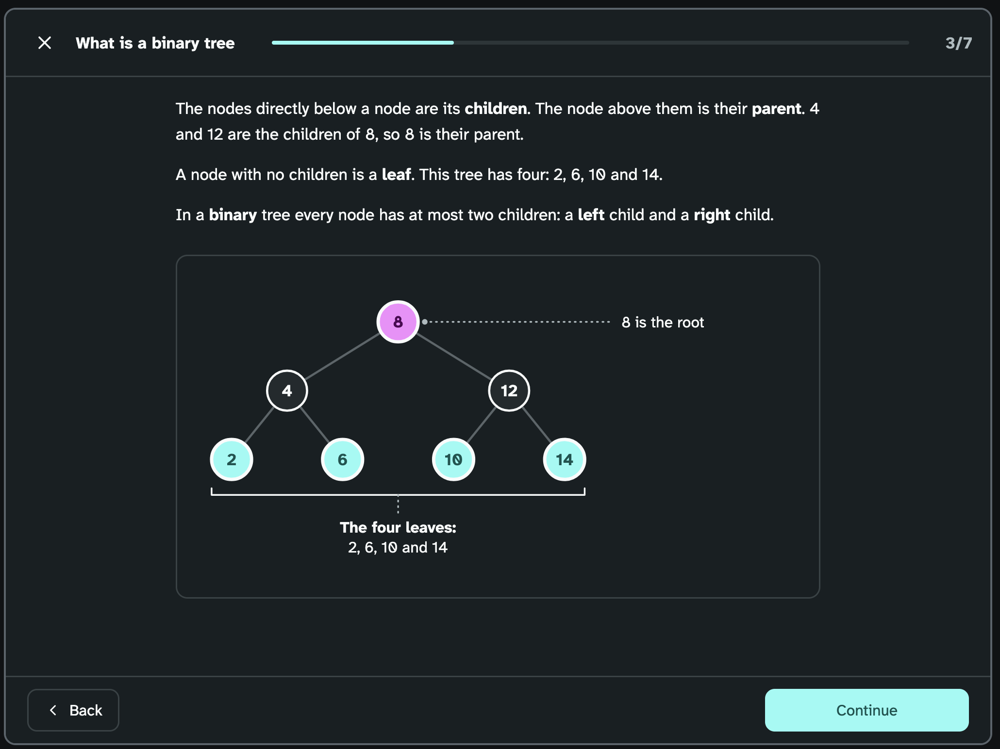
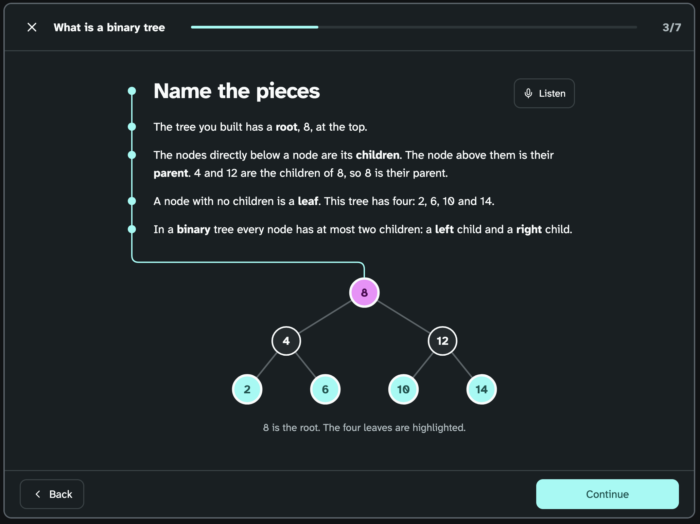

import { Aside, Steps } from "@astrojs/starlight/components";

Text and diagram blocks are most of what a learner reads in a lesson. A text block is the words of a step, sometimes with a small tree. A diagram block is a tree with some nodes highlighted and a caption.

We built the storyboards in two rounds. In round 1 we prototyped five ways to display the text and diagram blocks to the learner. In round 2 we took the three we liked best, B, C and D, and combined them.

## Round 1: Savvy start

### A: Margin figure

This prototype has the step laid out similar to a textbook. The text part of the 
step is on the left and the tree part of the step is on the right.

   

   *Figure 1: A · Margin figure*

### B: Word to node

In this prototype the bold words in the text are linked to the tree. 
When the user hovers over the word it highlights nodes in the corresponding tree.

<Steps>

1. The learner points at or taps a bold word, such as children and then the corresponding nodes then light up.

2. The learner points at a node, and the words for it light up. 

   

   *Figure 2: B · Word to node*

</Steps>

### C: Drawn in

In this prototype the tree nodes are added one-by-one when the learner loads the step.

<Steps>

1. The learner arrives on the step, and the tree draws itself on a dotted card, one level at a time.

2. The learner watches the highlights land last, and then the caption is written out under the tree.

   

   *Figure 3: C · Drawn in*

</Steps>

### D: Leader labels

This prototype has no caption under the tree rather the words are pinned to the nodes 
they talk about with dotted leader lines.

   

   *Figure 4: D · Leader labels*

### E: Stem

In this prototype a stem runs down the left of the text and joins up with the tree.

   

   *Figure 5: E · Stem*

## Round 2: B, C and D together

From round 1 we liked three of the protoypes B, C and D. 
We liked how storyboard B linked the words to the tree. 
For storyboard C we liked how the tree was drawn in when you arrive on a step. 
In storyboard D we liked how it labeled the tree placing the words right next to the nodes. 

### Drawn and labelled

In this prototype the tree and its labels are drawn in when the user arrives on the step.
The page bolds some words allowing the learner to hover over a bold word to see where it corresponds to on the tree.

   

   *Figure 6: Drawn and labelled*

## Decision

<Aside type="tip" title="We picked Drawn and labelled">
</Aside>

### Why we chose Drawn and labelled

- The learner doesn't have to read a sentence and then look for the nodes it refers to.
- Linking the bold words to the tree joins the new word to the thing it names, so the learner learns the word and sees it at the same time.

### Why we did not go with A or E

- We felt that A would be hard to make responsive on smaller screen and that it disconnected the text from the diagram.
- For E we felt that it didn't add anything that would benefit the user, it was more of an UI idea than functional.
