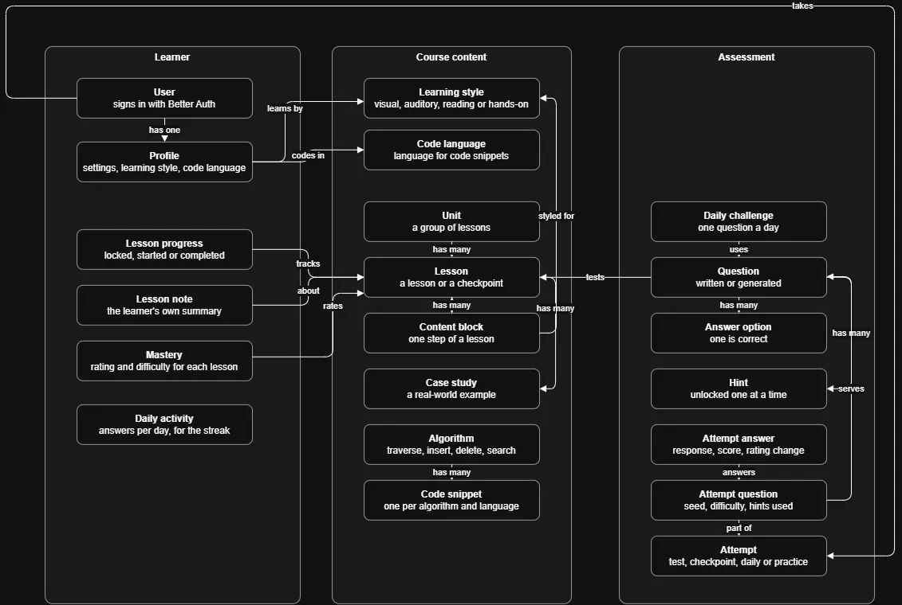

This page details our application one level lower than [architecture](../architecture/). It specifies our domain model, contains an ERD for our database, describes the assessment flow and refers to our API documentation.

## Domain model

The domain model details primary concepts (domains) inside Growth and visually describes their relationships. There are three main groups:

- **Course content:** Consists of units, which are composed of lessons. Lessons are either normal lessons or checkpoints (a test that covers previous lessons). A lesson is made out of content blocks. Blocks are often designed to accommodate a particular learning style. An algorithm has code snippets for the different coding languages we support.
- **Assessment:** A lesson may have multiple questions associated with it. These questions are either written by hand or generated via the AVL engine. An attempt will serve the learner with 5 questions and keep an answer for each. The daily challenge has a single question for a day, and a practice attempt has no lesson.
- **Learner:** A profile is maintained for each learner. For each lesson the learner has taken we store their progress, a note they've made on the lesson and their mastery on the underlying topic. Daily activity reflects the answers given for each day's challenge.

The code reflects these concepts as plain TypeScript types under `backend/src/domain` and matching repository interfaces.

_Figure 3: The domain model, without fields. The tables with their keys are in Figure 4._

## Database

We use a PostgreSQL database that is operated on via Prisma ORM. Each model has its own `.prisma` file detailing it.

_Figure 4: The database tables and their columns. PK is a primary key, UQ a unique column and FK a foreign key. A question mark means the column can be empty._

We grouped the tables into 6 primary areas: course content, assessment, people and progress, attempts, auth and code trace. We provide enums at the bottom that list the allowed values of the associated columns.

## Assessment flow

The assessment flow is the most complex one we designed. It starts when a user initiates a test, includes actions such as asking for a hint and answering a question, and involves scoring answers and unlocking the next lesson.

_Figure 5: Starting a test, answering its questions and getting the result._

A test consists of 5 questions chosen randomly. A lesson's test will only consist of questions relevant to the lesson while a checkpoint covers an entire unit. The final challenge has questions on every lesson. Restarting an unfinished test continues the previous attempt. Generated questions are made with a seed and a current difficulty that we store for a learner. This process is deterministic: the same seed and difficulty will always generate the same questions. Hints unlock one at a time and are opt-in. An answer's score will be lowered based on the number of hints used. A lesson gives the learner a rating that is determined by their score and the question difficulty using an Elo-style formula. That rating is mapped to mastery, a percentage that answers the question "How well does the learner understand this concept?". Finally, a score is the percentage of correct answers with a passing grade of 80.

The use cases are in `backend/src/application/assessment/`, and the scoring rules are in `backend/src/domain/assessment/`. See [Scaffolding](../../id/scaffolding/) and [Assessment](../../id/assessment/) in the ID document for why the app works this way.

## API

Every endpoint exposed by Growth is documented as its own page in the [API reference](../api/). This includes parameters, request body and response, along with a real example. The reference is generated from our OpenAPI spec, which is maintained by us. Better Auth has more endpoints than the 4 we list, but they are documented by Better Auth.
