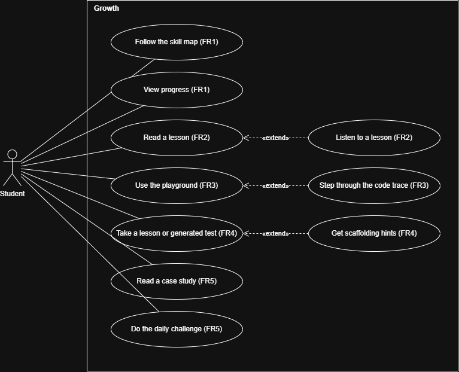

## Functional requirements

### User stories

| As a student I want to...                                                  | So that...                                        | Requirement |
| -------------------------------------------------------------------------- | ------------------------------------------------- | ----------- |
| follow a path of lessons and see my progress                               | I know what to learn next and how far I have come | FR1         |
| learn the concept from short lessons, with narration if I prefer to listen | I understand AVL trees before the lecture         | FR2         |
| step through an algorithm line by line while the tree changes              | I can see why each rotation happens               | FR3         |
| take a test after each lesson and a generated test on every operation      | I know whether I understood                       | FR4         |
| get extra hints and easier questions after a low score                     | I can catch up without giving up                  | FR4         |
| see where trees are used and do a daily challenge                          | I see why this matters and keep practising        | FR5         |

### Requirements list

Each requirement is **Must** or **Should**. A Must is needed for the app to do its job. A Should adds value but the app works without it.

**FR1 Skill map and learning path (Must)**

- A visual trail of lessons: traversals, insertion, deletion, rebalancing.
- A progress bar for each module.

**FR2 Lessons (Must)**

- Structured text with pseudocode walkthroughs.
- Interactive examples inside the lesson.
- Text-to-speech narration of lesson text.
- Students can write a summary of an operation.

**FR3 Interactive playground (Must)**

- Step-by-step animations: node movement on insert, rotations on rebalance, traversal paths node by node.
- Tree and source code side by side, with the current code line traced.
- Node colours for visited, current focus and about to be deleted.
- Debugger-style controls to step forwards and backwards.

**FR4 Tests and assessment (Must)**

- A short test at the end of each lesson.
- Generated exercises for traversals, insertion and deletion.
- Adaptive difficulty: larger trees and harder deletions for students who do well, smaller trees, simpler operations and hints for students who struggle.

**FR5 Practical application (Must)**

- Real-world case studies that tie tree operations to real uses.
- A daily challenge to encourage regular practice.

**Further Should requirements**

- Share a link to an exact tree or playground state.
- Class leaderboards and test completion streaks.
- Peer explain mode: write step-by-step explanations and read those written by peers.

### Use case diagram

_Figure 1: Use cases for the student. Each use case shows the requirement it belongs to._

## Non-functional requirements

- **Responsive design.** Every page works on devices of different sizes, checked at 375px wide with no horizontal scroll. Touch targets are at least 44px.
- **Accessibility.** Meets WCAG 2.2 AA and scores 90 or more for accessibility in Lighthouse. Everything can be used with a keyboard. Learners choose between default, high contrast and colour-blind friendly colour schemes. Colour is never the only signal. Animations respect reduced motion.
- **Performance.** Scores 90 or more for performance in Lighthouse. Stepping through an algorithm responds straight away.
- **Usability.** Students need no instructions to start a lesson. They can pause, step back and replay any animation at their own pace. Wrong answers give feedback that explains why.

## Requirements from the ID choices

The ID document makes choices about how students learn. These requirements follow directly from them:

| ID choice                     | Requirement                                                          |
| ----------------------------- | -------------------------------------------------------------------- |
| Visual learners               | FR3 animations, colour-coded nodes and the side-by-side code view    |
| Auditory learners             | FR2 text-to-speech narration                                         |
| Read and write learners       | FR2 structured text, pseudocode and written summaries                |
| Hands-on learners             | FR3 playground and FR5 case studies                                  |
| Self-paced, adaptive learning | FR1 progress tracking, FR3 step controls and FR4 adaptive difficulty |
| Scaffolding after struggle    | FR4 hints and easier questions                                       |

See [Learning styles](../../id/learning-styles/), [Scaffolding](../../id/scaffolding/) and [Assessment](../../id/assessment/) in the ID document.
