This document shows off all the pages of Growth and describes the navigation. Every screen can also render in three different colour schemes, as described in our non-functional requirements [here](../requirements/).

## Getting in

A prospective student signs up with 3 fields: an email, a display name (username) and a password. If the learner is already signed in and opens either page, they are redirected to the dashboard.

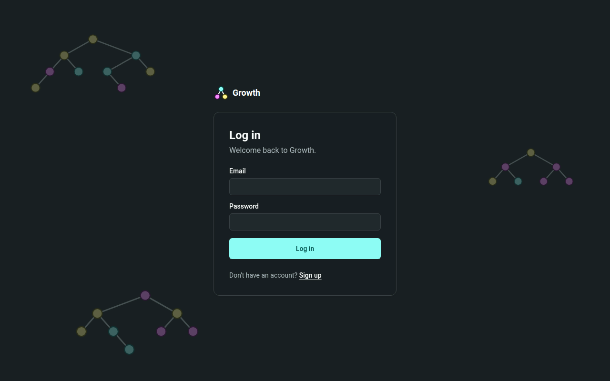

_Figure 6: Log in._

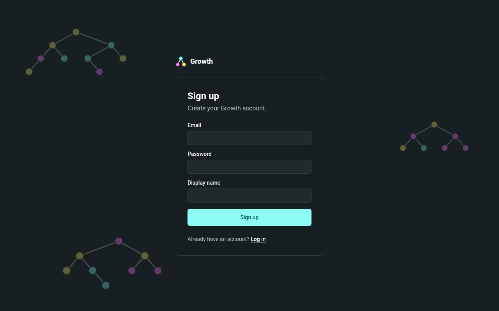

_Figure 7: Sign up._

After the sign-up process, the student must follow 5 onboarding steps:

1. Picking a colour scheme.
2. Finding their learning style.
3. Choosing a preferred coding language.
4. Opting in to appear on the leaderboard.
5. Deciding if the lessons should be read aloud.

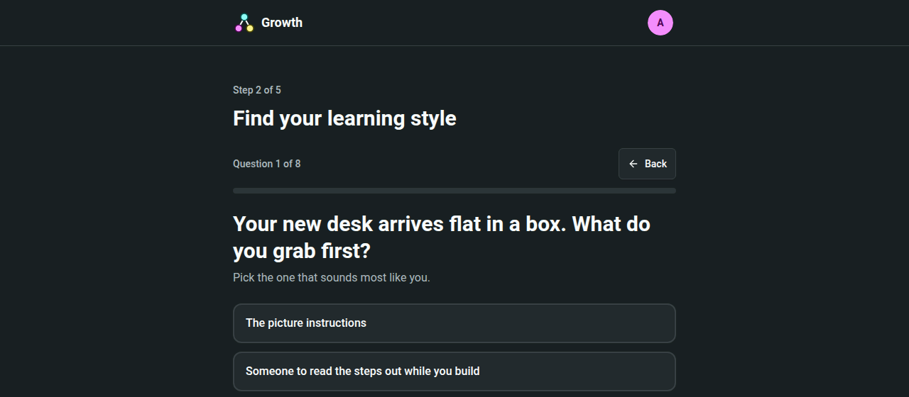

_Figure 8: Onboarding, finding a learning style._

## Learning

The dashboard acts as the home screen. It shows the learner what their next lesson is, with the daily challenge next to it until it is done. Below that is the overall progress, then a scrollable leaderboard of the day's fastest times, with the learner's own row pinned if they are outside the top 10, and then lesson mastery. Every section is a card with its title inside it.

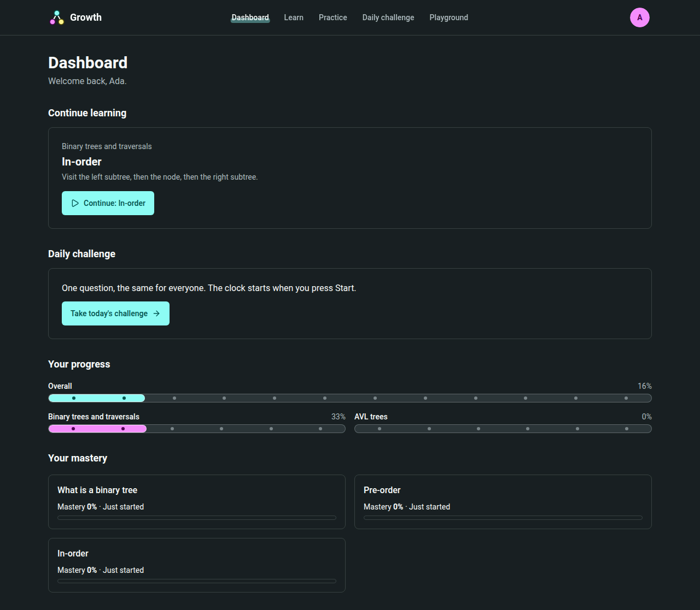

_Figure 9: Dashboard._

The Learn screen displays all lessons as a tree with a tick mark showing a finished lesson. A play icon shows the learner their current lesson, and lessons that have not been unlocked yet are displayed with a lock icon. Selecting a lesson opens a sheet where the learner can choose to start a lesson, review it or take its test.

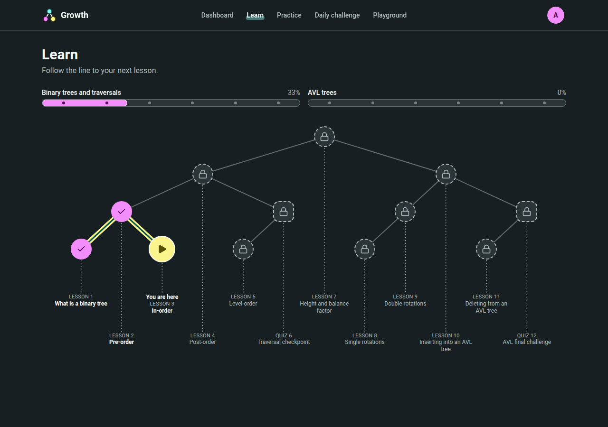

_Figure 10: Learn._

Each lesson is a series of steps with text, and most have something to interact with, like a code trace. Any step can be read aloud, and the learner can move forwards and back through the lessons freely.

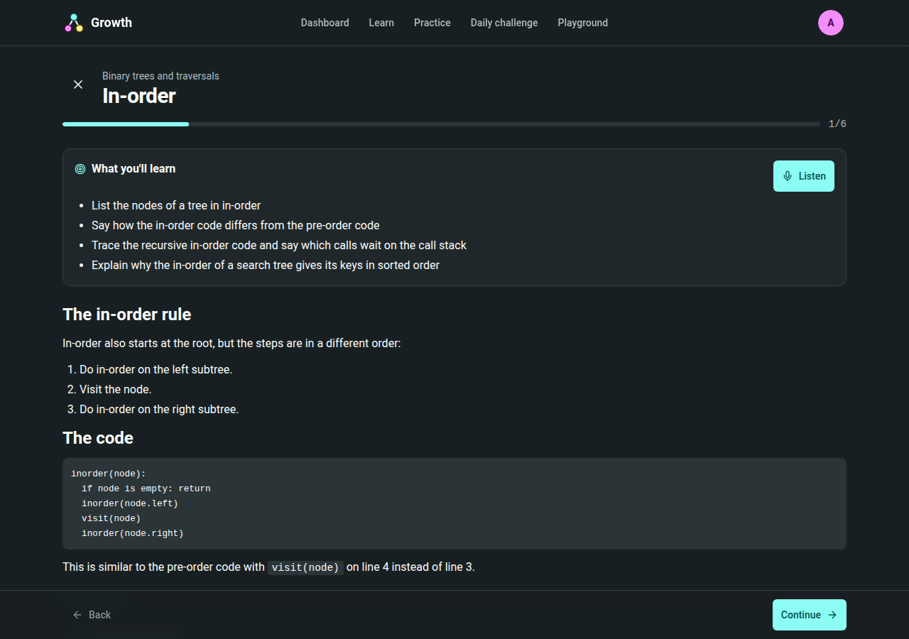

_Figure 11: A lesson._

## Tests and practice

Tests consist of five questions, displayed one at a time. Hints are fully optional, and the screen makes it clear that using a hint will lower your score. There are five types of questions; the figure shows one where the user is prompted to tap nodes in a specific order.

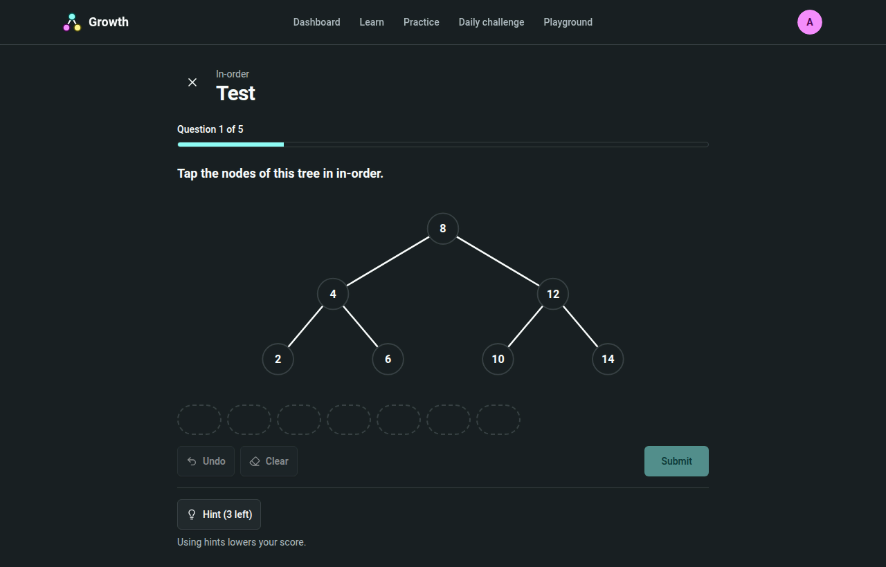

_Figure 12: A test question._

When a user answers a question, they immediately see if they answered correctly and why. They can then continue to the next question. When attempting to leave an unfinished test, the learner is asked to confirm.

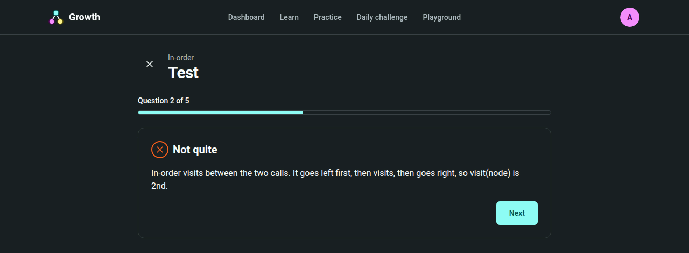

_Figure 13: Feedback on an answer._

The result page shows the score of the lesson, the points gained and the change in mastery. It also lists lessons that the learner should probably revise. There is also an option to retake the test or go back to the map.

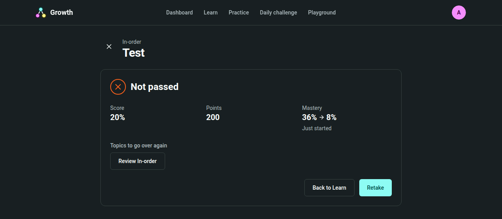

_Figure 14: Test results._

Practice has no stakes and never changes mastery. The student picks a topic, and a topic opens once a lesson that covers it is unlocked.
Practice has zero stakes and no effect on mastery. A learner picks a topic and is prompted with questions. Topics unlock as the matching lesson is unlocked.

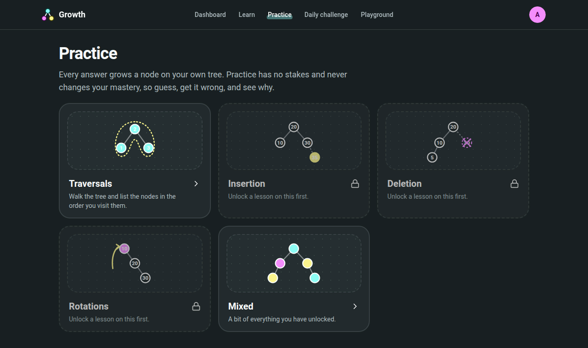

_Figure 15: Practice._

The daily challenge is a single question a day, the same question for everyone. The clock starts when Start is pressed, and the screen shows the difficulty and time.

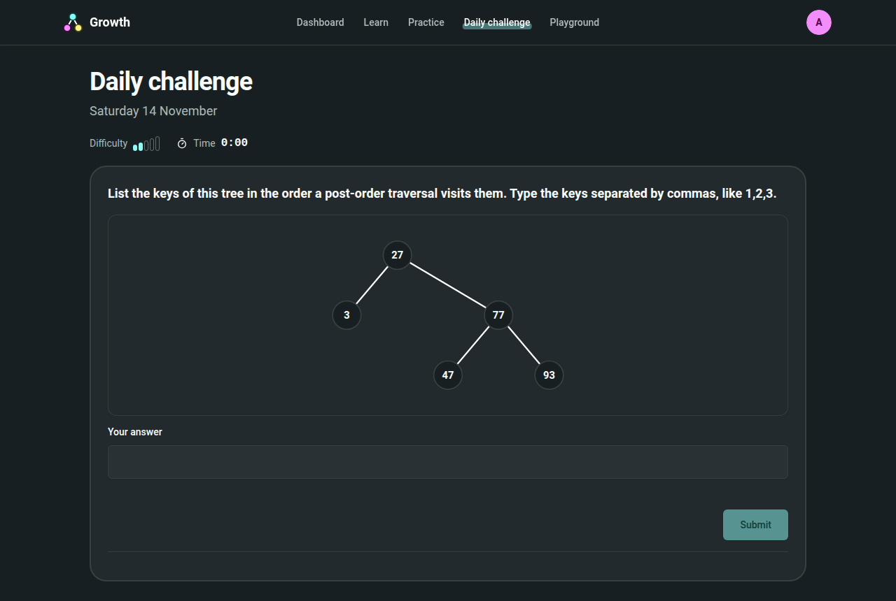

_Figure 16: Daily challenge._

## Playground

To use the playground the student must first set it up by choosing what to play with, whether they want to watch it run or interact with it and what tree to start with. The playground then opens displaying a tree on the left and code on the right, and every student interaction is shown as a command that ran.

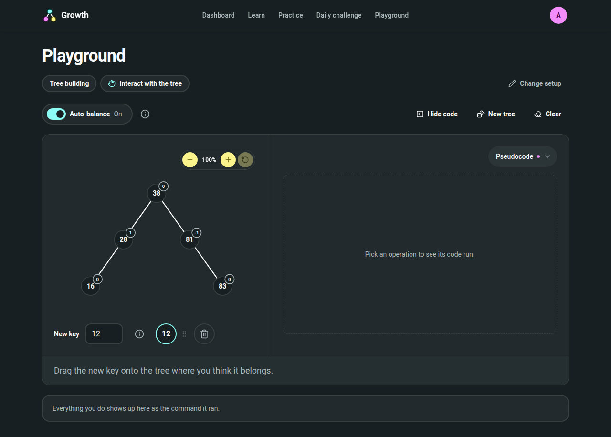

_Figure 17: The playground._

## Settings

The settings page displays every setting chosen during the onboarding flow.

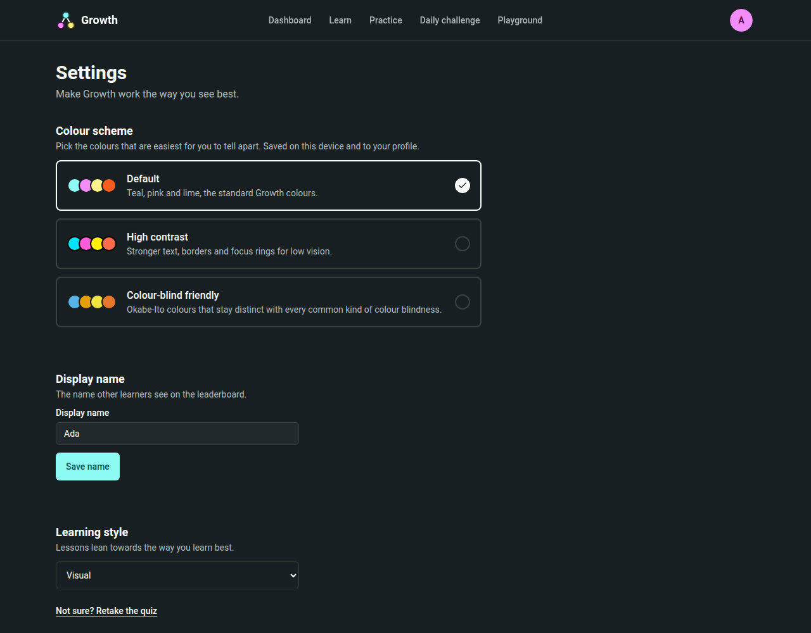

_Figure 18: Settings._

## On a phone

All pages are also dynamic and respond to narrow screens. The navigation links move to a menu and, for example, the Learn tree turns sideways.

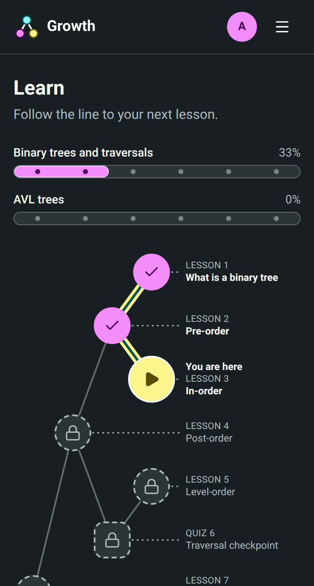

_Figure 19: Learn on a phone._

## Navigation flow

Every screen after the onboarding flow shares a top bar. Links are given to the dashboard, Learn, Practice, the daily challenge and the playground. There is also an avatar menu with Settings and Sign out.

The following is a comprehensive summary of all navigation flows:

| From        | Action                                 | To                   |
| ----------- | -------------------------------------- | -------------------- |
| Log in      | Sign up link                           | Sign up              |
| Sign up     | Submit the form                        | Onboarding           |
| Onboarding  | Finish the last step                   | Dashboard            |
| Dashboard   | Continue                               | Lesson               |
| Dashboard   | Take today's challenge                 | Daily challenge      |
| Learn       | Select a lesson, then Start or Review  | Lesson               |
| Learn       | Select a lesson, then Take the test    | Test                 |
| Lesson      | Take the test on the last step         | Test                 |
| Lesson      | Back to the map on the last step       | Learn                |
| Test        | Answer all five questions              | Results              |
| Results     | Retake                                 | Test                 |
| Results     | Review a lesson                        | Lesson               |
| Results     | Back to Learn                          | Learn                |
| Practice    | Pick a topic                           | Practice questions   |
| Playground  | Answer the setup questions, then Start | Playground workspace |
| Avatar menu | Settings                               | Settings             |
| Avatar menu | Sign out                               | Log in               |

The choices behind how these screens look and behave are in [Presentation design](../../id/presentation/) in the ID document.
